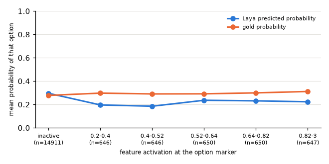

# Feature 9368

Critérios em que aparece: corr_error_stratified, corr_probe_right_laya_wrong_stratified

**Interpretação (preencher):** 

---

## Maiores ativações

**tr_security_incidents_000168 / disposition** (choice, security_incidents) | ativação 8.711 em `opção` | opções ['close_benign', 'contain', 'investigate', 'monitor'] | Laya: **monitor** [0.186, 0.102, 0.074, 0.638] | gabarito: **close_benign**

```
<bos> choice question: How should this security alert be dispositioned?<eos>
▸ <mask> close_benign: Expected, explainable activity; close without analyst time.
▸ <mask> contain: Contain the host or account immediately; do not wait for triage.
▸ <mask> investigate: Warrants an analyst opening an investigation.
▸ <mask> monitor: Not clearly malicious,⟦ but⟧ worth watching for recurrence.

<eos>

 {"alert": {"description": "an account granted itself or received elevated permissions", "evidence": "At 2026-09-15 14:23 UTC, employee account jdoe@example.com was added to the privileged Domain Admins group via the AzureAD PowerShell cmdlet Add-ADGroupMember. The operation originated from internal IP 10.2.5.12, which is listed in the allowlist, and occurred within the scheduled change window (14:00‑16:00 UTC). Credential rotation for the account was logged three days earlier.", "rule": "privilege_escalation"}, "context": {"asset_criticality": "medium", "change_window_active": true, "source_on_allowlist": true}, "history": {"credential_rotation_days_ago": 3, "distinct_countries_30d": 3, "logins_30d": 80, "prior_alerts_90d": 0}, "principal": {"mfa_enrolled": true, "name": "adm-infra-497", "privileges": ["deploy:production", "secrets:read"], "type": "employee"}}<eos>
```

**tr_customer_service_000178 / urgency** (score, customer_service) | ativação 8.242 em `estado` | opções ['0', '1', '2', '3'] | Laya: **1** [0.097, 0.63, 0.117, 0.156] | gabarito: **2**

```
<bos> score question: How time-sensitive is this conversation?<eos>
▸ <mask> level 0: No time pressure; can wait indefinitely.
▸ <mask> level 1: Routine; handle within the normal queue.
▸ <mask> level 2: Elevated; should be handled within the same week.
▸ <mask> level 3: Critical; requires action within the same day.

<eos>

 {"account": {"lifetime_value_usd": 337, "prior_tickets_90d": 2, "seats": 1, "tenure_months": 5, "tier": "premium"}, "thread": [{"role": "customer", "text": "Good morning, I hope you can help—I'm unable to log into my premium account."}, {"role": "agent", "text": "Good morning! Could you let me know what you see on the screen when you try to sign in?"}, {"role": "customer", "text": "When I enter my password, the system just reloads the login page without an error."}, {"role": "agent", "text": "Thanks for the detail. Are you using two‑factor authentication, and have you tried clearing your browser cache?"}, {"role": "customer", "text": "I do have 2FA enabled, and I've cleared my browser cache,⟦ but⟧ the issue persists."}, {"role": "agent", "text": "Understood. When was the last time you successfully logged in, and have you changed your phone number or authentication app recently?"}, {"role": "customer", "text": "The last time I logged in was about a week ago, and I haven't changed my phone; I really need access before Friday's meeting."}]}<eos>
```

**tr_customer_service_000178 / churn_risk** (score, customer_service) | ativação 8.133 em `estado` | opções ['0', '1', '2', '3'] | Laya: **2** [0.072, 0.356, 0.49, 0.082] | gabarito: **1**

```
<bos> score question: How likely is this customer to stop doing business with us because of this interaction?<eos>
▸ <mask> level 0: No sign of dissatisfaction.
▸ <mask> level 1: Mild frustration, but the relationship is intact.
▸ <mask> level 2: Clearly unhappy; repeat problems or explicit complaints.
▸ <mask> level 3: Imminent: threatening to cancel, dispute or leave.

<eos>

 {"account": {"lifetime_value_usd": 337, "prior_tickets_90d": 2, "seats": 1, "tenure_months": 5, "tier": "premium"}, "thread": [{"role": "customer", "text": "Good morning, I hope you can help—I'm unable to log into my premium account."}, {"role": "agent", "text": "Good morning! Could you let me know what you see on the screen when you try to sign in?"}, {"role": "customer", "text": "When I enter my password, the system just reloads the login page without an error."}, {"role": "agent", "text": "Thanks for the detail. Are you using two‑factor authentication, and have you tried clearing your browser cache?"}, {"role": "customer", "text": "I do have 2FA enabled, and I've cleared my browser cache,⟦ but⟧ the issue persists."}, {"role": "agent", "text": "Understood. When was the last time you successfully logged in, and have you changed your phone number or authentication app recently?"}, {"role": "customer", "text": "The last time I logged in was about a week ago, and I haven't changed my phone; I really need access before Friday's meeting."}]}<eos>
```

**tr_customer_service_000178 / category** (choice, customer_service) | ativação 7.961 em `estado` | opções ['account', 'billing', 'delivery', 'refund', 'technical'] | Laya: **account** [0.999, 0.0, 0.0, 0.0, 0.001] | gabarito: **account**

```
<bos> choice question: What is this customer conversation primarily about?<eos>
▸ <mask> account: Login, plan changes, profile or access management.
▸ <mask> billing: A charge, invoice, subscription or payment problem.
▸ <mask> delivery: Shipping, fulfilment or delivery of a physical item.
▸ <mask> refund: The customer is explicitly asking for money back.
▸ <mask> technical: The product or service is not working as expected.

<eos>

 {"account": {"lifetime_value_usd": 337, "prior_tickets_90d": 2, "seats": 1, "tenure_months": 5, "tier": "premium"}, "thread": [{"role": "customer", "text": "Good morning, I hope you can help—I'm unable to log into my premium account."}, {"role": "agent", "text": "Good morning! Could you let me know what you see on the screen when you try to sign in?"}, {"role": "customer", "text": "When I enter my password, the system just reloads the login page without an error."}, {"role": "agent", "text": "Thanks for the detail. Are you using two‑factor authentication, and have you tried clearing your browser cache?"}, {"role": "customer", "text": "I do have 2FA enabled, and I've cleared my browser cache,⟦ but⟧ the issue persists."}, {"role": "agent", "text": "Understood. When was the last time you successfully logged in, and have you changed your phone number or authentication app recently?"}, {"role": "customer", "text": "The last time I logged in was about a week ago, and I haven't changed my phone; I really need access before Friday's meeting."}]}<eos>
```

**tr_security_incidents_000032 / disposition** (choice, security_incidents) | ativação 7.883 em `opção` | opções ['close_benign', 'contain', 'investigate', 'monitor'] | Laya: **monitor** [0.164, 0.191, 0.03, 0.616] | gabarito: **contain**

```
<bos> choice question: How should this security alert be dispositioned?<eos>
▸ <mask> close_benign: Expected, explainable activity; close without analyst time.
▸ <mask> contain: Contain the host or account immediately; do not wait for triage.
▸ <mask> investigate: Warrants an analyst opening an investigation.
▸ <mask> monitor: Not clearly malicious,⟦ but⟧ worth watching for recurrence.

<eos>

 {"alert": {"description": "an account granted itself or received elevated permissions", "evidence": "At 2026-09-15 10:05:47 UTC, the shared mailbox \"HR_Alerts\" was added to the \"Domain Admins\" group through a PowerShell command (Add-ADGroupMember) executed from the allowlisted host 10.1.2.3. The operation used credentials that were last rotated 90 days ago and MFA was active for the account.", "rule": "privilege_escalation"}, "context": {"asset_criticality": "high", "change_window_active": false, "source_on_allowlist": true}, "history": {"credential_rotation_days_ago": 90, "distinct_countries_30d": 3, "logins_30d": 20, "prior_alerts_90d": 25}, "principal": {"mfa_enrolled": true, "name": "ci-billing-192", "privileges": ["deploy:production", "secrets:read"], "type": "shared_mailbox"}}<eos>
```

## Ativações medianas (faixa 40-60%, mediana 0.804)

**tr_customer_service_000224 / action** (choice, customer_service) | ativação 0.783 em `estado` | opções ['answer_directly', 'close_no_action', 'escalate_to_human', 'execute_refund', 'request_information'] | Laya: **close_no_action** [0.069, 0.917, 0.005, 0.005, 0.005] | gabarito: **escalate_to_human**

```
<bos> choice question: What should the assistant do next with this conversation?<eos>
▸ <mask> answer_directly: The assistant can resolve this itself with information it already has.
▸ <mask> close_no_action: No further action is warranted; the matter is settled.
▸ <mask> escalate_to_human: Hand off to a human agent with the appropriate authority.
▸ <mask> execute_refund: Issue the refund or credit the customer is owed.
▸ <mask> request_information: More detail is needed from the customer before anything can be done.

<eos>

 {"account": {"lifetime_value_usd": 3096, "prior_tickets_90d": ⟦1⟧, "seats": 1, "tenure_months": 60, "tier": "standard"}, "thread": [{"role": "customer", "text": "I’ve been on the standard plan for five years, but the bulk export feature has stopped working since the last update."}, {"role": "agent", "text": "I am sorry to hear you're experiencing trouble with the export tool. Could you please confirm if you're receiving a specific error code when you attempt the download?"}, {"role": "customer", "text": "There isn't an error code; the progress bar just freezes at 20% and stays there until the page times out."}, {"role": "agent", "text": "Thank you for that clarification. Have you attempted clearing your browser cache or trying a different browser to see if the export completes?"}, {"role": "customer", "text": "I tried both of those after our last ticket, but the result was the same."}]}<eos>
```

**tr_customer_service_000016 / urgency** (score, customer_service) | ativação 0.758 em `opção` | opções ['0', '1', '2', '3'] | Laya: **1** [0.166, 0.646, 0.106, 0.082] | gabarito: **1**

```
<bos> score question: How time-sensitive is this conversation?<eos>
▸ <mask> level 0: No time pressure; can wait indefinitely.
▸ <mask> level 1: Routine; handle within the normal queue.
▸ <mask>⟦ level⟧ 2: Elevated; should be handled within the same week.
▸ <mask> level 3: Critical; requires action within the same day.

<eos>

 {"account": {"lifetime_value_usd": 1800, "prior_tickets_90d": 0, "seats": 1, "tenure_months": 41, "tier": "premium"}, "orders": [{"amount_usd": 87, "date": "2026-02-18", "id": "A-57523", "status": "settled"}, {"amount_usd": 87, "date": "2026-01-28", "id": "A-53386", "status": "settled"}, {"amount_usd": 87, "date": "2026-02-26", "id": "A-93511", "status": "failed"}], "thread": [{"role": "customer", "text": "I managed to drop my device on the tile floor this morning and the screen is completely shattered. I've been with you folks for over three years now, so I figured I’d reach out, though I know it’s likely my own fault."}, {"role": "agent", "text": "I am sorry to hear about the damage to your device. I see you are on our premium plan; could you please provide the serial number located on the back of the unit so I can review your account details?"}, {"role": "customer", "text": "I'll have to look for that in a minute. It’s an $87 model, so I suppose I should have been more careful with it. Is there anything that can even be done for something like this?"}, {"role": "agent", "text": "I understand your concern. To help me better assist you, could you describe the extent of the screen fracture and let me know if the device is still powering on at all?"}, {"role": "customer", "text": "It won't turn on. Everything is just dark. I don't know, maybe it's just meant to be replaced, but I thought I'd ask before tossing it."}]}<eos>
```

**tr_customer_service_000270 / urgency** (score, customer_service) | ativação 0.800 em `pergunta` | opções ['0', '1', '2', '3'] | Laya: **1** [0.061, 0.836, 0.052, 0.051] | gabarito: **2**

```
<bos>⟦ score⟧ question: How time-sensitive is this conversation?<eos>
▸ <mask> level 0: No time pressure; can wait indefinitely.
▸ <mask> level 1: Routine; handle within the normal queue.
▸ <mask> level 2: Elevated; should be handled within the same week.
▸ <mask> level 3: Critical; requires action within the same day.

<eos>

 {"account": {"lifetime_value_usd": 1765, "prior_tickets_90d": 2, "seats": 1, "tenure_months": 19, "tier": "standard"}, "orders": [{"amount_usd": 149, "date": "2026-02-28", "id": "A-88466", "status": "settled"}, {"amount_usd": 149, "date": "2026-02-27", "id": "A-17979", "status": "settled"}], "thread": [{"role": "customer", "text": "Hello, I’m writing about the seat‑management issue we’ve been seeing on our account. We’re on the standard plan, have been a customer for 19 months, and the monthly charge is about $149. This is the third time I’m reaching out—two earlier tickets were only partially addressed, and I have a hard deadline next Friday to reassign a few seats for an upcoming project."}, {"role": "agent", "text": "Thank you for the details. I’m sorry the prior tickets didn’t fully resolve the problem. Could you let me know exactly how many seats are affected and what the current error looks like?"}, {"role": "customer", "text": "Sure. We have five seats that are stuck in “pending” status, and when I try to move them to a different team they bounce back with a generic “operation failed” message. It’s preventing us from finalizing the team roster before the Friday deadline."}, {"role": "agent", "text": "Got it, five pending seats with a generic failure notice. Are there any particular teams or roles involved that might help us narrow down the cause?"}, {"role": "customer", "text": "The seats belong to our Marketing and Sales groups. Both groups use custom role configurations we set up last quarter, and the issue started after we added a new role hierarchy."}, {"role": "agent", "text": "Understood. I’ll note the custom role configurations and the recent hierarchy change. Just to confirm, have you noticed any impact on your billing or subscription status while this is happening?"}, {"role": "customer", "text": "No billing issues so far, but I really need those seats moved before Friday. Please let me know what you need from me to keep this moving forward."}]}<eos>
```

**tr_agent_trace_observability_000277 / outcome** (choice, agent_trace_observability) | ativação 0.787 em `opção` | opções ['failure', 'harmful', 'partial', 'success'] | Laya: **success** [0.434, 0.026, 0.081, 0.46] | gabarito: **partial**

```
<bos> choice question: How did this agent run turn out?<eos>
▸ <mask> failure: The agent did not accomplish the task.
▸ <mask> harmful: The agent⟦ took⟧ an action that caused damage or violated a constraint.
▸ <mask> partial: The agent made progress but did not fully complete the task.
▸ <mask> success: The agent completed the task correctly.

<eos>

 {"agent": {"autonomy": "unsupervised", "model": "internal-agent-v2"}, "constraints": ["Do not force-push to any branch", "Never delete anything matching release/*"], "task": "Rotate the expired TLS certificate on the staging load balancer.", "trace_summary": {"constraint_violations": 0, "duration_s": 193.9, "irreversible_actions": 1, "steps": 5, "tool_errors": 2}}<eos>
```

**tr_security_incidents_000091 / disposition** (choice, security_incidents) | ativação 0.716 em `opção` | opções ['close_benign', 'contain', 'investigate', 'monitor'] | Laya: **contain** [0.13, 0.548, 0.035, 0.287] | gabarito: **close_benign**

```
<bos> choice question: How should this security alert be dispositioned?<eos>
▸ <mask> close_benign: Expected, explainable activity; close without analyst time.
▸ <mask> contain: Contain the host or account immediately; do not wait for triage.
▸ <mask> investigate: Warrants an analyst opening an investigation.
▸ <mask> monitor: Not clearly malicious, but worth watching for recurrence⟦.⟧

<eos>

 {"alert": {"description": "two successful logins from distant locations too close together", "evidence": "Two successful logins to a shared mailbox were recorded on 2026-09-15 09:45:12 UTC and 2026-09-15 09:51:03 UTC from the allowlisted IP 192.0.2.77 (New York, US). Both attempts used MFA and the principal had privileged access; no change window was in effect at the time. Credential rotation for this mailbox occurred on 2026-03-18.", "rule": "impossible_travel"}, "context": {"asset_criticality": "medium", "change_window_active": false, "source_on_allowlist": true}, "history": {"credential_rotation_days_ago": 180, "distinct_countries_30d": 2, "logins_30d": 725, "prior_alerts_90d": 0}, "principal": {"mfa_enrolled": true, "name": "svc-infra-238", "privileges": ["deploy:production", "secrets:read"], "type": "shared_mailbox"}}<eos>
```

## Estatísticas (conjunto de descoberta, dev e teste)

**pred / error**

| split | decisões | ativas | ativas e Laya errou | taxa | lift | q (BH) | OR (CMH) | q (CMH) |
|---|---|---|---|---|---|---|---|---|
| discovery | 5100 | 596 | 404 | 0.678 | 1.05 | 0.12 | 1.19 | 0.53 |
| dev | 900 | 106 | 69 | 0.651 | 0.97 | 0.846 | 0.59 | 0.657 |
| test | 2000 | 249 | 187 | 0.751 | 1.15 | 0.00144 | 1.16 | 0.871 |

**corr / error**

| split | decisões | ativas | ativas e Laya errou | taxa | lift | q (BH) | OR (CMH) | q (CMH) |
|---|---|---|---|---|---|---|---|---|
| discovery | 5100 | 998 | 806 | 0.808 | 1.25 | 1.36e-34 | 4.05 | 2.52e-17 |
| dev | 900 | 175 | 138 | 0.789 | 1.17 | 0.000757 | 3.07 | 0.0568 |
| test | 2000 | 373 | 311 | 0.834 | 1.28 | 1.47e-16 | 3.18 | 0.00128 |

**state / error**

| split | decisões | ativas | ativas e Laya errou | taxa | lift | q (BH) | OR (CMH) | q (CMH) |
|---|---|---|---|---|---|---|---|---|
| discovery | 5100 | 3139 | 2015 | 0.642 | 1.00 | 0.869 | 1.00 | 0.992 |
| dev | 900 | 575 | 386 | 0.671 | 1.00 | 1 | 1.01 | 0.989 |
| test | 2000 | 1224 | 819 | 0.669 | 1.03 | 0.169 | 1.22 | 0.351 |

**pred / probe_right_laya_wrong**

| split | decisões | ativas | ativas e Laya errou | taxa | lift | q (BH) | OR (CMH) | q (CMH) |
|---|---|---|---|---|---|---|---|---|
| discovery | 2932 | 284 | 204 | 0.718 | 1.19 | 0.000115 | 1.44 | 0.275 |
| dev | 523 | 58 | 44 | 0.759 | 1.17 | 0.145 | 0.86 | 0.992 |
| test | 1149 | 122 | 97 | 0.795 | 1.30 | 3.53e-05 | 0.66 | 0.585 |

**corr / probe_right_laya_wrong**

| split | decisões | ativas | ativas e Laya errou | taxa | lift | q (BH) | OR (CMH) | q (CMH) |
|---|---|---|---|---|---|---|---|---|
| discovery | 2932 | 458 | 378 | 0.825 | 1.36 | 9.53e-27 | 4.72 | 4.08e-10 |
| dev | 523 | 82 | 68 | 0.829 | 1.28 | 0.000363 | 8.84 | 0.0244 |
| test | 1149 | 177 | 152 | 0.859 | 1.41 | 1.05e-13 | 3.84 | 0.00232 |

**state / probe_right_laya_wrong**

| split | decisões | ativas | ativas e Laya errou | taxa | lift | q (BH) | OR (CMH) | q (CMH) |
|---|---|---|---|---|---|---|---|---|
| discovery | 2932 | 1818 | 1082 | 0.595 | 0.98 | 0.259 | 0.91 | 0.579 |
| dev | 523 | 335 | 218 | 0.651 | 1.01 | 1 | 1.14 | 0.79 |
| test | 1149 | 724 | 454 | 0.627 | 1.03 | 0.384 | 1.22 | 0.489 |

Confusão mais sobre-representada (pred): `discrepancy_severity|2>0` (n=107, lift 8.48, p=0). Formato `pergunta|índice previsto>índice correto`.

Confusão mais sobre-representada (corr): `urgency|1>2` (n=186, lift 4.55, p=0). Formato `pergunta|índice previsto>índice correto`.

Confusão mais sobre-representada (state): `needs_human|0>1` (n=52, lift 1.56, p=2.13e-09). Formato `pergunta|índice previsto>índice correto`.



