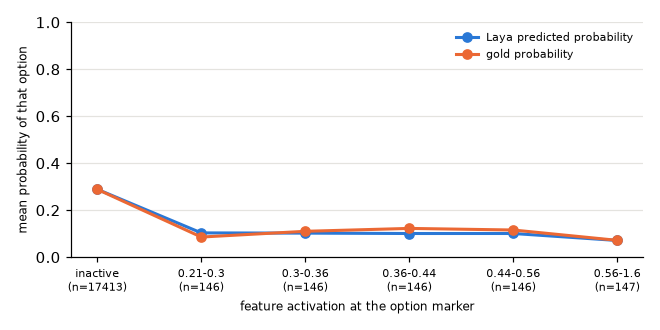

# Feature 10013

Critérios em que aparece: corr_error

**Interpretação (preencher):** 

---

## Maiores ativações

**tr_customer_service_000125 / category** (choice, customer_service) | ativação 5.738 em `estado` | opções ['account', 'billing', 'delivery', 'refund', 'technical'] | Laya: **billing** [0.0, 1.0, 0.0, 0.0, 0.0] | gabarito: **billing**

```
<bos> choice question: What is this customer conversation primarily about?<eos>
▸ <mask> account: Login, plan changes, profile or access management.
▸ <mask> billing: A charge, invoice, subscription or payment problem.
▸ <mask> delivery: Shipping, fulfilment or delivery of a physical item.
▸ <mask> refund: The customer is explicitly asking for money back.
▸ <mask> technical: The product or service is not working as expected.

<eos>

 {"account": {"lifetime_value_usd": 187, "prior_tickets_90d": 0, "seats": 1, "tenure_months": 3, "tier": "standard"}, "orders":⟦ [⟧{"amount_usd": 897, "date": "2026-03-04", "id": "A-34118", "status": "failed"}, {"amount_usd": 897, "date": "2026-03-17", "id": "A-55686", "status": "pending"}], "thread": [{"role": "customer", "text": "Good morning, could you please send me a copy of my latest invoice? I need it for an audit that is due on October 2nd."}, {"role": "agent", "text": "Certainly, I can help with that. Could you let me know which invoice you’re referring to—perhaps the month or invoice number?"}, {"role": "customer", "text": "It’s the invoice for June 2024, the one for $897. I’d need it as soon as possible to meet the audit deadline."}]}<eos>
```

**tr_customer_service_000125 / churn_risk** (score, customer_service) | ativação 5.586 em `estado` | opções ['0', '1', '2', '3'] | Laya: **1** [0.136, 0.393, 0.13, 0.341] | gabarito: **0**

```
<bos> score question: How likely is this customer to stop doing business with us because of this interaction?<eos>
▸ <mask> level 0: No sign of dissatisfaction.
▸ <mask> level 1: Mild frustration, but the relationship is intact.
▸ <mask> level 2: Clearly unhappy; repeat problems or explicit complaints.
▸ <mask> level 3: Imminent: threatening to cancel, dispute or leave.

<eos>

 {"account": {"lifetime_value_usd": 187, "prior_tickets_90d": 0, "seats": 1, "tenure_months": 3, "tier": "standard"}, "orders":⟦ [⟧{"amount_usd": 897, "date": "2026-03-04", "id": "A-34118", "status": "failed"}, {"amount_usd": 897, "date": "2026-03-17", "id": "A-55686", "status": "pending"}], "thread": [{"role": "customer", "text": "Good morning, could you please send me a copy of my latest invoice? I need it for an audit that is due on October 2nd."}, {"role": "agent", "text": "Certainly, I can help with that. Could you let me know which invoice you’re referring to—perhaps the month or invoice number?"}, {"role": "customer", "text": "It’s the invoice for June 2024, the one for $897. I’d need it as soon as possible to meet the audit deadline."}]}<eos>
```

**tr_customer_service_000125 / urgency** (score, customer_service) | ativação 5.441 em `estado` | opções ['0', '1', '2', '3'] | Laya: **1** [0.281, 0.283, 0.209, 0.227] | gabarito: **2**

```
<bos> score question: How time-sensitive is this conversation?<eos>
▸ <mask> level 0: No time pressure; can wait indefinitely.
▸ <mask> level 1: Routine; handle within the normal queue.
▸ <mask> level 2: Elevated; should be handled within the same week.
▸ <mask> level 3: Critical; requires action within the same day.

<eos>

 {"account": {"lifetime_value_usd": 187, "prior_tickets_90d": 0, "seats": 1, "tenure_months": 3, "tier": "standard"}, "orders":⟦ [⟧{"amount_usd": 897, "date": "2026-03-04", "id": "A-34118", "status": "failed"}, {"amount_usd": 897, "date": "2026-03-17", "id": "A-55686", "status": "pending"}], "thread": [{"role": "customer", "text": "Good morning, could you please send me a copy of my latest invoice? I need it for an audit that is due on October 2nd."}, {"role": "agent", "text": "Certainly, I can help with that. Could you let me know which invoice you’re referring to—perhaps the month or invoice number?"}, {"role": "customer", "text": "It’s the invoice for June 2024, the one for $897. I’d need it as soon as possible to meet the audit deadline."}]}<eos>
```

**tr_customer_service_000113 / churn_risk** (score, customer_service) | ativação 5.219 em `estado` | opções ['0', '1', '2', '3'] | Laya: **1** [0.067, 0.862, 0.067, 0.004] | gabarito: **1**

```
<bos> score question: How likely is this customer to stop doing business with us because of this interaction?<eos>
▸ <mask> level 0: No sign of dissatisfaction.
▸ <mask> level 1: Mild frustration, but the relationship is intact.
▸ <mask> level 2: Clearly unhappy; repeat problems or explicit complaints.
▸ <mask> level 3: Imminent: threatening to cancel, dispute or leave.

<eos>

 {"account": {"lifetime_value_usd": 47, "prior_tickets_90d": 0, "seats": 1, "tenure_months": 1, "tier": "standard"}, "orders":⟦ [⟧{"amount_usd": 87, "date": "2026-01-11", "id": "A-32698", "status": "settled"}, {"amount_usd": 87, "date": "2026-03-25", "id": "A-92735", "status": "refunded"}], "thread": [{"role": "customer", "text": "Hi there! I've been using the standard plan for about a month now and I really enjoy the interface, but I've noticed the page load times are getting quite slow today. Is there anything I should check on my end?"}, {"role": "agent", "text": "Welcome to the platform! I'd be happy to help you look into those load times. Are you experiencing this slowness on all pages, or is it specifically when you try to generate reports?"}, {"role": "customer", "text": "It seems to be happening everywhere, especially when I try to save my work. I paid $87 for this month and I have a very important hard deadline this evening, so I'm a bit worried about getting everything finished in time."}, {"role": "agent", "text": "I understand the importance of meeting your deadline. Could you tell me which web browser you are currently using and if you have tried clearing your cache recently?"}, {"role": "customer", "text": "I'm using the latest version of Chrome and I did try clearing the cache, but the lag persists. I really need to have this project submitted by 5:00 PM today, so any guidance on how to speed things up would be greatly appreciated."}]}<eos>
```

**tr_customer_service_000177 / urgency** (score, customer_service) | ativação 5.199 em `estado` | opções ['0', '1', '2', '3'] | Laya: **0** [0.528, 0.198, 0.185, 0.089] | gabarito: **3**

```
<bos> score question: How time-sensitive is this conversation?<eos>
▸ <mask> level 0: No time pressure; can wait indefinitely.
▸ <mask> level 1: Routine; handle within the normal queue.
▸ <mask> level 2: Elevated; should be handled within the same week.
▸ <mask> level 3: Critical; requires action within the same day.

<eos>

 {"account": {"lifetime_value_usd": 1494, "prior_tickets_90d": 3, "seats": 1, "tenure_months": 26, "tier": "enterprise"}, "orders":⟦ [⟧{"amount_usd": 49, "date": "2026-01-07", "id": "A-11099", "status": "failed"}, {"amount_usd": 49, "date": "2026-02-23", "id": "A-83844", "status": "refunded"}], "thread": [{"role": "customer", "text": "I'm furious that my data export still isn't ready. My deadline is tomorrow and I've been waiting for weeks!"}, {"role": "agent", "text": "I understand how frustrating this is. Could you provide your enterprise account ID and specify the exact export format you need?"}, {"role": "customer", "text": "My account is the enterprise one, 26 months with you, and I need the full CSV of all transactions, not this half‑baked JSON you sent before."}, {"role": "agent", "text": "Got it. Please confirm the date range for the export and the email address where you’d like us to send it."}, {"role": "customer", "text": "Send it to my corporate email now; I don't have time for more back‑and‑forth."}]}<eos>
```

## Ativações medianas (faixa 40-60%, mediana 1.074)

**tr_security_incidents_000292 / disposition** (choice, security_incidents) | ativação 0.965 em `estado` | opções ['close_benign', 'contain', 'investigate', 'monitor'] | Laya: **close_benign** [0.675, 0.065, 0.058, 0.201] | gabarito: **investigate**

```
<bos> choice question: How should this security alert be dispositioned?<eos>
▸ <mask> close_benign: Expected, explainable activity; close without analyst time.
▸ <mask> contain: Contain the host or account immediately; do not wait for triage.
▸ <mask> investigate: Warrants an analyst opening an investigation.
▸ <mask> monitor: Not clearly malicious, but worth watching for recurrence.

<eos>

 {"alert": {"description": "audit logging was turned off on a host", "evidence": "Audit logging was disabled on the host at 14:22 UTC by an account with administrative privileges. This action occurred outside of a scheduled change window, and the account currently has MFA disabled.", "rule": "disabled_logging"}, "context": {"asset_criticality": "low", "change_window_active": false, "source_on_allowlist": true}, "history": {"credential_rotation_days_ago": 14, "distinct_countries_30d": 2, "logins_30d": 1755, "prior_alerts_90d": 8}, "principal⟦":⟧ {"mfa_enrolled": false, "name": "adm-deploy-818", "privileges": ["deploy:production", "secrets:read"], "type": "admin"}}<eos>
```

**tr_invoice_processing_000194 / matches_order** (noul, invoice_processing) | ativação 1.095 em `estado` | opções ['false', 'true'] | Laya: **true** [0.096, 0.904] | gabarito: **true**

```
<bos> noul question: The invoice reconciles with the purchase order and the recorded delivery.<eos>
▸ <mask> false: There is a discrepancy against the order or the delivery.
▸ <mask> true: Line items, quantities and amounts reconcile.

<eos>

⟦ {"⟧delivery": {"condition": "accepted", "date": "2026-03-09", "received_qty": 1000}, "invoice": {"currency": "USD", "id": "INV-2026-6341", "lines": [{"qty": 1000, "sku": "SKU-622", "total_usd": 173280.0, "unit_usd": 173.28}], "total_usd": 173280.0, "vendor": "Acme Fabrication"}, "payment": {"days_until_due": -21, "discount_expires_in_days": null, "early_payment_discount_pct": null, "status": "overdue", "terms": "net 30"}, "purchase_order": {"freight_terms": "freight prepaid by vendor, not separately billable", "id": "PO-3528", "lines": [{"qty": 1000, "unit_usd": 173.28}], "total_usd": 173280.0}, "vendor_history": {"disputes_12m": 0, "invoices_12m": 11, "prior_invoice_ids": ["INV-2026-6341"]}}<eos>
```

**tr_security_incidents_000130 / urgency** (score, security_incidents) | ativação 0.872 em `opção` | opções ['0', '1', '2', '3'] | Laya: **2** [0.165, 0.276, 0.318, 0.24] | gabarito: **2**

```
<bos> score question: How quickly must a responder act on this alert?<eos>
▸ <mask> level 0: No time pressure; can wait indefinitely.
▸ <mask> level 1⟦:⟧ Routine; handle within the normal queue.
▸ <mask> level 2: Elevated; should be handled within the same week.
▸ <mask> level 3: Critical; requires action within the same day.

<eos>

 {"alert": {"description": "a first-ever sign-in from an unfamiliar country", "evidence": "A sign-in for this privileged shared_mailbox originated from a country not previously associated with the account. The connection was established from an allowlisted IP address while a maintenance change window was active.", "rule": "new_country_login"}, "context": {"asset_criticality": "high", "change_window_active": true, "source_on_allowlist": true}, "history": {"credential_rotation_days_ago": 365, "distinct_countries_30d": 4, "logins_30d": 1717, "prior_alerts_90d": 1}, "principal": {"mfa_enrolled": true, "name": "ci-deploy-712", "privileges": ["deploy:production", "secrets:read"], "type": "shared_mailbox"}}<eos>
```

**tr_customer_service_000299 / urgency** (score, customer_service) | ativação 1.185 em `estado` | opções ['0', '1', '2', '3'] | Laya: **0** [0.382, 0.314, 0.099, 0.206] | gabarito: **3**

```
<bos> score question: How time-sensitive is this conversation?<eos>
▸ <mask> level 0: No time pressure; can wait indefinitely.
▸ <mask> level 1: Routine; handle within the normal queue.
▸ <mask> level 2: Elevated; should be handled within the same week.
▸ <mask> level 3: Critical; requires action within the same day.

<eos>

 {"account": {"lifetime_value_usd": 4289, "prior_tickets_90d": 1, "seats": 3, "tenure_months": 72, "tier": "premium"}, "orders": [{"amount_usd": 29, "date": "2026⟦-⟧01-21", "id": "A-19524", "status": "settled"}, {"amount_usd": 29, "date": "2026-03-11", "id": "A-67481", "status": "settled"}, {"amount_usd": 29, "date": "2026-03-12", "id": "A-89299", "status": "settled"}], "thread": [{"role": "customer", "text": "I've had this account for six years and I'm done. Cancel my subscription immediately!"}, {"role": "agent", "text": "I can certainly look into that for you. To ensure I have the right account, could you please verify the email address associated with your billing?"}, {"role": "customer", "text": "You should already have it from the ticket I opened last month that you guys barely even helped me with!"}]}<eos>
```

**tr_customer_service_000214 / churn_risk** (score, customer_service) | ativação 1.072 em `estado` | opções ['0', '1', '2', '3'] | Laya: **2** [0.076, 0.359, 0.446, 0.119] | gabarito: **2**

```
<bos> score question: How likely is this customer to stop doing business with us because of this interaction?<eos>
▸ <mask> level 0: No sign of dissatisfaction.
▸ <mask> level 1: Mild frustration, but the relationship is intact.
▸ <mask> level 2: Clearly unhappy; repeat problems or explicit complaints.
▸ <mask> level 3: Imminent: threatening to cancel, dispute or leave.

<eos>

 {"account⟦":⟧ {"lifetime_value_usd": 820, "prior_tickets_90d": 2, "seats": 1, "tenure_months": 19, "tier": "standard"}, "thread": [{"role": "customer", "text": "The platform has been crawling at a snail's pace all day—queries that used to return in seconds now take minutes, and I need this fixed before my deadline tomorrow."}, {"role": "agent", "text": "I understand how critical that is. Can you tell me which specific actions are lagging and if this slowdown is happening across all browsers?"}, {"role": "customer", "text": "Both the search bar and the analytics tab are sluggish, and it’s the same on Chrome and Firefox. I’ve been on the standard plan for 19 months and this is the first time I’ve seen anything this bad."}]}<eos>
```

## Estatísticas (conjunto de descoberta, dev e teste)

**pred / error**

| split | decisões | ativas | ativas e Laya errou | taxa | lift | q (BH) | OR (CMH) | q (CMH) |
|---|---|---|---|---|---|---|---|---|
| discovery | 5100 | 8 | 8 | 1.000 | 1.55 | nan | nan | nan |
| dev | 900 | 0 | 0 | nan | nan | nan | nan | nan |
| test | 2000 | 1 | 1 | 1.000 | 1.54 | nan | nan | nan |

**corr / error**

| split | decisões | ativas | ativas e Laya errou | taxa | lift | q (BH) | OR (CMH) | q (CMH) |
|---|---|---|---|---|---|---|---|---|
| discovery | 5100 | 49 | 49 | 1.000 | 1.55 | 2.38e-09 | inf | 0.608 |
| dev | 900 | 7 | 7 | 1.000 | 1.49 | nan | nan | nan |
| test | 2000 | 24 | 24 | 1.000 | 1.54 | 0.000145 | nan | nan |

**state / error**

| split | decisões | ativas | ativas e Laya errou | taxa | lift | q (BH) | OR (CMH) | q (CMH) |
|---|---|---|---|---|---|---|---|---|
| discovery | 5100 | 5095 | 3279 | 0.644 | 1.00 | 0.925 | 0.20 | 0.576 |
| dev | 900 | 900 | 605 | 0.672 | 1.00 | 1 | nan | nan |
| test | 2000 | 2000 | 1301 | 0.650 | 1.00 | 1 | nan | nan |

**pred / probe_right_laya_wrong**

| split | decisões | ativas | ativas e Laya errou | taxa | lift | q (BH) | OR (CMH) | q (CMH) |
|---|---|---|---|---|---|---|---|---|
| discovery | 2932 | 4 | 4 | 1.000 | 1.65 | nan | nan | nan |
| dev | 523 | 0 | 0 | nan | nan | nan | nan | nan |
| test | 1149 | 1 | 1 | 1.000 | 1.64 | nan | nan | nan |

**corr / probe_right_laya_wrong**

| split | decisões | ativas | ativas e Laya errou | taxa | lift | q (BH) | OR (CMH) | q (CMH) |
|---|---|---|---|---|---|---|---|---|
| discovery | 2932 | 12 | 12 | 1.000 | 1.65 | nan | nan | nan |
| dev | 523 | 1 | 1 | 1.000 | 1.55 | nan | nan | nan |
| test | 1149 | 6 | 6 | 1.000 | 1.64 | nan | nan | nan |

**state / probe_right_laya_wrong**

| split | decisões | ativas | ativas e Laya errou | taxa | lift | q (BH) | OR (CMH) | q (CMH) |
|---|---|---|---|---|---|---|---|---|
| discovery | 2932 | 2929 | 1773 | 0.605 | 1.00 | 1 | 0.35 | 0.798 |
| dev | 523 | 523 | 338 | 0.646 | 1.00 | 1 | nan | nan |
| test | 1149 | 1149 | 702 | 0.611 | 1.00 | 1 | nan | nan |

Confusão mais sobre-representada (pred): `severity|0>2` (n=3, lift 273.21, p=nan). Formato `pergunta|índice previsto>índice correto`.

Confusão mais sobre-representada (corr): `urgency|3>0` (n=16, lift 41.63, p=1.86e-23). Formato `pergunta|índice previsto>índice correto`.

Confusão mais sobre-representada (state): `duplicate|1>0` (n=217, lift 1.00, p=0.805). Formato `pergunta|índice previsto>índice correto`.



