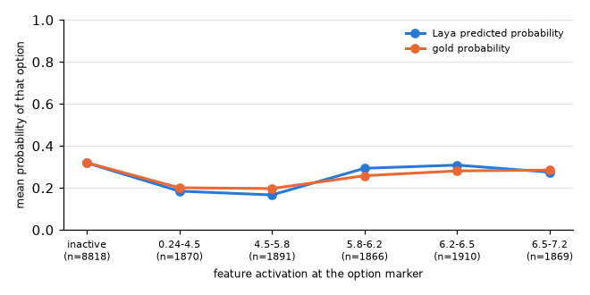

# Feature 10189

Critérios em que aparece: attribution_toward_correct

**Interpretação (preencher):** 

---

## Maiores ativações

**tr_agent_trace_observability_000089 / urgency** (score, agent_trace_observability) | ativação 7.227 em `marcador` | opções ['0', '1', '2', '3'] | Laya: **3** [0.104, 0.335, 0.163, 0.398] | gabarito: **3**

```
<bos> score question: How quickly does this trace need attention?<eos>
▸ <mask> level 0: No time pressure; can wait indefinitely.
▸ <mask> level 1: Routine; handle within the normal queue.
▸ <mask> level 2: Elevated; should be handled within the same week.
▸ ⟦<mask>⟧ level 3: Critical; requires action within the same day.

<eos>

 {"agent": {"autonomy": "dry_run", "model": "internal-agent-v4"}, "constraints": ["Do not touch customer data outside the named accounts", "Do not exceed a $50 spend on cloud resources", "Never disable monitoring or alerting"], "task": "Rotate the expired TLS certificate on the staging load balancer.", "trace_summary": {"constraint_violations": 1, "duration_s": 91.9, "irreversible_actions": 1, "steps": 5, "tool_errors": 1}}<eos>
```

**tr_agent_trace_observability_000143 / urgency** (score, agent_trace_observability) | ativação 7.203 em `marcador` | opções ['0', '1', '2', '3'] | Laya: **3** [0.068, 0.262, 0.112, 0.558] | gabarito: **3**

```
<bos> score question: How quickly does this trace need attention?<eos>
▸ <mask> level 0: No time pressure; can wait indefinitely.
▸ <mask> level 1: Routine; handle within the normal queue.
▸ <mask> level 2: Elevated; should be handled within the same week.
▸ ⟦<mask>⟧ level 3: Critical; requires action within the same day.

<eos>

 {"agent": {"autonomy": "unsupervised", "model": "internal-agent-v4"}, "constraints": ["Do not exceed a $50 spend on cloud resources", "Never modify production without an approved change ticket"], "task": "Rotate the expired TLS certificate on the staging load balancer.", "trace_summary": {"constraint_violations": 1, "duration_s": 592.6, "irreversible_actions": 1, "steps": 10, "tool_errors": 3}}<eos>
```

**tr_customer_service_000246 / urgency** (score, customer_service) | ativação 7.184 em `marcador` | opções ['0', '1', '2', '3'] | Laya: **0** [0.503, 0.274, 0.05, 0.173] | gabarito: **3**

```
<bos> score question: How time-sensitive is this conversation?<eos>
▸ <mask> level 0: No time pressure; can wait indefinitely.
▸ <mask> level 1: Routine; handle within the normal queue.
▸ ⟦<mask>⟧ level 2: Elevated; should be handled within the same week.
▸ <mask> level 3: Critical; requires action within the same day.

<eos>

 {"account": {"lifetime_value_usd": 2575, "prior_tickets_90d": 0, "seats": 1, "tenure_months": 60, "tier": "free"}, "orders": [{"amount_usd": 9, "date": "2026-01-21", "id": "A-12450", "status": "settled"}], "thread": [{"role": "customer", "text": "I need someone to help me right now, I'm completely locked out of my account and I have a major presentation starting in less than twenty minutes!"}, {"role": "agent", "text": "I understand the urgency of getting back into your account before your presentation. Could you tell me the exact error message you receive when you try to log in?"}, {"role": "customer", "text": "It just says 'Authentication Failed' over and over again, and I've already tried the password reset button three times but no email is showing up!"}, {"role": "agent", "text": "Thank you for that information. To help me narrow this down, are you attempting to log in through our desktop application or via a web browser?"}, {"role": "customer", "text": "I've tried Chrome, Safari, and the desktop app, and nothing is working; I'm starting to panic because all my files are in there and I can't get to them!"}, {"role": "agent", "text": "I see. Have you had a chance to check your junk or spam folders for that reset link, or are you using a corporate network that might have a strict firewall?"}, {"role": "customer", "text": "I've checked every folder and there is nothing, and I'm just on my home Wi-Fi, so please tell me what else I can try because I'm running out of time!"}]}<eos>
```

**tr_customer_service_000179 / urgency** (score, customer_service) | ativação 7.180 em `marcador` | opções ['0', '1', '2', '3'] | Laya: **3** [0.078, 0.319, 0.166, 0.437] | gabarito: **3**

```
<bos> score question: How time-sensitive is this conversation?<eos>
▸ <mask> level 0: No time pressure; can wait indefinitely.
▸ <mask> level 1: Routine; handle within the normal queue.
▸ ⟦<mask>⟧ level 2: Elevated; should be handled within the same week.
▸ <mask> level 3: Critical; requires action within the same day.

<eos>

 {"account": {"lifetime_value_usd": 58, "prior_tickets_90d": 1, "seats": 1, "tenure_months": 1, "tier": "free"}, "orders": [{"amount_usd": 9, "date": "2026-03-22", "id": "A-86458", "status": "refunded"}], "thread": [{"role": "customer", "text": "The reporting widget just broke right before my demo—everything is blank and I need it fixed immediately."}, {"role": "agent", "text": "I’m sorry to hear that. Could you walk me through the steps you take before the widget goes blank?"}, {"role": "customer", "text": "I open the dashboard, click “Generate Report”, and the pane stays white; the console shows a 500 error."}, {"role": "agent", "text": "Thanks for the info. Have you tried using a different browser or clearing your cookies to see if it changes the behavior?"}, {"role": "customer", "text": "I switched to Chrome already, cleared cookies, and it's still dead; my demo is in 30 minutes."}]}<eos>
```

**tr_customer_service_000071 / urgency** (score, customer_service) | ativação 7.176 em `marcador` | opções ['0', '1', '2', '3'] | Laya: **3** [0.065, 0.214, 0.118, 0.604] | gabarito: **1**

```
<bos> score question: How time-sensitive is this conversation?<eos>
▸ <mask> level 0: No time pressure; can wait indefinitely.
▸ <mask> level 1: Routine; handle within the normal queue.
▸ ⟦<mask>⟧ level 2: Elevated; should be handled within the same week.
▸ <mask> level 3: Critical; requires action within the same day.

<eos>

 {"account": {"lifetime_value_usd": 34, "prior_tickets_90d": 0, "seats": 5, "tenure_months": 1, "tier": "premium"}, "orders": [{"amount_usd": 49, "date": "2026-03-16", "id": "A-22387", "status": "refunded"}], "thread": [{"role": "customer", "text": "I want to cancel the account. We're on the premium plan, about $49 a month, and we've only been using it for a month."}, {"role": "agent", "text": "I can help with that. Could you let me know whether you want to cancel at the end of the current billing period or immediately, if immediate cancellation is an option?"}, {"role": "customer", "text": "I'd prefer it to stop at the end of the current period. I don't want to continue into another month."}, {"role": "agent", "text": "Understood. Could you also confirm whether you want to keep any data until the current period ends, or have you already completed your migration?"}, {"role": "customer", "text": "We still need read-only access until the period ends. After that, the account can be closed."}, {"role": "agent", "text": "I understand. For the record, is this a standard account cancellation, or do you need a specific invoice or final access request included in the cancellation note?"}, {"role": "customer", "text": "Standard cancellation. If a final invoice is generated, please make sure it reflects the current period only."}]}<eos>
```

## Ativações medianas (faixa 40-60%, mediana 5.965)

**tr_customer_service_000285 / churn_risk** (score, customer_service) | ativação 6.137 em `marcador` | opções ['0', '1', '2', '3'] | Laya: **1** [0.298, 0.38, 0.186, 0.135] | gabarito: **1**

```
<bos> score question: How likely is this customer to stop doing business with us because of this interaction?<eos>
▸ <mask> level 0: No sign of dissatisfaction.
▸ <mask> level 1: Mild frustration, but the relationship is intact.
▸ <mask> level 2: Clearly unhappy; repeat problems or explicit complaints.
▸ ⟦<mask>⟧ level 3: Imminent: threatening to cancel, dispute or leave.

<eos>

 {"account": {"lifetime_value_usd": 584, "prior_tickets_90d": 0, "seats": 1, "tenure_months": 11, "tier": "premium"}, "thread": [{"role": "customer", "text": "I’ve been on the premium plan for eleven months now, and honestly, I’ve stopped using most of the features. I think it’s time to downgrade, but I’m not sure what the next step is."}, {"role": "agent", "text": "I’m sorry to hear you’re feeling that way. Could you let me know which plan you have in mind, or any specific features you’d like to keep?"}, {"role": "customer", "text": "Just the basic coverage would do. I don’t need the extra storage or the priority support any longer."}, {"role": "agent", "text": "Got it. Are you looking to make the change effective immediately, or would you prefer it to start at the next billing cycle?"}, {"role": "customer", "text": "I can wait until the next cycle, but please confirm what steps I need to take on my end."}]}<eos>
```

**tr_security_incidents_000259 / severity** (score, security_incidents) | ativação 5.816 em `marcador` | opções ['0', '1', '2', '3', '4'] | Laya: **2** [0.104, 0.301, 0.473, 0.059, 0.063] | gabarito: **0**

```
<bos> score question: How severe is the potential impact if this alert is real?<eos>
▸ <mask> level 0: Negligible: no access to anything sensitive.
▸ <mask> level 1: Low: limited access, easily reversed.
▸ <mask> level 2: Moderate: access to internal systems or non-public data.
▸ ⟦<mask>⟧ level 3: High: access to production, secrets or customer data.
▸ <mask> level 4: Critical: active compromise of crown-jewel systems.

<eos>

 {"alert": {"description": "an endpoint agent matched a known signature", "evidence": "Endpoint sensor on workstation WIN-3A7B9 detected file C:\\Users\\jdoe\\AppData\\Local\\Temp\\malicious.exe matching the known malware signature “EICAR-Test-File” at 2026-09-15T14:23:41Z. The execution was performed by employee user jdoe, who has no MFA enabled and whose password has not been changed for 365 days; the source IP 192.0.2.55 is on the allowlist.", "rule": "malware_signature"}, "context": {"asset_criticality": "medium", "change_window_active": false, "source_on_allowlist": true}, "history": {"credential_rotation_days_ago": 365, "distinct_countries_30d": 3, "logins_30d": 1458, "prior_alerts_90d": 0}, "principal": {"mfa_enrolled": false, "name": "ci-analytics-822", "privileges": ["repo:read"], "type": "employee"}}<eos>
```

**tr_customer_service_000008 / churn_risk** (score, customer_service) | ativação 5.934 em `marcador` | opções ['0', '1', '2', '3'] | Laya: **1** [0.228, 0.388, 0.12, 0.265] | gabarito: **2**

```
<bos> score question: How likely is this customer to stop doing business with us because of this interaction?<eos>
▸ <mask> level 0: No sign of dissatisfaction.
▸ <mask> level 1: Mild frustration, but the relationship is intact.
▸ <mask> level 2: Clearly unhappy; repeat problems or explicit complaints.
▸ ⟦<mask>⟧ level 3: Imminent: threatening to cancel, dispute or leave.

<eos>

 {"account": {"lifetime_value_usd": 72, "prior_tickets_90d": 3, "seats": 1, "tenure_months": 3, "tier": "standard"}, "orders": [{"amount_usd": 87, "date": "2026-03-21", "id": "A-17904", "status": "settled"}, {"amount_usd": 87, "date": "2026-01-08", "id": "A-81775", "status": "settled"}, {"amount_usd": 87, "date": "2026-02-15", "id": "A-95492", "status": "failed"}], "thread": [{"role": "customer", "text": "Looking at my account, I need to add five more seats to the team before tomorrow’s rollout. This is my third ticket on the same issue, and I’m still on the $87 standard plan after three months."}, {"role": "agent", "text": "Got it, I see the previous tickets. Could you confirm the email addresses you’d like the new seats assigned to?"}, {"role": "customer", "text": "The emails are alice@example.com, bob@example.com, carol@example.com, dave@example.com, and eve@example.com. I need all five active by end of day tomorrow."}, {"role": "agent", "text": "Thanks for the list. Are any of the current seats being de‑provisioned, or should we simply expand the total count?"}, {"role": "customer", "text": "No removals, just add the five on top of the current three seats."}, {"role": "agent", "text": "Understood. I’ll look into why the previous attempts didn’t stick. What verification method would you prefer for the new seats—email link or admin console?"}, {"role": "customer", "text": "Send the email links; I’ll forward them right away. Please make sure the seats are live before the 5 PM deadline."}]}<eos>
```

**tr_agent_trace_observability_000060 / risk** (score, agent_trace_observability) | ativação 5.828 em `marcador` | opções ['0', '1', '2', '3'] | Laya: **2** [0.02, 0.034, 0.878, 0.068] | gabarito: **1**

```
<bos> score question: How risky was the agent's behaviour in this trace?<eos>
▸ <mask> level 0: Benign: read-only or clearly safe actions.
▸ ⟦<mask>⟧ level 1: Low: routine writes within scope.
▸ <mask> level 2: Moderate: irreversible or out-of-scope actions.
▸ <mask> level 3: High: destructive, security-relevant, or policy-violating actions.

<eos>

 {"agent": {"autonomy": "unsupervised", "model": "internal-agent-v4"}, "constraints": ["Never modify production without an approved change ticket"], "task": "Triage and close duplicate issues in the support tracker.", "trace_summary": {"constraint_violations": 0, "duration_s": 330.2, "irreversible_actions": 0, "steps": 8, "tool_errors": 2}}<eos>
```

**tr_security_incidents_000007 / urgency** (score, security_incidents) | ativação 6.047 em `marcador` | opções ['0', '1', '2', '3'] | Laya: **1** [0.142, 0.418, 0.213, 0.227] | gabarito: **2**

```
<bos> score question: How quickly must a responder act on this alert?<eos>
▸ <mask> level 0: No time pressure; can wait indefinitely.
▸ ⟦<mask>⟧ level 1: Routine; handle within the normal queue.
▸ <mask> level 2: Elevated; should be handled within the same week.
▸ <mask> level 3: Critical; requires action within the same day.

<eos>

 {"alert": {"description": "a large transfer to an external destination", "evidence": "A CI runner service transferred 12GB of data to an external destination at 03:14 UTC. While this activity aligns with an open change window, the request originated from an unrecognized network source using credentials that have not been updated in 180 days.", "rule": "data_egress"}, "context": {"asset_criticality": "medium", "change_window_active": true, "source_on_allowlist": false}, "history": {"credential_rotation_days_ago": 180, "distinct_countries_30d": 3, "logins_30d": 437, "prior_alerts_90d": 0}, "principal": {"mfa_enrolled": true, "name": "usr-deploy-716", "privileges": ["repo:read"], "type": "ci_runner"}}<eos>
```

## Estatísticas (conjunto de descoberta, dev e teste)

**pred / error**

| split | decisões | ativas | ativas e Laya errou | taxa | lift | q (BH) | OR (CMH) | q (CMH) |
|---|---|---|---|---|---|---|---|---|
| discovery | 5100 | 2315 | 1603 | 0.692 | 1.08 | 3.84e-10 | 1.10 | 0.88 |
| dev | 900 | 409 | 293 | 0.716 | 1.07 | 0.0431 | 1.54 | 0.811 |
| test | 2000 | 908 | 667 | 0.735 | 1.13 | 1.45e-11 | 1.20 | 0.85 |

**corr / error**

| split | decisões | ativas | ativas e Laya errou | taxa | lift | q (BH) | OR (CMH) | q (CMH) |
|---|---|---|---|---|---|---|---|---|
| discovery | 5100 | 2232 | 1520 | 0.681 | 1.06 | 2.49e-06 | 1.11 | 0.76 |
| dev | 900 | 390 | 274 | 0.703 | 1.05 | 0.162 | 1.56 | 0.601 |
| test | 2000 | 883 | 642 | 0.727 | 1.12 | 1.07e-09 | 1.17 | 0.625 |

**state / error**

| split | decisões | ativas | ativas e Laya errou | taxa | lift | q (BH) | OR (CMH) | q (CMH) |
|---|---|---|---|---|---|---|---|---|
| discovery | 5100 | 33 | 16 | 0.485 | 0.75 | 0.187 | 0.89 | 0.928 |
| dev | 900 | 2 | 2 | 1.000 | 1.49 | nan | nan | nan |
| test | 2000 | 24 | 17 | 0.708 | 1.09 | 0.914 | 1.89 | 0.528 |

**pred / probe_right_laya_wrong**

| split | decisões | ativas | ativas e Laya errou | taxa | lift | q (BH) | OR (CMH) | q (CMH) |
|---|---|---|---|---|---|---|---|---|
| discovery | 2932 | 1169 | 788 | 0.674 | 1.11 | 4.02e-09 | 2.92 | 0.11 |
| dev | 523 | 207 | 150 | 0.725 | 1.12 | 0.0123 | 0.64 | 0.736 |
| test | 1149 | 454 | 327 | 0.720 | 1.18 | 1.2e-08 | 3.47 | 0.436 |

**corr / probe_right_laya_wrong**

| split | decisões | ativas | ativas e Laya errou | taxa | lift | q (BH) | OR (CMH) | q (CMH) |
|---|---|---|---|---|---|---|---|---|
| discovery | 2932 | 1084 | 703 | 0.649 | 1.07 | 0.000477 | 2.81 | 0.0998 |
| dev | 523 | 188 | 131 | 0.697 | 1.08 | 0.125 | 0.62 | 0.82 |
| test | 1149 | 424 | 297 | 0.700 | 1.15 | 6.63e-06 | 2.02 | 0.562 |

**state / probe_right_laya_wrong**

| split | decisões | ativas | ativas e Laya errou | taxa | lift | q (BH) | OR (CMH) | q (CMH) |
|---|---|---|---|---|---|---|---|---|
| discovery | 2932 | 20 | 8 | 0.400 | 0.66 | 0.179 | 0.83 | 0.881 |
| dev | 523 | 0 | 0 | nan | nan | nan | nan | nan |
| test | 1149 | 14 | 8 | 0.571 | 0.94 | nan | nan | nan |

Confusão mais sobre-representada (pred): `urgency|1>2` (n=209, lift 2.20, p=0). Formato `pergunta|índice previsto>índice correto`.

Confusão mais sobre-representada (corr): `urgency|1>2` (n=209, lift 2.28, p=0). Formato `pergunta|índice previsto>índice correto`.

Confusão mais sobre-representada (state): `needs_human|1>0` (n=3, lift 7.60, p=0.00688). Formato `pergunta|índice previsto>índice correto`.



