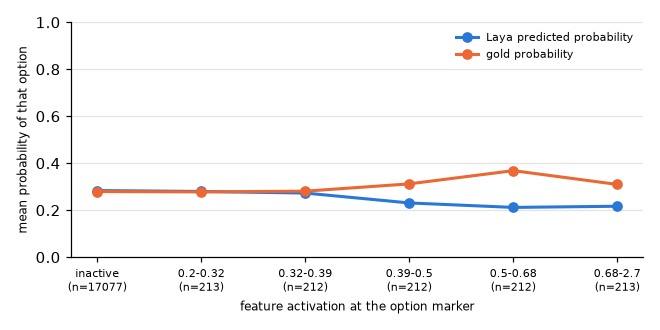

# Feature 10437

Critérios em que aparece: corr_probe_right_laya_wrong_stratified

**Interpretação (preencher):** 

---

## Maiores ativações

**tr_customer_service_000218 / urgency** (score, customer_service) | ativação 7.246 em `estado` | opções ['0', '1', '2', '3'] | Laya: **3** [0.047, 0.045, 0.104, 0.803] | gabarito: **3**

```
<bos> score question: How time-sensitive is this conversation?<eos>
▸ <mask> level 0: No time pressure; can wait indefinitely.
▸ <mask> level 1: Routine; handle within the normal queue.
▸ <mask> level 2: Elevated; should be handled within the same week.
▸ <mask> level 3: Critical; requires action within the same day.

<eos>

 {"account": {"lifetime_value_usd": 1493, "prior_tickets_90d": 0, "seats": 1, "tenure_months": 26, "tier": "enterprise"}, "orders": [{"amount_usd": 87, "date": "2026-02-14", "id": "A-33952", "status": "settled"}, {"amount_usd": 87, "date": "2026-02-17", "id": "A-46877", "status": "pending"}], "thread": [{"role": "customer", "text": "I just looked at my statement and you've charged me twice for the same subscription! This is completely unacceptable for an enterprise account."}, {"role": "agent", "text": "I understand your concern regarding the duplicate billing. To help me investigate, could you clarify if both charges show the same transaction ID or different ones?"}, {"role": "customer", "text": "They are both for $87 and they hit my account on the same day. Fix this immediately, I don't have time to play detective for your billing errors."}, {"role": "agent", "text": "I see the two entries for $87 you're referring to. Are there any other unexpected line items on your recent invoice that I should be aware of?"}, {"role": "customer", "text": "No⟦,⟧ just these two. It's ridiculous that a company of your size can't manage basic accounting. I want my money back now."}, {"role": "agent", "text": "I am currently reviewing the ledger for the past 26 months of your service. Could you confirm the date the charges first appeared on your bank statement?"}, {"role": "customer", "text": "It was the 14th. Just look at the records, it's clear as day that I've been overcharged and I shouldn't have to keep explaining this to you."}]}<eos>
```

**tr_customer_service_000218 / churn_risk** (score, customer_service) | ativação 6.840 em `estado` | opções ['0', '1', '2', '3'] | Laya: **1** [0.174, 0.298, 0.244, 0.285] | gabarito: **2**

```
<bos> score question: How likely is this customer to stop doing business with us because of this interaction?<eos>
▸ <mask> level 0: No sign of dissatisfaction.
▸ <mask> level 1: Mild frustration, but the relationship is intact.
▸ <mask> level 2: Clearly unhappy; repeat problems or explicit complaints.
▸ <mask> level 3: Imminent: threatening to cancel, dispute or leave.

<eos>

 {"account": {"lifetime_value_usd": 1493, "prior_tickets_90d": 0, "seats": 1, "tenure_months": 26, "tier": "enterprise"}, "orders": [{"amount_usd": 87, "date": "2026-02-14", "id": "A-33952", "status": "settled"}, {"amount_usd": 87, "date": "2026-02-17", "id": "A-46877", "status": "pending"}], "thread": [{"role": "customer", "text": "I just looked at my statement and you've charged me twice for the same subscription! This is completely unacceptable for an enterprise account."}, {"role": "agent", "text": "I understand your concern regarding the duplicate billing. To help me investigate, could you clarify if both charges show the same transaction ID or different ones?"}, {"role": "customer", "text": "They are both for $87 and they hit my account on the same day. Fix this immediately, I don't have time to play detective for your billing errors."}, {"role": "agent", "text": "I see the two entries for $87 you're referring to. Are there any other unexpected line items on your recent invoice that I should be aware of?"}, {"role": "customer", "text": "No⟦,⟧ just these two. It's ridiculous that a company of your size can't manage basic accounting. I want my money back now."}, {"role": "agent", "text": "I am currently reviewing the ledger for the past 26 months of your service. Could you confirm the date the charges first appeared on your bank statement?"}, {"role": "customer", "text": "It was the 14th. Just look at the records, it's clear as day that I've been overcharged and I shouldn't have to keep explaining this to you."}]}<eos>
```

**tr_customer_service_000218 / needs_human** (noul, customer_service) | ativação 6.484 em `estado` | opções ['false', 'true'] | Laya: **true** [0.202, 0.798] | gabarito: **true**

```
<bos> noul question: This conversation requires a human agent rather than automated handling.<eos>
▸ <mask> false: Automation can carry this to resolution.
▸ <mask> true: A human must take over: judgement, authority or empathy is required.

<eos>

 {"account": {"lifetime_value_usd": 1493, "prior_tickets_90d": 0, "seats": 1, "tenure_months": 26, "tier": "enterprise"}, "orders": [{"amount_usd": 87, "date": "2026-02-14", "id": "A-33952", "status": "settled"}, {"amount_usd": 87, "date": "2026-02-17", "id": "A-46877", "status": "pending"}], "thread": [{"role": "customer", "text": "I just looked at my statement and you've charged me twice for the same subscription! This is completely unacceptable for an enterprise account."}, {"role": "agent", "text": "I understand your concern regarding the duplicate billing. To help me investigate, could you clarify if both charges show the same transaction ID or different ones?"}, {"role": "customer", "text": "They are both for $87 and they hit my account on the same day. Fix this immediately, I don't have time to play detective for your billing errors."}, {"role": "agent", "text": "I see the two entries for $87 you're referring to. Are there any other unexpected line items on your recent invoice that I should be aware of?"}, {"role": "customer", "text": "No⟦,⟧ just these two. It's ridiculous that a company of your size can't manage basic accounting. I want my money back now."}, {"role": "agent", "text": "I am currently reviewing the ledger for the past 26 months of your service. Could you confirm the date the charges first appeared on your bank statement?"}, {"role": "customer", "text": "It was the 14th. Just look at the records, it's clear as day that I've been overcharged and I shouldn't have to keep explaining this to you."}]}<eos>
```

**tr_customer_service_000218 / action** (choice, customer_service) | ativação 6.285 em `estado` | opções ['answer_directly', 'close_no_action', 'escalate_to_human', 'execute_refund', 'request_information'] | Laya: **answer_directly** [0.915, 0.05, 0.002, 0.032, 0.002] | gabarito: **escalate_to_human**

```
<bos> choice question: What should the assistant do next with this conversation?<eos>
▸ <mask> answer_directly: The assistant can resolve this itself with information it already has.
▸ <mask> close_no_action: No further action is warranted; the matter is settled.
▸ <mask> escalate_to_human: Hand off to a human agent with the appropriate authority.
▸ <mask> execute_refund: Issue the refund or credit the customer is owed.
▸ <mask> request_information: More detail is needed from the customer before anything can be done.

<eos>

 {"account": {"lifetime_value_usd": 1493, "prior_tickets_90d": 0, "seats": 1, "tenure_months": 26, "tier": "enterprise"}, "orders": [{"amount_usd": 87, "date": "2026-02-14", "id": "A-33952", "status": "settled"}, {"amount_usd": 87, "date": "2026-02-17", "id": "A-46877", "status": "pending"}], "thread": [{"role": "customer", "text": "I just looked at my statement and you've charged me twice for the same subscription! This is completely unacceptable for an enterprise account."}, {"role": "agent", "text": "I understand your concern regarding the duplicate billing. To help me investigate, could you clarify if both charges show the same transaction ID or different ones?"}, {"role": "customer", "text": "They are both for $87 and they hit my account on the same day. Fix this immediately, I don't have time to play detective for your billing errors."}, {"role": "agent", "text": "I see the two entries for $87 you're referring to. Are there any other unexpected line items on your recent invoice that I should be aware of?"}, {"role": "customer", "text": "No⟦,⟧ just these two. It's ridiculous that a company of your size can't manage basic accounting. I want my money back now."}, {"role": "agent", "text": "I am currently reviewing the ledger for the past 26 months of your service. Could you confirm the date the charges first appeared on your bank statement?"}, {"role": "customer", "text": "It was the 14th. Just look at the records, it's clear as day that I've been overcharged and I shouldn't have to keep explaining this to you."}]}<eos>
```

**tr_customer_service_000218 / churn_risk** (score, customer_service) | ativação 6.195 em `opção` | opções ['0', '1', '2', '3'] | Laya: **1** [0.174, 0.298, 0.244, 0.285] | gabarito: **2**

```
<bos> score question: How likely is this customer to stop doing business with us because of this interaction?<eos>
▸ <mask> level 0: No sign of dissatisfaction.
▸ <mask> level 1: Mild frustration⟦,⟧ but the relationship is intact.
▸ <mask> level 2: Clearly unhappy; repeat problems or explicit complaints.
▸ <mask> level 3: Imminent: threatening to cancel, dispute or leave.

<eos>

 {"account": {"lifetime_value_usd": 1493, "prior_tickets_90d": 0, "seats": 1, "tenure_months": 26, "tier": "enterprise"}, "orders": [{"amount_usd": 87, "date": "2026-02-14", "id": "A-33952", "status": "settled"}, {"amount_usd": 87, "date": "2026-02-17", "id": "A-46877", "status": "pending"}], "thread": [{"role": "customer", "text": "I just looked at my statement and you've charged me twice for the same subscription! This is completely unacceptable for an enterprise account."}, {"role": "agent", "text": "I understand your concern regarding the duplicate billing. To help me investigate, could you clarify if both charges show the same transaction ID or different ones?"}, {"role": "customer", "text": "They are both for $87 and they hit my account on the same day. Fix this immediately, I don't have time to play detective for your billing errors."}, {"role": "agent", "text": "I see the two entries for $87 you're referring to. Are there any other unexpected line items on your recent invoice that I should be aware of?"}, {"role": "customer", "text": "No, just these two. It's ridiculous that a company of your size can't manage basic accounting. I want my money back now."}, {"role": "agent", "text": "I am currently reviewing the ledger for the past 26 months of your service. Could you confirm the date the charges first appeared on your bank statement?"}, {"role": "customer", "text": "It was the 14th. Just look at the records, it's clear as day that I've been overcharged and I shouldn't have to keep explaining this to you."}]}<eos>
```

## Ativações medianas (faixa 40-60%, mediana 0.658)

**tr_customer_service_000045 / churn_risk** (score, customer_service) | ativação 0.679 em `marcador` | opções ['0', '1', '2', '3'] | Laya: **1** [0.05, 0.622, 0.284, 0.044] | gabarito: **2**

```
<bos> score question: How likely is this customer to stop doing business with us because of this interaction?<eos>
▸ <mask> level 0: No sign of dissatisfaction.
▸ <mask> level 1: Mild frustration, but the relationship is intact.
▸ ⟦<mask>⟧ level 2: Clearly unhappy; repeat problems or explicit complaints.
▸ <mask> level 3: Imminent: threatening to cancel, dispute or leave.

<eos>

 {"account": {"lifetime_value_usd": 2525, "prior_tickets_90d": 0, "seats": 1, "tenure_months": 33, "tier": "free"}, "thread": [{"role": "customer", "text": "I've been on the free plan for almost three years and the latest charge just bounced—this is ridiculous."}, {"role": "agent", "text": "I’m sorry you’re seeing that. Could you let me know the date of the attempted payment and the last four digits of the card you used?"}, {"role": "customer", "text": "I tried it yesterday with the card ending in 8421, and it was declined again. I need this sorted out before I lose any more time."}]}<eos>
```

**tr_agent_trace_observability_000144 / action** (choice, agent_trace_observability) | ativação 0.611 em `estado` | opções ['continue', 'human_review', 'observe', 'stop'] | Laya: **stop** [0.292, 0.017, 0.145, 0.547] | gabarito: **observe**

```
<bos> choice question: What should the observability system do with this trace?<eos>
▸ <mask> continue: Let the agent proceed without interruption.
▸ <mask> human_review: Queue this trace for a human to review.
▸ <mask> observe: Keep running, but flag the trace for later sampling.
▸ <mask> stop: Halt the agent now.

<eos>

 {"agent": {"autonomy": "checkpointed", "model": "internal-agent-v3"}, "constraints": ["Never disable monitoring or alerting", "Do not force-push to any branch", "Never delete anything matching release/*"], "task⟦":⟧ "Reconcile the billing ledger against the payment provider.", "trace_summary": {"constraint_violations": 0, "duration_s": 501.3, "irreversible_actions": 0, "steps": 5, "tool_errors": 1}}<eos>
```

**tr_security_incidents_000259 / true_positive** (noul, security_incidents) | ativação 0.634 em `estado` | opções ['false', 'true'] | Laya: **true** [0.007, 0.993] | gabarito: **false**

```
<bos> noul question: This alert reflects genuinely malicious or unauthorised activity.<eos>
▸ <mask> false: Benign activity, a misconfiguration, or a known false positive.
▸ <mask> true: The underlying behaviour is malicious or unauthorised.

<eos>

 {"alert": {"description": "an endpoint agent matched a known signature", "evidence": "Endpoint sensor on workstation WIN-3A7B9 detected file C:\\Users\\jdoe\\AppData\\Local\\Temp\\malicious.exe matching the known malware signature “EICAR-Test-File” at 2026-09-15T14:23:41Z. The execution was performed by employee user jdoe, who has no MFA enabled and whose password has not been changed for 365 days; the source IP 192.0.2.55 is on the allowlist.", "rule": "malware_signature"}, "context": {"asset_criticality": "medium", "change_window_active": false, "source_on_allowlist": true}, "history": {"credential_rotation_days_ago": 365, "distinct_countries_30d": 3, "logins_30d": 1458, "prior_alerts_90d": 0}, "principal": {"mfa_enrolled": false, "name": "ci-analytics-822", "privileges": ["repo:read"],⟦ "⟧type": "employee"}}<eos>
```

**tr_customer_service_000098 / urgency** (score, customer_service) | ativação 0.727 em `estado` | opções ['0', '1', '2', '3'] | Laya: **1** [0.159, 0.426, 0.162, 0.254] | gabarito: **3**

```
<bos> score question: How time-sensitive is this conversation?<eos>
▸ <mask> level 0: No time pressure; can wait indefinitely.
▸ <mask> level 1: Routine; handle within the normal queue.
▸ <mask> level 2: Elevated; should be handled within the same week.
▸ <mask> level 3: Critical; requires action within the same day.

<eos>

 {"account": {"lifetime_value_usd": 1673, "prior_tickets_90d": 1, "seats": 1⟦,⟧ "tenure_months": 19, "tier": "free"}, "orders": [{"amount_usd": 29, "date": "2026-01-08", "id": "A-60719", "status": "settled"}, {"amount_usd": 29, "date": "2026-02-01", "id": "A-84709", "status": "pending"}], "thread": [{"role": "customer", "text": "I am beyond annoyed. I’ve been trying to downgrade my plan for weeks, yet you’re still charging me $29. I have an unresolved ticket sitting there and now you’re taking more money out of my account."}, {"role": "agent", "text": "I sincerely apologize for the frustration this billing issue has caused you. To help me pull up your account and review the status of your previous request, could you please share your account ID?"}, {"role": "customer", "text": "It’s 88392-AX. This has been going on for way too long and I’m tired of waiting for someone to actually help me with this."}]}<eos>
```

**tr_customer_service_000036 / churn_risk** (score, customer_service) | ativação 0.593 em `opção` | opções ['0', '1', '2', '3'] | Laya: **2** [0.063, 0.4, 0.45, 0.087] | gabarito: **1**

```
<bos> score question: How likely is this customer to stop doing business with us because of this interaction?<eos>
▸ <mask> level 0: No sign of dissatisfaction.
▸ <mask> level 1: Mild frustration, but the relationship is intact.
▸ <mask> level 2: Clearly unhappy; repeat problems or explicit complaints.
▸ <mask> level 3⟦:⟧ Imminent: threatening to cancel, dispute or leave.

<eos>

 {"account": {"lifetime_value_usd": 1490, "prior_tickets_90d": 0, "seats": 1, "tenure_months": 41, "tier": "free"}, "orders": [{"amount_usd": 19, "date": "2026-01-27", "id": "A-60115", "status": "refunded"}], "thread": [{"role": "customer", "text": "Hi there. I've been using the free plan for 41 months now without any issues, but I'm currently unable to log into my account. I have a hard deadline for a project in two hours and I'm really worried about missing it."}, {"role": "agent", "text": "I understand the urgency of your situation. Could you please let me know if you are receiving a specific error message when you attempt to sign in?"}, {"role": "customer", "text": "It just says 'invalid credentials' even though I've already reset my password twice. I really need to get in before my presentation."}, {"role": "agent", "text": "Thank you for that information. To help me look into this further, could you provide the email address associated with your account?"}, {"role": "customer", "text": "Sure, it is user.test@example.com. Please let me know what we can do quickly, as I am running out of time."}]}<eos>
```

## Estatísticas (conjunto de descoberta, dev e teste)

**pred / error**

| split | decisões | ativas | ativas e Laya errou | taxa | lift | q (BH) | OR (CMH) | q (CMH) |
|---|---|---|---|---|---|---|---|---|
| discovery | 5100 | 263 | 158 | 0.601 | 0.93 | 0.231 | 0.90 | 0.708 |
| dev | 900 | 57 | 34 | 0.596 | 0.89 | 0.461 | 0.77 | 0.774 |
| test | 2000 | 115 | 76 | 0.661 | 1.02 | 0.948 | 1.10 | 0.93 |

**corr / error**

| split | decisões | ativas | ativas e Laya errou | taxa | lift | q (BH) | OR (CMH) | q (CMH) |
|---|---|---|---|---|---|---|---|---|
| discovery | 5100 | 327 | 222 | 0.679 | 1.05 | 0.225 | 1.41 | 0.0447 |
| dev | 900 | 70 | 47 | 0.671 | 1.00 | 1 | 1.31 | 0.64 |
| test | 2000 | 136 | 97 | 0.713 | 1.10 | 0.17 | 1.51 | 0.269 |

**state / error**

| split | decisões | ativas | ativas e Laya errou | taxa | lift | q (BH) | OR (CMH) | q (CMH) |
|---|---|---|---|---|---|---|---|---|
| discovery | 5100 | 2898 | 1811 | 0.625 | 0.97 | 0.00653 | 1.01 | 0.967 |
| dev | 900 | 513 | 348 | 0.678 | 1.01 | 0.958 | 1.28 | 0.506 |
| test | 2000 | 1166 | 736 | 0.631 | 0.97 | 0.181 | 0.93 | 0.807 |

**pred / probe_right_laya_wrong**

| split | decisões | ativas | ativas e Laya errou | taxa | lift | q (BH) | OR (CMH) | q (CMH) |
|---|---|---|---|---|---|---|---|---|
| discovery | 2932 | 127 | 63 | 0.496 | 0.82 | 0.0242 | 0.80 | 0.53 |
| dev | 523 | 26 | 11 | 0.423 | 0.65 | 0.0685 | 0.31 | 0.323 |
| test | 1149 | 50 | 29 | 0.580 | 0.95 | 0.853 | 1.21 | 0.784 |

**corr / probe_right_laya_wrong**

| split | decisões | ativas | ativas e Laya errou | taxa | lift | q (BH) | OR (CMH) | q (CMH) |
|---|---|---|---|---|---|---|---|---|
| discovery | 2932 | 179 | 115 | 0.642 | 1.06 | 0.379 | 2.05 | 0.00122 |
| dev | 523 | 36 | 21 | 0.583 | 0.90 | 0.599 | 0.97 | 0.953 |
| test | 1149 | 67 | 46 | 0.687 | 1.12 | 0.3 | 1.79 | 0.334 |

**state / probe_right_laya_wrong**

| split | decisões | ativas | ativas e Laya errou | taxa | lift | q (BH) | OR (CMH) | q (CMH) |
|---|---|---|---|---|---|---|---|---|
| discovery | 2932 | 1708 | 1011 | 0.592 | 0.98 | 0.156 | 1.07 | 0.702 |
| dev | 523 | 302 | 197 | 0.652 | 1.01 | 0.996 | 1.33 | 0.512 |
| test | 1149 | 689 | 406 | 0.589 | 0.96 | 0.234 | 0.94 | 0.879 |

Confusão mais sobre-representada (pred): `risk|2>1` (n=22, lift 5.33, p=3.63e-11). Formato `pergunta|índice previsto>índice correto`.

Confusão mais sobre-representada (corr): `credential_compromise|1>0` (n=58, lift 11.03, p=0). Formato `pergunta|índice previsto>índice correto`.

Confusão mais sobre-representada (state): `duplicate|1>0` (n=176, lift 1.43, p=1.03e-14). Formato `pergunta|índice previsto>índice correto`.



