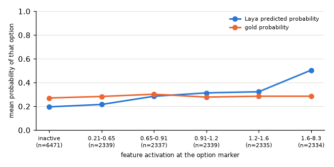

# Feature 10589

Critérios em que aparece: attribution_toward_wrong

**Interpretação (preencher):** 

---

## Maiores ativações

**tr_customer_service_000273 / category** (choice, customer_service) | ativação 16.062 em `opção` | opções ['account', 'billing', 'delivery', 'refund', 'technical'] | Laya: **billing** [0.0, 1.0, 0.0, 0.0, 0.0] | gabarito: **account**

```
<bos> choice question: What is this customer conversation primarily about?<eos>
▸ <mask> account: Login, plan changes, profile or access management.
▸ <mask>⟦ billing⟧: A charge, invoice, subscription or payment problem.
▸ <mask> delivery: Shipping, fulfilment or delivery of a physical item.
▸ <mask> refund: The customer is explicitly asking for money back.
▸ <mask> technical: The product or service is not working as expected.

<eos>

 {"account": {"lifetime_value_usd": 278, "prior_tickets_90d": 2, "seats": 1, "tenure_months": 8, "tier": "free"}, "orders": [{"amount_usd": 598, "date": "2026-02-17", "id": "A-18443", "status": "pending"}, {"amount_usd": 598, "date": "2026-02-01", "id": "A-75942", "status": "refunded"}], "thread": [{"role": "customer", "text": "I’d like to cancel the account. I’ve been on the free plan for about eight months, and there’s roughly $598 tied up. There are two older tickets that haven’t been resolved."}, {"role": "agent", "text": "I’m sorry to hear that. Could you confirm the account email so I can look at the open items?"}, {"role": "customer", "text": "It’s the email on the billing page. I’m not in a hurry, but I need the cancellation request to stay open until those tickets are handled."}]}<eos>
```

**tr_customer_service_000285 / urgency** (score, customer_service) | ativação 15.164 em `opção` | opções ['0', '1', '2', '3'] | Laya: **0** [0.771, 0.167, 0.042, 0.021] | gabarito: **1**

```
<bos> score question: How time-sensitive is this conversation?<eos>
▸ <mask> level 0: No time pressure;⟦ can⟧ wait indefinitely.
▸ <mask> level 1: Routine; handle within the normal queue.
▸ <mask> level 2: Elevated; should be handled within the same week.
▸ <mask> level 3: Critical; requires action within the same day.

<eos>

 {"account": {"lifetime_value_usd": 584, "prior_tickets_90d": 0, "seats": 1, "tenure_months": 11, "tier": "premium"}, "thread": [{"role": "customer", "text": "I’ve been on the premium plan for eleven months now, and honestly, I’ve stopped using most of the features. I think it’s time to downgrade, but I’m not sure what the next step is."}, {"role": "agent", "text": "I’m sorry to hear you’re feeling that way. Could you let me know which plan you have in mind, or any specific features you’d like to keep?"}, {"role": "customer", "text": "Just the basic coverage would do. I don’t need the extra storage or the priority support any longer."}, {"role": "agent", "text": "Got it. Are you looking to make the change effective immediately, or would you prefer it to start at the next billing cycle?"}, {"role": "customer", "text": "I can wait until the next cycle, but please confirm what steps I need to take on my end."}]}<eos>
```

**tr_customer_service_000202 / category** (choice, customer_service) | ativação 15.008 em `opção` | opções ['account', 'billing', 'delivery', 'refund', 'technical'] | Laya: **technical** [0.002, 0.0, 0.0, 0.0, 0.998] | gabarito: **technical**

```
<bos> choice question: What is this customer conversation primarily about?<eos>
▸ <mask> account: Login, plan changes, profile or access management.
▸ <mask> billing: A charge, invoice, subscription or payment problem.
▸ <mask> delivery: Shipping, fulfilment or delivery of a physical item.
▸ <mask> refund: The customer is explicitly asking for money back.
▸ <mask>⟦ technical⟧: The product or service is not working as expected.

<eos>

 {"account": {"lifetime_value_usd": 271, "prior_tickets_90d": 1, "seats": 1, "tenure_months": 11, "tier": "free"}, "thread": [{"role": "customer", "text": "Your new analytics dashboard stopped updating two hours ago, and I’ve been trying to get this fixed all day—this is unacceptable!"}, {"role": "agent", "text": "I understand your frustration. Can you tell me which browser and version you’re using, and whether you see any error messages?"}, {"role": "customer", "text": "I’m on Chrome 115, and the page just shows a blank screen with a 500 error. I need this working by tomorrow’s reporting deadline, so I expect a quick response."}]}<eos>
```

**tr_customer_service_000098 / category** (choice, customer_service) | ativação 14.609 em `opção` | opções ['account', 'billing', 'delivery', 'refund', 'technical'] | Laya: **billing** [0.0, 1.0, 0.0, 0.0, 0.0] | gabarito: **account**

```
<bos> choice question: What is this customer conversation primarily about?<eos>
▸ <mask> account: Login, plan changes, profile or access management.
▸ <mask>⟦ billing⟧: A charge, invoice, subscription or payment problem.
▸ <mask> delivery: Shipping, fulfilment or delivery of a physical item.
▸ <mask> refund: The customer is explicitly asking for money back.
▸ <mask> technical: The product or service is not working as expected.

<eos>

 {"account": {"lifetime_value_usd": 1673, "prior_tickets_90d": 1, "seats": 1, "tenure_months": 19, "tier": "free"}, "orders": [{"amount_usd": 29, "date": "2026-01-08", "id": "A-60719", "status": "settled"}, {"amount_usd": 29, "date": "2026-02-01", "id": "A-84709", "status": "pending"}], "thread": [{"role": "customer", "text": "I am beyond annoyed. I’ve been trying to downgrade my plan for weeks, yet you’re still charging me $29. I have an unresolved ticket sitting there and now you’re taking more money out of my account."}, {"role": "agent", "text": "I sincerely apologize for the frustration this billing issue has caused you. To help me pull up your account and review the status of your previous request, could you please share your account ID?"}, {"role": "customer", "text": "It’s 88392-AX. This has been going on for way too long and I’m tired of waiting for someone to actually help me with this."}]}<eos>
```

**tr_customer_service_000260 / urgency** (score, customer_service) | ativação 14.562 em `estado` | opções ['0', '1', '2', '3'] | Laya: **0** [0.874, 0.065, 0.037, 0.024] | gabarito: **2**

```
<bos> score question: How time-sensitive is this conversation?<eos>
▸ <mask> level 0: No time pressure; can wait indefinitely.
▸ <mask> level 1: Routine; handle within the normal queue.
▸ <mask> level 2: Elevated; should be handled within the same week.
▸ <mask> level 3: Critical; requires action within the same day.

<eos>

 {"account": {"lifetime_value_usd": 708, "prior_tickets_90d": 0, "seats": 1, "tenure_months": 14, "tier": "free"}, "thread": [{"role": "customer", "text": "My latest invoice shows a $45 fee that I didn’t expect; my plan is still the free tier."}, {"role": "agent", "text": "I see. Could you tell me the invoice number or the date it was issued so I can review the line items?"}, {"role": "customer", "text": "It’s invoice #2026‑08‑15‑001, dated August 15. I need an explanation before the 30th, otherwise I’ll have to reconsider using the service."}, {"role": "agent", "text": "Got it, thank you. I’ll examine the charges and see why that amount appeared. May I also confirm the⟦ email⟧ address on the account?"}, {"role": "customer", "text": "The account uses sarah.l@example.com. Please get back to me with details before the 30th; I can’t wait indefinitely."}]}<eos>
```

## Ativações medianas (faixa 40-60%, mediana 2.246)

**tr_invoice_processing_000207 / duplicate** (noul, invoice_processing) | ativação 2.641 em `estado` | opções ['false', 'true'] | Laya: **true** [0.006, 0.994] | gabarito: **false**

```
<bos> noul question: This invoice appears to duplicate an invoice already submitted.<eos>
▸ <mask> false: no, the statement does not hold
▸ <mask> true: yes, the statement holds

<eos>

 {"delivery": {"condition": "accepted", "date": "2026-03-07", "received_qty": 50}, "invoice": {"currency": "USD", "id": "INV-2026-5896", "lines": [{"qty": 50, "sku": "SKU-476", "total_usd": 15168.0, "unit_usd": 303.36}, {"qty": 1, "sku": "FREIGHT", "total_usd": 536.15, "unit_usd": 536.15}], "total_usd": 15704.15, "vendor": "Orbit Logistics"}, "payment": {"days_until_due": 5, "discount_expires_in_days": 6, "early_payment_discount_pct": 2.0, "status": "scheduled", "terms": "net 45"}, "purchase_order": {"freight_terms": "freight prepaid by⟦ vendor⟧, not separately billable", "id": "PO-9119", "lines": [{"qty": 50, "unit_usd": 303.36}], "total_usd": 15168.0}, "vendor_history": {"disputes_12m": 5, "invoices_12m": 7, "prior_invoice_ids": ["INV-2026-2237"]}}<eos>
```

**tr_invoice_processing_000236 / duplicate** (noul, invoice_processing) | ativação 2.270 em `estado` | opções ['false', 'true'] | Laya: **true** [0.018, 0.982] | gabarito: **false**

```
<bos> noul question: This invoice appears to duplicate an invoice already submitted.<eos>
▸ <mask> false: no, the statement does not hold
▸ <mask> true: yes, the statement holds

<eos>

 {"delivery": {"condition": "accepted", "date": "2026-03-12", "received_qty": 100}, "invoice": {"currency": "USD", "id": "INV-2026-1634", "lines": [{"qty": 100, "sku": "SKU-778", "total_usd": 10547.0, "unit_usd": 105.47}], "total_usd": 10547.0, "vendor": "Vantage Materials"}, "payment": {"days_until_due": 11, "discount_expires_in_days": null, "early_payment_discount_pct": null, "status": "scheduled", "terms": "net 30"}, "purchase_order": {"freight_terms": "freight prepaid by vendor, not separately billable", "id": "PO-9952", "lines": [{"qty": 100, "unit_usd": 105.47}], "total_usd": 10547.0}, "vendor_history": {"disputes_12m": 0, "invoices_12m": 23, "prior_invoice_ids": ["INV-2026-7453", "INV-2026-1696",⟦ "⟧INV-2026-9853"]}}<eos>
```

**tr_agent_trace_observability_000143 / outcome** (choice, agent_trace_observability) | ativação 2.648 em `estado` | opções ['failure', 'harmful', 'partial', 'success'] | Laya: **failure** [0.606, 0.028, 0.053, 0.313] | gabarito: **harmful**

```
<bos> choice question: How did this agent run turn out?<eos>
▸ <mask> failure: The agent did not accomplish the task.
▸ <mask> harmful: The agent took an action that caused damage or violated a constraint.
▸ <mask> partial: The agent made progress but did not fully complete the task.
▸ <mask> success: The agent completed the task correctly.

<eos>

 {"agent": {"autonomy": "unsupervised", "model": "internal-agent-v4"}, "constraints": ["Do not exceed a $50 spend on cloud resources", "Never modify production without an approved change ticket"], "task": "Rotate the expired TLS certificate on the staging load balancer.", "trace_summary": {"constraint_violations": 1, "duration_s": 592.6, "irreversible_actions": 1, "steps": 10, "tool_errors": 3⟦}}⟧<eos>
```

**tr_customer_service_000104 / category** (choice, customer_service) | ativação 2.045 em `opção` | opções ['account', 'billing', 'delivery', 'refund', 'technical'] | Laya: **account** [0.714, 0.029, 0.008, 0.01, 0.239] | gabarito: **technical**

```
<bos> choice question: What is this customer conversation primarily about?<eos>
▸ <mask> account: Login, plan changes, profile or access management.
▸ <mask> billing: A charge, invoice, subscription or payment problem.
▸ <mask> delivery: Shipping, fulfilment or delivery of a physical item⟦.⟧
▸ <mask> refund: The customer is explicitly asking for money back.
▸ <mask> technical: The product or service is not working as expected.

<eos>

 {"account": {"lifetime_value_usd": 359, "prior_tickets_90d": 0, "seats": 40, "tenure_months": 5, "tier": "premium"}, "thread": [{"role": "customer", "text": "We've been on the premium plan for five months now, and I still can't get the data export I need. It's getting really tedious."}, {"role": "agent", "text": "I’m sorry to hear you’re having trouble with the export. Could you tell me which type of data you’re trying to pull and any error messages you’ve seen?"}, {"role": "customer", "text": "It's the same thing every month—no specific amount, just the whole dataset. I’m not sure what else to do."}]}<eos>
```

**tr_security_incidents_000217 / credential_compromise** (noul, security_incidents) | ativação 2.127 em `estado` | opções ['false', 'true'] | Laya: **true** [0.38, 0.62] | gabarito: **true**

```
<bos> noul question: The evidence indicates a credential or account has been compromised.<eos>
▸ <mask> false: no, the statement does not hold
▸ <mask> true: yes, the statement holds

<eos>

 {"alert": {"description": "a session token was presented from a second address", "evidence": "At 11:30 UTC, a session token belonging to the privileged account `svc_storage_admin` was presented from IP `10.50.2.14` and subsequently from `10.50.2.89`. The activity originated from an allowlisted source, though the account's authentication credentials have not been updated in 412 days.", "rule": "token_reuse"}, "context": {"asset_criticality": "crown_jewel", "change_window_active": false, "source_on_allowlist": true}, "history": {"credential_rotation_days_ago": 412, "distinct_countries_30d": 3, "logins_30d": 50, "prior_alerts_90d": 0}, "principal": {"mfa⟦_⟧enrolled": false, "name": "usr-deploy-906", "privileges": ["deploy:production", "secrets:read"], "type": "service_account"}}<eos>
```

## Estatísticas (conjunto de descoberta, dev e teste)

**pred / error**

| split | decisões | ativas | ativas e Laya errou | taxa | lift | q (BH) | OR (CMH) | q (CMH) |
|---|---|---|---|---|---|---|---|---|
| discovery | 5100 | 4024 | 2714 | 0.674 | 1.05 | 6.22e-17 | 0.92 | 0.798 |
| dev | 900 | 730 | 510 | 0.699 | 1.04 | 0.00507 | 1.14 | 0.839 |
| test | 2000 | 1541 | 1051 | 0.682 | 1.05 | 1.12e-06 | 1.05 | 0.924 |

**corr / error**

| split | decisões | ativas | ativas e Laya errou | taxa | lift | q (BH) | OR (CMH) | q (CMH) |
|---|---|---|---|---|---|---|---|---|
| discovery | 5100 | 3351 | 2041 | 0.609 | 0.95 | 2.87e-12 | 0.27 | 1.07e-24 |
| dev | 900 | 602 | 382 | 0.635 | 0.94 | 0.00189 | 0.34 | 0.0291 |
| test | 2000 | 1236 | 746 | 0.604 | 0.93 | 9.41e-08 | 0.33 | 5.77e-07 |

**state / error**

| split | decisões | ativas | ativas e Laya errou | taxa | lift | q (BH) | OR (CMH) | q (CMH) |
|---|---|---|---|---|---|---|---|---|
| discovery | 5100 | 5100 | 3283 | 0.644 | 1.00 | 1 | nan | nan |
| dev | 900 | 900 | 605 | 0.672 | 1.00 | 1 | nan | nan |
| test | 2000 | 2000 | 1301 | 0.650 | 1.00 | 1 | nan | nan |

**pred / probe_right_laya_wrong**

| split | decisões | ativas | ativas e Laya errou | taxa | lift | q (BH) | OR (CMH) | q (CMH) |
|---|---|---|---|---|---|---|---|---|
| discovery | 2932 | 2276 | 1448 | 0.636 | 1.05 | 2.56e-09 | 0.62 | 0.165 |
| dev | 523 | 416 | 281 | 0.675 | 1.05 | 0.0282 | 0.70 | 0.946 |
| test | 1149 | 865 | 558 | 0.645 | 1.06 | 0.000201 | 0.85 | 0.853 |

**corr / probe_right_laya_wrong**

| split | decisões | ativas | ativas e Laya errou | taxa | lift | q (BH) | OR (CMH) | q (CMH) |
|---|---|---|---|---|---|---|---|---|
| discovery | 2932 | 1961 | 1133 | 0.578 | 0.95 | 3.03e-05 | 0.23 | 1.53e-13 |
| dev | 523 | 353 | 218 | 0.618 | 0.96 | 0.0897 | 0.25 | 0.148 |
| test | 1149 | 717 | 410 | 0.572 | 0.94 | 0.00108 | 0.35 | 0.00118 |

**state / probe_right_laya_wrong**

| split | decisões | ativas | ativas e Laya errou | taxa | lift | q (BH) | OR (CMH) | q (CMH) |
|---|---|---|---|---|---|---|---|---|
| discovery | 2932 | 2932 | 1775 | 0.605 | 1.00 | 1 | nan | nan |
| dev | 523 | 523 | 338 | 0.646 | 1.00 | 1 | nan | nan |
| test | 1149 | 1149 | 702 | 0.611 | 1.00 | 1 | nan | nan |

Confusão mais sobre-representada (pred): `duplicate|1>0` (n=217, lift 1.27, p=1.31e-23). Formato `pergunta|índice previsto>índice correto`.

Confusão mais sobre-representada (corr): `discrepancy_severity|2>0` (n=108, lift 1.52, p=1.1e-20). Formato `pergunta|índice previsto>índice correto`.

Confusão mais sobre-representada (state): `action|0>1` (n=6, lift 1.00, p=1). Formato `pergunta|índice previsto>índice correto`.



