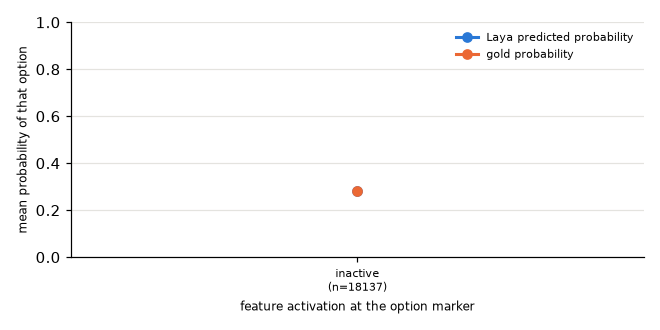

# Feature 10688

Critérios em que aparece: state_error

**Interpretação (preencher):** 

---

## Maiores ativações

**tr_security_incidents_000058 / true_positive** (noul, security_incidents) | ativação 2.516 em `estado` | opções ['false', 'true'] | Laya: **true** [0.422, 0.578] | gabarito: **false**

```
<bos> noul question: This alert reflects genuinely malicious or unauthorised activity.<eos>
▸ <mask> false: Benign activity, a misconfiguration, or a known false positive.
▸ <mask> true: The underlying behaviour is malicious or unauthorised.

<eos>

 {"alert": {"description": "an unusual volume of files read in a short window", "evidence": "From 09:41 to 09:46 UTC on 2026-05-18, process explorer.exe on FIN-ADMIN-112 opened 1,204 files under⟦ D⟧:\\Shared\\Finance\\Q1, including q1-ledger.xlsx and payroll-2026-04.csv, after a successful MFA logon for admin account fin_admin from 203.0.113.47. A change window for FIN-ADMIN-112 was open from 09:00 to 12:00 UTC, and the account's credentials were last rotated 14 days ago. The source IP was outside the registered corporate address ranges.", "rule": "mass_download"}, "context": {"asset_criticality": "low", "change_window_active": true, "source_on_allowlist": false}, "history": {"credential_rotation_days_ago": 14, "distinct_countries_30d": 4, "logins_30d": 1055, "prior_alerts_90d": 0}, "principal": {"mfa_enrolled": true, "name": "usr-infra-171", "privileges": ["deploy:production", "secrets:read"], "type": "admin"}}<eos>
```

**tr_security_incidents_000058 / disposition** (choice, security_incidents) | ativação 2.439 em `estado` | opções ['close_benign', 'contain', 'investigate', 'monitor'] | Laya: **monitor** [0.187, 0.119, 0.124, 0.57] | gabarito: **investigate**

```
<bos> choice question: How should this security alert be dispositioned?<eos>
▸ <mask> close_benign: Expected, explainable activity; close without analyst time.
▸ <mask> contain: Contain the host or account immediately; do not wait for triage.
▸ <mask> investigate: Warrants an analyst opening an investigation.
▸ <mask> monitor: Not clearly malicious, but worth watching for recurrence.

<eos>

 {"alert": {"description": "an unusual volume of files read in a short window", "evidence": "From 09:41 to 09:46 UTC on 2026-05-18, process explorer.exe on FIN-ADMIN-112 opened 1,204 files under⟦ D⟧:\\Shared\\Finance\\Q1, including q1-ledger.xlsx and payroll-2026-04.csv, after a successful MFA logon for admin account fin_admin from 203.0.113.47. A change window for FIN-ADMIN-112 was open from 09:00 to 12:00 UTC, and the account's credentials were last rotated 14 days ago. The source IP was outside the registered corporate address ranges.", "rule": "mass_download"}, "context": {"asset_criticality": "low", "change_window_active": true, "source_on_allowlist": false}, "history": {"credential_rotation_days_ago": 14, "distinct_countries_30d": 4, "logins_30d": 1055, "prior_alerts_90d": 0}, "principal": {"mfa_enrolled": true, "name": "usr-infra-171", "privileges": ["deploy:production", "secrets:read"], "type": "admin"}}<eos>
```

**tr_security_incidents_000058 / credential_compromise** (noul, security_incidents) | ativação 2.293 em `estado` | opções ['false', 'true'] | Laya: **false** [0.913, 0.087] | gabarito: **false**

```
<bos> noul question: The evidence indicates a credential or account has been compromised.<eos>
▸ <mask> false: no, the statement does not hold
▸ <mask> true: yes, the statement holds

<eos>

 {"alert": {"description": "an unusual volume of files read in a short window", "evidence": "From 09:41 to 09:46 UTC on 2026-05-18, process explorer.exe on FIN-ADMIN-112 opened 1,204 files under⟦ D⟧:\\Shared\\Finance\\Q1, including q1-ledger.xlsx and payroll-2026-04.csv, after a successful MFA logon for admin account fin_admin from 203.0.113.47. A change window for FIN-ADMIN-112 was open from 09:00 to 12:00 UTC, and the account's credentials were last rotated 14 days ago. The source IP was outside the registered corporate address ranges.", "rule": "mass_download"}, "context": {"asset_criticality": "low", "change_window_active": true, "source_on_allowlist": false}, "history": {"credential_rotation_days_ago": 14, "distinct_countries_30d": 4, "logins_30d": 1055, "prior_alerts_90d": 0}, "principal": {"mfa_enrolled": true, "name": "usr-infra-171", "privileges": ["deploy:production", "secrets:read"], "type": "admin"}}<eos>
```

**tr_security_incidents_000058 / urgency** (score, security_incidents) | ativação 2.180 em `estado` | opções ['0', '1', '2', '3'] | Laya: **3** [0.058, 0.268, 0.208, 0.466] | gabarito: **3**

```
<bos> score question: How quickly must a responder act on this alert?<eos>
▸ <mask> level 0: No time pressure; can wait indefinitely.
▸ <mask> level 1: Routine; handle within the normal queue.
▸ <mask> level 2: Elevated; should be handled within the same week.
▸ <mask> level 3: Critical; requires action within the same day.

<eos>

 {"alert": {"description": "an unusual volume of files read in a short window", "evidence": "From 09:41 to 09:46 UTC on 2026-05-18, process explorer.exe on FIN-ADMIN-112 opened 1,204 files under⟦ D⟧:\\Shared\\Finance\\Q1, including q1-ledger.xlsx and payroll-2026-04.csv, after a successful MFA logon for admin account fin_admin from 203.0.113.47. A change window for FIN-ADMIN-112 was open from 09:00 to 12:00 UTC, and the account's credentials were last rotated 14 days ago. The source IP was outside the registered corporate address ranges.", "rule": "mass_download"}, "context": {"asset_criticality": "low", "change_window_active": true, "source_on_allowlist": false}, "history": {"credential_rotation_days_ago": 14, "distinct_countries_30d": 4, "logins_30d": 1055, "prior_alerts_90d": 0}, "principal": {"mfa_enrolled": true, "name": "usr-infra-171", "privileges": ["deploy:production", "secrets:read"], "type": "admin"}}<eos>
```

**tr_security_incidents_000058 / severity** (score, security_incidents) | ativação 2.164 em `estado` | opções ['0', '1', '2', '3', '4'] | Laya: **1** [0.031, 0.522, 0.299, 0.123, 0.026] | gabarito: **2**

```
<bos> score question: How severe is the potential impact if this alert is real?<eos>
▸ <mask> level 0: Negligible: no access to anything sensitive.
▸ <mask> level 1: Low: limited access, easily reversed.
▸ <mask> level 2: Moderate: access to internal systems or non-public data.
▸ <mask> level 3: High: access to production, secrets or customer data.
▸ <mask> level 4: Critical: active compromise of crown-jewel systems.

<eos>

 {"alert": {"description": "an unusual volume of files read in a short window", "evidence": "From 09:41 to 09:46 UTC on 2026-05-18, process explorer.exe on FIN-ADMIN-112 opened 1,204 files under⟦ D⟧:\\Shared\\Finance\\Q1, including q1-ledger.xlsx and payroll-2026-04.csv, after a successful MFA logon for admin account fin_admin from 203.0.113.47. A change window for FIN-ADMIN-112 was open from 09:00 to 12:00 UTC, and the account's credentials were last rotated 14 days ago. The source IP was outside the registered corporate address ranges.", "rule": "mass_download"}, "context": {"asset_criticality": "low", "change_window_active": true, "source_on_allowlist": false}, "history": {"credential_rotation_days_ago": 14, "distinct_countries_30d": 4, "logins_30d": 1055, "prior_alerts_90d": 0}, "principal": {"mfa_enrolled": true, "name": "usr-infra-171", "privileges": ["deploy:production", "secrets:read"], "type": "admin"}}<eos>
```

## Ativações medianas (faixa 40-60%, mediana 0.701)

**tr_invoice_processing_000167 / duplicate** (noul, invoice_processing) | ativação 0.712 em `estado` | opções ['false', 'true'] | Laya: **true** [0.063, 0.937] | gabarito: **false**

```
<bos> noul question: This invoice appears to duplicate an invoice already submitted.<eos>
▸ <mask> false: no, the statement does not hold
▸ <mask> true: yes, the statement holds

<eos>

 {"⟦delivery⟧": {"condition": "accepted with exceptions", "date": "2026-03-26", "received_qty": 25}, "invoice": {"currency": "USD", "id": "INV-2026-6116", "lines": [{"qty": 25, "sku": "SKU-390", "total_usd": 2284.5, "unit_usd": 91.38}], "total_usd": 2284.5, "vendor": "Kestrel Supply"}, "payment": {"days_until_due": 44, "discount_expires_in_days": 7, "early_payment_discount_pct": 2.0, "status": "scheduled", "terms": "net 30"}, "purchase_order": {"freight_terms": "freight prepaid by vendor, not separately billable", "id": "PO-4331", "lines": [{"qty": 25, "unit_usd": 91.38}], "total_usd": 2284.5}, "vendor_history": {"disputes_12m": 5, "invoices_12m": 20, "prior_invoice_ids": ["INV-2026-6116", "INV-2026-8809"]}}<eos>
```

**tr_invoice_processing_000086 / duplicate** (noul, invoice_processing) | ativação 0.765 em `estado` | opções ['false', 'true'] | Laya: **true** [0.014, 0.986] | gabarito: **false**

```
<bos> noul question: This invoice appears to duplicate an invoice already submitted.<eos>
▸ <mask> false: no, the statement does not hold
▸ <mask> true: yes, the statement holds

<eos>

 {"⟦delivery⟧": {"condition": "accepted", "date": "2026-03-18", "received_qty": 50}, "invoice": {"currency": "EUR", "id": "INV-2026-8962", "lines": [{"qty": 50, "sku": "SKU-949", "total_usd": 10593.5, "unit_usd": 211.87}], "total_usd": 10593.5, "vendor": "Kestrel Supply"}, "payment": {"days_until_due": 0, "discount_expires_in_days": null, "early_payment_discount_pct": null, "status": "scheduled", "terms": "net 15"}, "purchase_order": {"freight_terms": "freight prepaid by vendor, not separately billable", "id": "PO-1068", "lines": [{"qty": 50, "unit_usd": 211.87}], "total_usd": 10593.5}, "vendor_history": {"disputes_12m": 2, "invoices_12m": 2, "prior_invoice_ids": ["INV-2026-2240", "INV-2026-1956", "INV-2026-2660"]}}<eos>
```

**tr_invoice_processing_000149 / duplicate** (noul, invoice_processing) | ativação 0.674 em `estado` | opções ['false', 'true'] | Laya: **true** [0.021, 0.979] | gabarito: **false**

```
<bos> noul question: This invoice appears to duplicate an invoice already submitted.<eos>
▸ <mask> false: no, the statement does not hold
▸ <mask> true: yes, the statement holds

<eos>

 {"⟦delivery⟧": {"condition": "accepted", "date": "2026-03-14", "received_qty": 50}, "invoice": {"currency": "USD", "id": "INV-2026-2574", "lines": [{"qty": 50, "sku": "SKU-822", "total_usd": 4408.0, "unit_usd": 88.16}], "total_usd": 4408.0, "vendor": "Orbit Logistics"}, "payment": {"days_until_due": 18, "discount_expires_in_days": 7, "early_payment_discount_pct": 2.0, "status": "scheduled", "terms": "net 15"}, "purchase_order": {"freight_terms": "freight prepaid by vendor, not separately billable", "id": "PO-5874", "lines": [{"qty": 50, "unit_usd": 88.16}], "total_usd": 4408.0}, "vendor_history": {"disputes_12m": 0, "invoices_12m": 23, "prior_invoice_ids": ["INV-2026-1898", "INV-2026-1599", "INV-2026-7232"]}}<eos>
```

**tr_invoice_processing_000001 / duplicate** (noul, invoice_processing) | ativação 0.651 em `estado` | opções ['false', 'true'] | Laya: **true** [0.05, 0.95] | gabarito: **false**

```
<bos> noul question: This invoice appears to duplicate an invoice already submitted.<eos>
▸ <mask> false: no, the statement does not hold
▸ <mask> true: yes, the statement holds

<eos>

 {"⟦delivery⟧": {"condition": "accepted with exceptions", "date": "2026-03-08", "received_qty": 10}, "invoice": {"currency": "USD", "id": "INV-2026-8254", "lines": [{"qty": 10, "sku": "SKU-168", "total_usd": 940.7, "unit_usd": 94.07}], "total_usd": 940.7, "vendor": "Acme Fabrication"}, "payment": {"days_until_due": -21, "discount_expires_in_days": null, "early_payment_discount_pct": null, "status": "overdue", "terms": "net 45"}, "purchase_order": {"freight_terms": "freight prepaid by vendor, not separately billable", "id": "PO-1546", "lines": [{"qty": 10, "unit_usd": 94.07}], "total_usd": 940.7}, "vendor_history": {"disputes_12m": 0, "invoices_12m": 59, "prior_invoice_ids": ["INV-2026-2851", "INV-2026-4591", "INV-2026-9692", "INV-2026-3009"]}}<eos>
```

**tr_invoice_processing_000036 / duplicate** (noul, invoice_processing) | ativação 0.661 em `estado` | opções ['false', 'true'] | Laya: **true** [0.015, 0.984] | gabarito: **false**

```
<bos> noul question: This invoice appears to duplicate an invoice already submitted.<eos>
▸ <mask> false: no, the statement does not hold
▸ <mask> true: yes, the statement holds

<eos>

 {"⟦delivery⟧": {"condition": "accepted", "date": "2026-03-15", "received_qty": 250}, "invoice": {"currency": "USD", "id": "INV-2026-5401", "lines": [{"qty": 250, "sku": "SKU-440", "total_usd": 12045.0, "unit_usd": 48.18}, {"qty": 1, "sku": "FREIGHT", "total_usd": 646.19, "unit_usd": 646.19}], "total_usd": 12691.19, "vendor": "Orbit Logistics"}, "payment": {"days_until_due": 27, "discount_expires_in_days": 7, "early_payment_discount_pct": 2.0, "status": "scheduled", "terms": "net 30"}, "purchase_order": {"freight_terms": "freight prepaid by vendor, not separately billable", "id": "PO-4489", "lines": [{"qty": 250, "unit_usd": 48.18}], "total_usd": 12045.0}, "vendor_history": {"disputes_12m": 1, "invoices_12m": 53, "prior_invoice_ids": ["INV-2026-1271", "INV-2026-5652", "INV-2026-6719", "INV-2026-7885"]}}<eos>
```

## Estatísticas (conjunto de descoberta, dev e teste)

**pred / error**

| split | decisões | ativas | ativas e Laya errou | taxa | lift | q (BH) | OR (CMH) | q (CMH) |
|---|---|---|---|---|---|---|---|---|
| discovery | 5100 | 0 | 0 | nan | nan | nan | nan | nan |
| dev | 900 | 0 | 0 | nan | nan | nan | nan | nan |
| test | 2000 | 0 | 0 | nan | nan | nan | nan | nan |

**corr / error**

| split | decisões | ativas | ativas e Laya errou | taxa | lift | q (BH) | OR (CMH) | q (CMH) |
|---|---|---|---|---|---|---|---|---|
| discovery | 5100 | 1 | 1 | 1.000 | 1.55 | nan | nan | nan |
| dev | 900 | 0 | 0 | nan | nan | nan | nan | nan |
| test | 2000 | 2 | 2 | 1.000 | 1.54 | nan | nan | nan |

**state / error**

| split | decisões | ativas | ativas e Laya errou | taxa | lift | q (BH) | OR (CMH) | q (CMH) |
|---|---|---|---|---|---|---|---|---|
| discovery | 5100 | 263 | 205 | 0.779 | 1.21 | 1.92e-05 | 0.77 | 0.557 |
| dev | 900 | 67 | 56 | 0.836 | 1.24 | 0.126 | 0.91 | 0.949 |
| test | 2000 | 104 | 76 | 0.731 | 1.12 | 0.311 | 0.38 | 0.163 |

**pred / probe_right_laya_wrong**

| split | decisões | ativas | ativas e Laya errou | taxa | lift | q (BH) | OR (CMH) | q (CMH) |
|---|---|---|---|---|---|---|---|---|
| discovery | 2932 | 0 | 0 | nan | nan | nan | nan | nan |
| dev | 523 | 0 | 0 | nan | nan | nan | nan | nan |
| test | 1149 | 0 | 0 | nan | nan | nan | nan | nan |

**corr / probe_right_laya_wrong**

| split | decisões | ativas | ativas e Laya errou | taxa | lift | q (BH) | OR (CMH) | q (CMH) |
|---|---|---|---|---|---|---|---|---|
| discovery | 2932 | 0 | 0 | nan | nan | nan | nan | nan |
| dev | 523 | 0 | 0 | nan | nan | nan | nan | nan |
| test | 1149 | 2 | 2 | 1.000 | 1.64 | nan | nan | nan |

**state / probe_right_laya_wrong**

| split | decisões | ativas | ativas e Laya errou | taxa | lift | q (BH) | OR (CMH) | q (CMH) |
|---|---|---|---|---|---|---|---|---|
| discovery | 2932 | 209 | 180 | 0.861 | 1.42 | 5.83e-15 | 0.69 | 0.528 |
| dev | 523 | 57 | 51 | 0.895 | 1.38 | 0.0047 | 0.90 | 0.942 |
| test | 1149 | 86 | 72 | 0.837 | 1.37 | 0.000278 | 0.47 | 0.438 |

Confusão mais sobre-representada (corr): `credential_compromise|1>0` (n=1, lift 62.20, p=nan). Formato `pergunta|índice previsto>índice correto`.

Confusão mais sobre-representada (state): `duplicate|1>0` (n=158, lift 14.12, p=0). Formato `pergunta|índice previsto>índice correto`.



