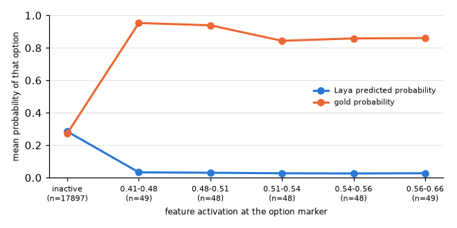

# Feature 10845

Critérios em que aparece: corr_error, corr_probe_right_laya_wrong

**Interpretação (preencher):** 

---

## Maiores ativações

**tr_security_incidents_000032 / credential_compromise** (noul, security_incidents) | ativação 1.838 em `estado` | opções ['false', 'true'] | Laya: **false** [0.857, 0.143] | gabarito: **true**

```
<bos> noul question: The evidence indicates a credential or account has been compromised.<eos>
▸ <mask> false: no, the statement does not hold
▸ <mask> true: yes, the statement holds

<eos>

 {"alert": {"description": "an account granted itself or received elevated permissions", "evidence": "At 2026-09-15 10:05:47 UTC, the shared mailbox \"HR_Alerts\" was added to the \"Domain Admins\" group through a PowerShell command (Add-AD⟦Group⟧Member) executed from the allowlisted host 10.1.2.3. The operation used credentials that were last rotated 90 days ago and MFA was active for the account.", "rule": "privilege_escalation"}, "context": {"asset_criticality": "high", "change_window_active": false, "source_on_allowlist": true}, "history": {"credential_rotation_days_ago": 90, "distinct_countries_30d": 3, "logins_30d": 20, "prior_alerts_90d": 25}, "principal": {"mfa_enrolled": true, "name": "ci-billing-192", "privileges": ["deploy:production", "secrets:read"], "type": "shared_mailbox"}}<eos>
```

**tr_security_incidents_000032 / disposition** (choice, security_incidents) | ativação 1.831 em `estado` | opções ['close_benign', 'contain', 'investigate', 'monitor'] | Laya: **monitor** [0.164, 0.191, 0.03, 0.616] | gabarito: **contain**

```
<bos> choice question: How should this security alert be dispositioned?<eos>
▸ <mask> close_benign: Expected, explainable activity; close without analyst time.
▸ <mask> contain: Contain the host or account immediately; do not wait for triage.
▸ <mask> investigate: Warrants an analyst opening an investigation.
▸ <mask> monitor: Not clearly malicious, but worth watching for recurrence.

<eos>

 {"alert": {"description": "an account granted itself or received elevated permissions", "evidence": "At 2026-09-15 10:05:47 UTC, the shared mailbox \"HR_Alerts\" was added to the \"Domain Admins\" group through a PowerShell command (Add-AD⟦Group⟧Member) executed from the allowlisted host 10.1.2.3. The operation used credentials that were last rotated 90 days ago and MFA was active for the account.", "rule": "privilege_escalation"}, "context": {"asset_criticality": "high", "change_window_active": false, "source_on_allowlist": true}, "history": {"credential_rotation_days_ago": 90, "distinct_countries_30d": 3, "logins_30d": 20, "prior_alerts_90d": 25}, "principal": {"mfa_enrolled": true, "name": "ci-billing-192", "privileges": ["deploy:production", "secrets:read"], "type": "shared_mailbox"}}<eos>
```

**tr_security_incidents_000032 / urgency** (score, security_incidents) | ativação 1.814 em `estado` | opções ['0', '1', '2', '3'] | Laya: **3** [0.179, 0.206, 0.26, 0.356] | gabarito: **3**

```
<bos> score question: How quickly must a responder act on this alert?<eos>
▸ <mask> level 0: No time pressure; can wait indefinitely.
▸ <mask> level 1: Routine; handle within the normal queue.
▸ <mask> level 2: Elevated; should be handled within the same week.
▸ <mask> level 3: Critical; requires action within the same day.

<eos>

 {"alert": {"description": "an account granted itself or received elevated permissions", "evidence": "At 2026-09-15 10:05:47 UTC, the shared mailbox \"HR_Alerts\" was added to the \"Domain Admins\" group through a PowerShell command (Add-AD⟦Group⟧Member) executed from the allowlisted host 10.1.2.3. The operation used credentials that were last rotated 90 days ago and MFA was active for the account.", "rule": "privilege_escalation"}, "context": {"asset_criticality": "high", "change_window_active": false, "source_on_allowlist": true}, "history": {"credential_rotation_days_ago": 90, "distinct_countries_30d": 3, "logins_30d": 20, "prior_alerts_90d": 25}, "principal": {"mfa_enrolled": true, "name": "ci-billing-192", "privileges": ["deploy:production", "secrets:read"], "type": "shared_mailbox"}}<eos>
```

**tr_security_incidents_000032 / severity** (score, security_incidents) | ativação 1.788 em `estado` | opções ['0', '1', '2', '3', '4'] | Laya: **2** [0.164, 0.265, 0.346, 0.147, 0.078] | gabarito: **4**

```
<bos> score question: How severe is the potential impact if this alert is real?<eos>
▸ <mask> level 0: Negligible: no access to anything sensitive.
▸ <mask> level 1: Low: limited access, easily reversed.
▸ <mask> level 2: Moderate: access to internal systems or non-public data.
▸ <mask> level 3: High: access to production, secrets or customer data.
▸ <mask> level 4: Critical: active compromise of crown-jewel systems.

<eos>

 {"alert": {"description": "an account granted itself or received elevated permissions", "evidence": "At 2026-09-15 10:05:47 UTC, the shared mailbox \"HR_Alerts\" was added to the \"Domain Admins\" group through a PowerShell command (Add-AD⟦Group⟧Member) executed from the allowlisted host 10.1.2.3. The operation used credentials that were last rotated 90 days ago and MFA was active for the account.", "rule": "privilege_escalation"}, "context": {"asset_criticality": "high", "change_window_active": false, "source_on_allowlist": true}, "history": {"credential_rotation_days_ago": 90, "distinct_countries_30d": 3, "logins_30d": 20, "prior_alerts_90d": 25}, "principal": {"mfa_enrolled": true, "name": "ci-billing-192", "privileges": ["deploy:production", "secrets:read"], "type": "shared_mailbox"}}<eos>
```

**tr_security_incidents_000233 / credential_compromise** (noul, security_incidents) | ativação 1.766 em `estado` | opções ['false', 'true'] | Laya: **true** [0.008, 0.992] | gabarito: **true**

```
<bos> noul question: The evidence indicates a credential or account has been compromised.<eos>
▸ <mask> false: no, the statement does not hold
▸ <mask> true: yes, the statement holds

<eos>

 {"alert": {"description": "an endpoint agent matched a known signature", "evidence": "On 2026-09-15 09:17:03 UTC, the endpoint detection agent on host \"WIN-DC01\" flagged a match to the \"Em⟦ote⟧t\" malware signature (SHA256: a1b2c3d4e5f6g7h8i9j0...), detected in the file \"C:\\Windows\\Temp\\svchost.exe\". The suspicious file was launched by process \"msiexec.exe\" with PID 6420, the event was recorded as originating from an unrecognized source, and the associated admin account \"svc_admin\" had MFA enabled with its password last changed on 2026-09-12.", "rule": "malware_signature"}, "context": {"asset_criticality": "medium", "change_window_active": false, "source_on_allowlist": false}, "history": {"credential_rotation_days_ago": 3, "distinct_countries_30d": 4, "logins_30d": 695, "prior_alerts_90d": 0}, "principal": {"mfa_enrolled": true, "name": "svc-deploy-569", "privileges": ["deploy:production", "secrets:read"], "type": "admin"}}<eos>
```

## Ativações medianas (faixa 40-60%, mediana 0.677)

**tr_invoice_processing_000152 / duplicate** (noul, invoice_processing) | ativação 0.591 em `marcador` | opções ['false', 'true'] | Laya: **true** [0.014, 0.986] | gabarito: **false**

```
<bos> noul question: This invoice appears to duplicate an invoice already submitted.<eos>
▸ ⟦<mask>⟧ false: no, the statement does not hold
▸ <mask> true: yes, the statement holds

<eos>

 {"delivery": {"condition": "accepted", "date": "2026-03-07", "received_qty": 100}, "invoice": {"currency": "USD", "id": "INV-2026-1355", "lines": [{"qty": 100, "sku": "SKU-197", "total_usd": 32117.0, "unit_usd": 321.17}], "total_usd": 32117.0, "vendor": "Acme Fabrication"}, "payment": {"days_until_due": 44, "discount_expires_in_days": null, "early_payment_discount_pct": null, "status": "scheduled", "terms": "net 15"}, "purchase_order": {"freight_terms": "freight prepaid by vendor, not separately billable", "id": "PO-6509", "lines": [{"qty": 100, "unit_usd": 321.17}], "total_usd": 32117.0}, "vendor_history": {"disputes_12m": 0, "invoices_12m": 53, "prior_invoice_ids": ["INV-2026-3659", "INV-2026-7085"]}}<eos>
```

**tr_customer_service_000242 / needs_human** (noul, customer_service) | ativação 0.692 em `estado` | opções ['false', 'true'] | Laya: **true** [0.164, 0.836] | gabarito: **true**

```
<bos> noul question: This conversation requires a human agent rather than automated handling.<eos>
▸ <mask> false: Automation can carry this to resolution.
▸ <mask> true: A human must take over: judgement, authority or empathy is required.

<eos>

 {"account": {"lifetime_⟦value⟧_usd": 173, "prior_tickets_90d": 3, "seats": 1, "tenure_months": 8, "tier": "enterprise"}, "orders": [{"amount_usd": 9, "date": "2026-02-12", "id": "A-38723", "status": "settled"}, {"amount_usd": 9, "date": "2026-03-02", "id": "A-97049", "status": "pending"}, {"amount_usd": 9, "date": "2026-02-13", "id": "A-82820", "status": "refunded"}], "thread": [{"role": "customer", "text": "I’m really upset—my latest invoice shows an extra $9 charge I never approved, and I need this cleared before the end of the week."}, {"role": "agent", "text": "I’m sorry to hear that. To investigate, could you provide the invoice number and the date it was issued?"}, {"role": "customer", "text": "The invoice is #E20230908, dated September 1st. Please look into why that $9 appears and let me know what’s needed to fix it before Friday."}]}<eos>
```

**tr_security_incidents_000150 / true_positive** (noul, security_incidents) | ativação 0.738 em `estado` | opções ['false', 'true'] | Laya: **true** [0.277, 0.722] | gabarito: **true**

```
<bos> noul question: This alert reflects genuinely malicious or unauthorised activity.<eos>
▸ <mask> false: Benign activity, a misconfiguration, or a known false positive.
▸ <mask> true: The underlying behaviour is malicious or unauthorised.

<eos>

 {"alert": {"description": "an account granted itself or received elevated permissions", "evidence": "On 2026-09-15 at 22:13:07 UTC, the CI runner process \"gitlab-runner\" on host 10.2.5.12 executed a net localgroup command that added its own service account to the local Administrators group. The account’s credential record shows the last rotation occurred 365 days ago.", "rule": "privilege_escalation"}, "context": {"asset_criticality": "low", "change_window_active": false, "source_on_allowlist": true}, "history": {"credential_rotation_days_ago": 365, "distinct_countries_30d": 4, "logins_30d": 788, "prior_alerts_90d": 1}, "principal": {"mfa_enrolled": true, "name": "usr-billing-6⟦7⟧5", "privileges": ["repo:read"], "type": "ci_runner"}}<eos>
```

**tr_invoice_processing_000097 / urgency** (score, invoice_processing) | ativação 0.771 em `estado` | opções ['0', '1', '2', '3'] | Laya: **1** [0.134, 0.381, 0.279, 0.207] | gabarito: **1**

```
<bos> score question: How time-sensitive is processing this invoice?<eos>
▸ <mask> level 0: No time pressure; can wait indefinitely.
▸ <mask> level 1: Routine; handle within the normal queue.
▸ <mask> level 2: Elevated; should be handled within the same week.
▸ <mask> level 3: Critical; requires action within the same day.

<eos>

 {"delivery": {"condition": "accepted with exceptions", "date": "2026-03-02", "received_qty": 50}, "invoice": {"currency": "USD", "id": "INV-2026-3793", "lines": [{"qty": 50, "sku": "SKU-9⟦0⟧5", "total_usd": 17279.5, "unit_usd": 345.59}], "total_usd": 17279.5, "vendor": "Orbit Logistics"}, "payment": {"days_until_due": 11, "discount_expires_in_days": null, "early_payment_discount_pct": null, "status": "scheduled", "terms": "net 30"}, "purchase_order": {"freight_terms": "freight prepaid by vendor, not separately billable", "id": "PO-8082", "lines": [{"qty": 50, "unit_usd": 345.59}], "total_usd": 17279.5}, "vendor_history": {"disputes_12m": 0, "invoices_12m": 60, "prior_invoice_ids": ["INV-2026-3793", "INV-2026-3886", "INV-2026-6555"]}}<eos>
```

**tr_security_incidents_000248 / credential_compromise** (noul, security_incidents) | ativação 0.728 em `estado` | opções ['false', 'true'] | Laya: **false** [0.814, 0.186] | gabarito: **true**

```
<bos> noul question: The evidence indicates a credential or account has been compromised.<eos>
▸ <mask> false: no, the statement does not hold
▸ <mask> true: yes, the statement holds

<eos>

 {"alert": {"description": "a security group was opened to the public internet", "evidence": "A security group configuration was modified to allow inbound traffic from the 0.0.0.0/0 CIDR block at 14:22 UTC. The modification was initiated by an unrecognized source using an unprivileged service account, with no corresponding record in the change management log.", "rule": "config_drift"}, "context": {"asset_criticality": "medium", "change_window_active": false, "source_on_allowlist": false}, "history": {"credential_rotation_days_ago": 180, "distinct_countries_30d": 1, "logins_30d": 1240, "prior_alerts_90d": 0}, "principal": {"mfa_enrolled": true, "name": "svc-infra-7⟦0⟧9", "privileges": ["repo:read"], "type": "service_account"}}<eos>
```

## Estatísticas (conjunto de descoberta, dev e teste)

**pred / error**

| split | decisões | ativas | ativas e Laya errou | taxa | lift | q (BH) | OR (CMH) | q (CMH) |
|---|---|---|---|---|---|---|---|---|
| discovery | 5100 | 0 | 0 | nan | nan | nan | nan | nan |
| dev | 900 | 0 | 0 | nan | nan | nan | nan | nan |
| test | 2000 | 0 | 0 | nan | nan | nan | nan | nan |

**corr / error**

| split | decisões | ativas | ativas e Laya errou | taxa | lift | q (BH) | OR (CMH) | q (CMH) |
|---|---|---|---|---|---|---|---|---|
| discovery | 5100 | 217 | 217 | 1.000 | 1.55 | 1.09e-41 | nan | nan |
| dev | 900 | 55 | 55 | 1.000 | 1.49 | 3.26e-09 | nan | nan |
| test | 2000 | 89 | 89 | 1.000 | 1.54 | 2.05e-16 | nan | nan |

**state / error**

| split | decisões | ativas | ativas e Laya errou | taxa | lift | q (BH) | OR (CMH) | q (CMH) |
|---|---|---|---|---|---|---|---|---|
| discovery | 5100 | 947 | 550 | 0.581 | 0.90 | 0.000103 | 0.88 | 0.395 |
| dev | 900 | 186 | 112 | 0.602 | 0.90 | 0.256 | 0.78 | 0.561 |
| test | 2000 | 335 | 200 | 0.597 | 0.92 | 0.163 | 0.90 | 0.786 |

**pred / probe_right_laya_wrong**

| split | decisões | ativas | ativas e Laya errou | taxa | lift | q (BH) | OR (CMH) | q (CMH) |
|---|---|---|---|---|---|---|---|---|
| discovery | 2932 | 0 | 0 | nan | nan | nan | nan | nan |
| dev | 523 | 0 | 0 | nan | nan | nan | nan | nan |
| test | 1149 | 0 | 0 | nan | nan | nan | nan | nan |

**corr / probe_right_laya_wrong**

| split | decisões | ativas | ativas e Laya errou | taxa | lift | q (BH) | OR (CMH) | q (CMH) |
|---|---|---|---|---|---|---|---|---|
| discovery | 2932 | 217 | 217 | 1.000 | 1.65 | 1.4e-48 | nan | nan |
| dev | 523 | 55 | 55 | 1.000 | 1.55 | 1.65e-10 | nan | nan |
| test | 1149 | 89 | 89 | 1.000 | 1.64 | 3.3e-19 | nan | nan |

**state / probe_right_laya_wrong**

| split | decisões | ativas | ativas e Laya errou | taxa | lift | q (BH) | OR (CMH) | q (CMH) |
|---|---|---|---|---|---|---|---|---|
| discovery | 2932 | 561 | 294 | 0.524 | 0.87 | 0.000104 | 0.79 | 0.156 |
| dev | 523 | 108 | 61 | 0.565 | 0.87 | 0.261 | 0.72 | 0.535 |
| test | 1149 | 202 | 112 | 0.554 | 0.91 | 0.254 | 0.78 | 0.504 |

Confusão mais sobre-representada (corr): `duplicate|1>0` (n=217, lift 23.50, p=0). Formato `pergunta|índice previsto>índice correto`.

Confusão mais sobre-representada (state): `credential_compromise|0>1` (n=14, lift 3.43, p=3.83e-06). Formato `pergunta|índice previsto>índice correto`.



