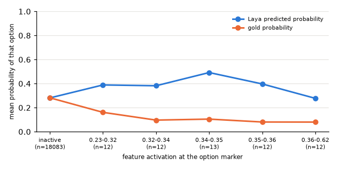

# Feature 10874

Critérios em que aparece: pred_error

**Interpretação (preencher):** 

---

## Maiores ativações

**tr_customer_service_000029 / needs_human** (noul, customer_service) | ativação 10.719 em `estado` | opções ['false', 'true'] | Laya: **true** [0.277, 0.722] | gabarito: **true**

```
<bos> noul question: This conversation requires a human agent rather than automated handling.<eos>
▸ <mask> false: Automation can carry this to resolution.
▸ <mask> true: A human must take over: judgement, authority or empathy is required.

<eos>

 {"account": {"lifetime_value_usd": 5176, "prior_tickets_90d": 1, "seats": 1, "tenure_months": 72, "tier": "standard"}, "thread": [{"role": "customer", "text": "I am beyond frustrated right now. I've been a loyal customer for six years and I requested a downgrade from the Standard plan weeks ago. I⟦ was⟧ told it was taken care of, but I just got hit with another full-price bill."}, {"role": "agent", "text": "I am very sorry to hear that the downgrade wasn't processed as expected, especially given your long history with us. I can certainly understand why seeing that charge is upsetting."}, {"role": "customer", "text": "This is the second time I've had to open a ticket for this exact same issue. The last agent promised me it was resolved, yet here I am again wasting my time because your system won't update my status."}, {"role": "agent", "text": "I see your previous interaction in our logs. To assist me in investigating why the change didn't take effect, could you let me know if you received a confirmation email after your last conversation regarding the plan change?"}, {"role": "customer", "text": "I never received any confirmation, which is why I'm so annoyed. I shouldn't have to keep chasing you guys down to stop charging me for features I am no longer using."}]}<eos>
```

**tr_customer_service_000133 / urgency** (score, customer_service) | ativação 10.664 em `estado` | opções ['0', '1', '2', '3'] | Laya: **2** [0.114, 0.283, 0.436, 0.167] | gabarito: **1**

```
<bos> score question: How time-sensitive is this conversation?<eos>
▸ <mask> level 0: No time pressure; can wait indefinitely.
▸ <mask> level 1: Routine; handle within the normal queue.
▸ <mask> level 2: Elevated; should be handled within the same week.
▸ <mask> level 3: Critical; requires action within the same day.

<eos>

 {"account": {"lifetime_value_usd": 1849, "prior_tickets_90d": 1, "seats": 1, "tenure_months": 26, "tier": "enterprise"}, "orders": [{"amount_usd": 29, "date": "2026-03-07", "id": "A-56399", "status": "settled"}, {"amount_usd": 29, "date": "2026-02-18", "id": "A-97170", "status": "pending"}], "thread": [{"role": "customer", "text": "I need another copy of the invoice from last month. I’ve already gone through this once, so I’m just hoping it can⟦ be⟧ sent over quickly."}, {"role": "agent", "text": "Understood. Could you tell me which month’s invoice you need and the email address associated with the account?"}, {"role": "customer", "text": "It’s the March 2024 invoice, and the email on file is billing@example.com. Please let me know when it’s ready."}]}<eos>
```

**tr_customer_service_000133 / action** (choice, customer_service) | ativação 10.617 em `estado` | opções ['answer_directly', 'close_no_action', 'escalate_to_human', 'execute_refund', 'request_information'] | Laya: **answer_directly** [0.869, 0.018, 0.043, 0.02, 0.051] | gabarito: **answer_directly**

```
<bos> choice question: What should the assistant do next with this conversation?<eos>
▸ <mask> answer_directly: The assistant can resolve this itself with information it already has.
▸ <mask> close_no_action: No further action is warranted; the matter is settled.
▸ <mask> escalate_to_human: Hand off to a human agent with the appropriate authority.
▸ <mask> execute_refund: Issue the refund or credit the customer is owed.
▸ <mask> request_information: More detail is needed from the customer before anything can be done.

<eos>

 {"account": {"lifetime_value_usd": 1849, "prior_tickets_90d": 1, "seats": 1, "tenure_months": 26, "tier": "enterprise"}, "orders": [{"amount_usd": 29, "date": "2026-03-07", "id": "A-56399", "status": "settled"}, {"amount_usd": 29, "date": "2026-02-18", "id": "A-97170", "status": "pending"}], "thread": [{"role": "customer", "text": "I need another copy of the invoice from last month. I’ve already gone through this once, so I’m just hoping it can⟦ be⟧ sent over quickly."}, {"role": "agent", "text": "Understood. Could you tell me which month’s invoice you need and the email address associated with the account?"}, {"role": "customer", "text": "It’s the March 2024 invoice, and the email on file is billing@example.com. Please let me know when it’s ready."}]}<eos>
```

**tr_customer_service_000029 / action** (choice, customer_service) | ativação 10.570 em `estado` | opções ['answer_directly', 'close_no_action', 'escalate_to_human', 'execute_refund', 'request_information'] | Laya: **answer_directly** [0.364, 0.235, 0.349, 0.044, 0.007] | gabarito: **escalate_to_human**

```
<bos> choice question: What should the assistant do next with this conversation?<eos>
▸ <mask> answer_directly: The assistant can resolve this itself with information it already has.
▸ <mask> close_no_action: No further action is warranted; the matter is settled.
▸ <mask> escalate_to_human: Hand off to a human agent with the appropriate authority.
▸ <mask> execute_refund: Issue the refund or credit the customer is owed.
▸ <mask> request_information: More detail is needed from the customer before anything can be done.

<eos>

 {"account": {"lifetime_value_usd": 5176, "prior_tickets_90d": 1, "seats": 1, "tenure_months": 72, "tier": "standard"}, "thread": [{"role": "customer", "text": "I am beyond frustrated right now. I've been a loyal customer for six years and I requested a downgrade from the Standard plan weeks ago. I⟦ was⟧ told it was taken care of, but I just got hit with another full-price bill."}, {"role": "agent", "text": "I am very sorry to hear that the downgrade wasn't processed as expected, especially given your long history with us. I can certainly understand why seeing that charge is upsetting."}, {"role": "customer", "text": "This is the second time I've had to open a ticket for this exact same issue. The last agent promised me it was resolved, yet here I am again wasting my time because your system won't update my status."}, {"role": "agent", "text": "I see your previous interaction in our logs. To assist me in investigating why the change didn't take effect, could you let me know if you received a confirmation email after your last conversation regarding the plan change?"}, {"role": "customer", "text": "I never received any confirmation, which is why I'm so annoyed. I shouldn't have to keep chasing you guys down to stop charging me for features I am no longer using."}]}<eos>
```

**tr_customer_service_000133 / needs_human** (noul, customer_service) | ativação 10.414 em `estado` | opções ['false', 'true'] | Laya: **false** [0.518, 0.482] | gabarito: **false**

```
<bos> noul question: This conversation requires a human agent rather than automated handling.<eos>
▸ <mask> false: Automation can carry this to resolution.
▸ <mask> true: A human must take over: judgement, authority or empathy is required.

<eos>

 {"account": {"lifetime_value_usd": 1849, "prior_tickets_90d": 1, "seats": 1, "tenure_months": 26, "tier": "enterprise"}, "orders": [{"amount_usd": 29, "date": "2026-03-07", "id": "A-56399", "status": "settled"}, {"amount_usd": 29, "date": "2026-02-18", "id": "A-97170", "status": "pending"}], "thread": [{"role": "customer", "text": "I need another copy of the invoice from last month. I’ve already gone through this once, so I’m just hoping it can⟦ be⟧ sent over quickly."}, {"role": "agent", "text": "Understood. Could you tell me which month’s invoice you need and the email address associated with the account?"}, {"role": "customer", "text": "It’s the March 2024 invoice, and the email on file is billing@example.com. Please let me know when it’s ready."}]}<eos>
```

## Ativações medianas (faixa 40-60%, mediana 3.885)

**tr_invoice_processing_000141 / disposition** (choice, invoice_processing) | ativação 3.396 em `opção` | opções ['approve', 'hold', 'manual_review', 'reject'] | Laya: **approve** [0.52, 0.122, 0.015, 0.343] | gabarito: **manual_review**

```
<bos> choice question: How should this vendor invoice be dispositioned?<eos>
▸ <mask> approve: Matches the order and delivery; approve for payment.
▸ <mask> hold: Something needs confirming before payment; hold pending clarification.
▸ <mask> manual_review: A human in finance must review the discrepancy.
▸ <mask> reject: Should not⟦ be⟧ paid: duplicate, unauthorised or materially wrong.

<eos>

 {"delivery": {"condition": "accepted", "date": "2026-03-04", "received_qty": 400}, "invoice": {"currency": "USD", "id": "INV-2026-9876", "lines": [{"qty": 400, "sku": "SKU-665", "total_usd": 40408.0, "unit_usd": 101.02}, {"qty": 1, "sku": "FREIGHT", "total_usd": 1975.55, "unit_usd": 1975.55}], "total_usd": 42383.55, "vendor": "Kestrel Supply"}, "payment": {"days_until_due": -9, "discount_expires_in_days": null, "early_payment_discount_pct": null, "status": "overdue", "terms": "net 60"}, "purchase_order": {"freight_terms": "freight prepaid by vendor, not separately billable", "id": "PO-5110", "lines": [{"qty": 400, "unit_usd": 101.02}], "total_usd": 40408.0}, "vendor_history": {"disputes_12m": 0, "invoices_12m": 12, "prior_invoice_ids": ["INV-2026-3144", "INV-2026-2282", "INV-2026-7894", "INV-2026-6333"]}}<eos>
```

**tr_invoice_processing_000144 / disposition** (choice, invoice_processing) | ativação 3.328 em `opção` | opções ['approve', 'hold', 'manual_review', 'reject'] | Laya: **approve** [0.553, 0.142, 0.037, 0.268] | gabarito: **approve**

```
<bos> choice question: How should this vendor invoice be dispositioned?<eos>
▸ <mask> approve: Matches the order and delivery; approve for payment.
▸ <mask> hold: Something needs confirming before payment; hold pending clarification.
▸ <mask> manual_review: A human in finance must review the discrepancy.
▸ <mask> reject: Should not⟦ be⟧ paid: duplicate, unauthorised or materially wrong.

<eos>

 {"delivery": {"condition": "accepted", "date": "2026-03-03", "received_qty": 250}, "invoice": {"currency": "USD", "id": "INV-2026-4721", "lines": [{"qty": 250, "sku": "SKU-840", "total_usd": 80237.5, "unit_usd": 320.95}], "total_usd": 80237.5, "vendor": "Pallas Industrial"}, "payment": {"days_until_due": -9, "discount_expires_in_days": null, "early_payment_discount_pct": null, "status": "overdue", "terms": "net 60"}, "purchase_order": {"freight_terms": "freight prepaid by vendor, not separately billable", "id": null, "lines": [{"qty": 250, "unit_usd": 320.95}], "total_usd": 80237.5}, "vendor_history": {"disputes_12m": 1, "invoices_12m": 56, "prior_invoice_ids": ["INV-2026-5685", "INV-2026-2769"]}}<eos>
```

**tr_security_incidents_000123 / true_positive** (noul, security_incidents) | ativação 4.324 em `estado` | opções ['false', 'true'] | Laya: **true** [0.026, 0.974] | gabarito: **true**

```
<bos> noul question: This alert reflects genuinely malicious or unauthorised activity.<eos>
▸ <mask> false: Benign activity, a misconfiguration, or a known false positive.
▸ <mask> true: The underlying behaviour is malicious or unauthorised.

<eos>

 {"alert": {"description": "two successful logins from distant locations too close together", "evidence": "Successful authentications for the unprivileged service account 'svc_data_sync'⟦ were⟧ recorded from IP 192.168.4.12 in New York at 08:00 UTC and IP 10.0.5.88 in London at 08:14 UTC. These logins originated from unrecognized network sources using credentials that were last rotated 412 days ago.", "rule": "impossible_travel"}, "context": {"asset_criticality": "crown_jewel", "change_window_active": false, "source_on_allowlist": false}, "history": {"credential_rotation_days_ago": 412, "distinct_countries_30d": 3, "logins_30d": 1458, "prior_alerts_90d": 0}, "principal": {"mfa_enrolled": false, "name": "usr-deploy-577", "privileges": ["repo:read"], "type": "service_account"}}<eos>
```

**tr_customer_service_000100 / churn_risk** (score, customer_service) | ativação 4.480 em `estado` | opções ['0', '1', '2', '3'] | Laya: **2** [0.071, 0.285, 0.611, 0.033] | gabarito: **1**

```
<bos> score question: How likely is this customer to stop doing business with us because of this interaction?<eos>
▸ <mask> level 0: No sign of dissatisfaction.
▸ <mask> level 1: Mild frustration, but the relationship is intact.
▸ <mask> level 2: Clearly unhappy; repeat problems or explicit complaints.
▸ <mask> level 3: Imminent: threatening to cancel, dispute or leave.

<eos>

 {"account": {"lifetime_value_usd": 3569, "prior_tickets_90d": 0, "seats": 1, "tenure_months": 60, "tier": "free"}, "thread": [{"role": "customer", "text": "Hi there, I hope you’re doing well. I’ve been on the free plan for the past five years (about 60 months now) and I just received my latest order, but it looks like the wrong item⟦ was⟧ shipped. Could you help me figure this out?"}, {"role": "agent", "text": "Hello! I’m sorry to hear about the mix‑up. Could you share the order number and tell me which product you received versus what you expected?"}, {"role": "customer", "text": "Sure, the order number is #A987654. I was supposed to get the ergonomic mouse, but I got a standard wired mouse instead."}, {"role": "agent", "text": "Thanks for the details. To verify, may I ask for a quick photo of the item you received? You can attach it here or let me know the best way to receive it."}, {"role": "customer", "text": "I’ve attached a picture to this message. Let me know what the next steps are for getting the correct mouse sent."}]}<eos>
```

**tr_security_incidents_000049 / credential_compromise** (noul, security_incidents) | ativação 4.516 em `pergunta` | opções ['false', 'true'] | Laya: **true** [0.007, 0.993] | gabarito: **false**

```
<bos> noul question: The evidence indicates a credential or account has⟦ been⟧ compromised.<eos>
▸ <mask> false: no, the statement does not hold
▸ <mask> true: yes, the statement holds

<eos>

 {"alert": {"description": "a first-ever sign-in from an unfamiliar country", "evidence": "An unprivileged employee account authenticated from a previously unseen country 30 days after its last credential rotation. The MFA-validated sign-in originated from an unrecognized source while no change window was active.", "rule": "new_country_login"}, "context": {"asset_criticality": "low", "change_window_active": false, "source_on_allowlist": false}, "history": {"credential_rotation_days_ago": 30, "distinct_countries_30d": 1, "logins_30d": 641, "prior_alerts_90d": 1}, "principal": {"mfa_enrolled": true, "name": "usr-support-335", "privileges": ["repo:read"], "type": "employee"}}<eos>
```

## Estatísticas (conjunto de descoberta, dev e teste)

**pred / error**

| split | decisões | ativas | ativas e Laya errou | taxa | lift | q (BH) | OR (CMH) | q (CMH) |
|---|---|---|---|---|---|---|---|---|
| discovery | 5100 | 30 | 28 | 0.933 | 1.45 | 0.00154 | 2.00 | 0.662 |
| dev | 900 | 7 | 7 | 1.000 | 1.49 | nan | nan | nan |
| test | 2000 | 10 | 8 | 0.800 | 1.23 | nan | nan | nan |

**corr / error**

| split | decisões | ativas | ativas e Laya errou | taxa | lift | q (BH) | OR (CMH) | q (CMH) |
|---|---|---|---|---|---|---|---|---|
| discovery | 5100 | 5 | 3 | 0.600 | 0.93 | nan | nan | nan |
| dev | 900 | 0 | 0 | nan | nan | nan | nan | nan |
| test | 2000 | 2 | 0 | 0.000 | 0.00 | nan | nan | nan |

**state / error**

| split | decisões | ativas | ativas e Laya errou | taxa | lift | q (BH) | OR (CMH) | q (CMH) |
|---|---|---|---|---|---|---|---|---|
| discovery | 5100 | 2224 | 1347 | 0.606 | 0.94 | 1.04e-05 | 1.15 | 0.295 |
| dev | 900 | 353 | 222 | 0.629 | 0.94 | 0.265 | 1.36 | 0.471 |
| test | 2000 | 899 | 550 | 0.612 | 0.94 | 0.0251 | 1.18 | 0.568 |

**pred / probe_right_laya_wrong**

| split | decisões | ativas | ativas e Laya errou | taxa | lift | q (BH) | OR (CMH) | q (CMH) |
|---|---|---|---|---|---|---|---|---|
| discovery | 2932 | 19 | 19 | 1.000 | 1.65 | nan | nan | nan |
| dev | 523 | 4 | 4 | 1.000 | 1.55 | nan | nan | nan |
| test | 1149 | 3 | 3 | 1.000 | 1.64 | nan | nan | nan |

**corr / probe_right_laya_wrong**

| split | decisões | ativas | ativas e Laya errou | taxa | lift | q (BH) | OR (CMH) | q (CMH) |
|---|---|---|---|---|---|---|---|---|
| discovery | 2932 | 0 | 0 | nan | nan | nan | nan | nan |
| dev | 523 | 0 | 0 | nan | nan | nan | nan | nan |
| test | 1149 | 0 | 0 | nan | nan | nan | nan | nan |

**state / probe_right_laya_wrong**

| split | decisões | ativas | ativas e Laya errou | taxa | lift | q (BH) | OR (CMH) | q (CMH) |
|---|---|---|---|---|---|---|---|---|
| discovery | 2932 | 1296 | 706 | 0.545 | 0.90 | 4.42e-08 | 1.38 | 0.0184 |
| dev | 523 | 195 | 113 | 0.579 | 0.90 | 0.129 | 1.70 | 0.232 |
| test | 1149 | 527 | 296 | 0.562 | 0.92 | 0.022 | 1.47 | 0.153 |

Confusão mais sobre-representada (pred): `disposition|3>2` (n=15, lift 15.18, p=3.16e-15). Formato `pergunta|índice previsto>índice correto`.

Confusão mais sobre-representada (corr): `disposition|0>3` (n=2, lift 255.00, p=nan). Formato `pergunta|índice previsto>índice correto`.

Confusão mais sobre-representada (state): `severity|1>3` (n=62, lift 2.00, p=1.48e-14). Formato `pergunta|índice previsto>índice correto`.



