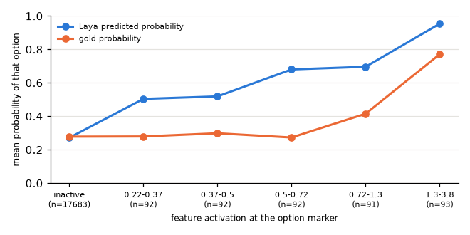

# Feature 11271

Critérios em que aparece: attribution_toward_wrong

**Interpretação (preencher):** 

---

## Maiores ativações

**tr_invoice_processing_000199 / urgency** (score, invoice_processing) | ativação 4.672 em `estado` | opções ['0', '1', '2', '3'] | Laya: **1** [0.133, 0.378, 0.308, 0.181] | gabarito: **2**

```
<bos> score question: How time-sensitive is processing this invoice?<eos>
▸ <mask> level 0: No time pressure; can wait indefinitely.
▸ <mask> level 1: Routine; handle within the normal queue.
▸ <mask> level 2: Elevated; should be handled within the same week.
▸ <mask> level 3: Critical; requires action within the same day.

<eos>

 {"delivery": {"condition": "accepted", "date": "2026-03-09", "received_qty": 1000}, "invoice": {"currency": "USD", "id": "INV-2026-1122", "lines": [{"qty": 1000, "sku": "SKU-843", "total_usd": 114150.0, "unit_usd": 114.15}], "total_usd": 114150.0, "vendor": "Orbit Logistics"}, "payment": {"days_until_due": 44, "discount_expires_in_days": 1, "early_payment_discount_pct": 2.0, "status": "scheduled", "terms": "net 30"}, "purchase_order": {"freight_terms": "freight prepaid by vendor, not separately billable", "id": "PO-5232", "lines": [{"qty": 1000, "unit_usd": 114.15}], "total_usd": 114150.0}, "vendor_history": {"disputes_12m": 5, "⟦invoices⟧_12m": 48, "prior_invoice_ids": ["INV-2026-1122", "INV-2026-2468", "INV-2026-5673", "INV-2026-6777"]}}<eos>
```

**tr_customer_service_000242 / category** (choice, customer_service) | ativação 4.652 em `opção` | opções ['account', 'billing', 'delivery', 'refund', 'technical'] | Laya: **billing** [0.0, 1.0, 0.0, 0.0, 0.0] | gabarito: **billing**

```
<bos> choice question: What is this customer conversation primarily about?<eos>
▸ <mask> account: Login, plan changes, profile or access management.
▸ <mask>⟦ billing⟧: A charge, invoice, subscription or payment problem.
▸ <mask> delivery: Shipping, fulfilment or delivery of a physical item.
▸ <mask> refund: The customer is explicitly asking for money back.
▸ <mask> technical: The product or service is not working as expected.

<eos>

 {"account": {"lifetime_value_usd": 173, "prior_tickets_90d": 3, "seats": 1, "tenure_months": 8, "tier": "enterprise"}, "orders": [{"amount_usd": 9, "date": "2026-02-12", "id": "A-38723", "status": "settled"}, {"amount_usd": 9, "date": "2026-03-02", "id": "A-97049", "status": "pending"}, {"amount_usd": 9, "date": "2026-02-13", "id": "A-82820", "status": "refunded"}], "thread": [{"role": "customer", "text": "I’m really upset—my latest invoice shows an extra $9 charge I never approved, and I need this cleared before the end of the week."}, {"role": "agent", "text": "I’m sorry to hear that. To investigate, could you provide the invoice number and the date it was issued?"}, {"role": "customer", "text": "The invoice is #E20230908, dated September 1st. Please look into why that $9 appears and let me know what’s needed to fix it before Friday."}]}<eos>
```

**tr_customer_service_000242 / category** (choice, customer_service) | ativação 4.508 em `opção` | opções ['account', 'billing', 'delivery', 'refund', 'technical'] | Laya: **billing** [0.0, 1.0, 0.0, 0.0, 0.0] | gabarito: **billing**

```
<bos> choice question: What is this customer conversation primarily about?<eos>
▸ <mask> account: Login, plan changes, profile or access management.
▸ <mask> billing: A charge,⟦ invoice⟧, subscription or payment problem.
▸ <mask> delivery: Shipping, fulfilment or delivery of a physical item.
▸ <mask> refund: The customer is explicitly asking for money back.
▸ <mask> technical: The product or service is not working as expected.

<eos>

 {"account": {"lifetime_value_usd": 173, "prior_tickets_90d": 3, "seats": 1, "tenure_months": 8, "tier": "enterprise"}, "orders": [{"amount_usd": 9, "date": "2026-02-12", "id": "A-38723", "status": "settled"}, {"amount_usd": 9, "date": "2026-03-02", "id": "A-97049", "status": "pending"}, {"amount_usd": 9, "date": "2026-02-13", "id": "A-82820", "status": "refunded"}], "thread": [{"role": "customer", "text": "I’m really upset—my latest invoice shows an extra $9 charge I never approved, and I need this cleared before the end of the week."}, {"role": "agent", "text": "I’m sorry to hear that. To investigate, could you provide the invoice number and the date it was issued?"}, {"role": "customer", "text": "The invoice is #E20230908, dated September 1st. Please look into why that $9 appears and let me know what’s needed to fix it before Friday."}]}<eos>
```

**tr_invoice_processing_000243 / urgency** (score, invoice_processing) | ativação 4.414 em `estado` | opções ['0', '1', '2', '3'] | Laya: **1** [0.104, 0.435, 0.316, 0.145] | gabarito: **1**

```
<bos> score question: How time-sensitive is processing this invoice?<eos>
▸ <mask> level 0: No time pressure; can wait indefinitely.
▸ <mask> level 1: Routine; handle within the normal queue.
▸ <mask> level 2: Elevated; should be handled within the same week.
▸ <mask> level 3: Critical; requires action within the same day.

<eos>

 {"delivery": {"condition": "accepted", "date": "2026-03-21", "received_qty": 1000}, "invoice": {"currency": "USD", "id": "INV-2026-2996", "lines": [{"qty": 1000, "sku": "SKU-704", "total_usd": 347130.0, "unit_usd": 347.13}, {"qty": 1, "sku": "FREIGHT", "total_usd": 328.32, "unit_usd": 328.32}], "total_usd": 347458.32, "vendor": "Orbit Logistics"}, "payment": {"days_until_due": 0, "discount_expires_in_days": null, "early_payment_discount_pct": null, "status": "scheduled", "terms": "net 30"}, "purchase_order": {"freight_terms": "freight prepaid by vendor, not separately billable", "id": "PO-9513", "lines": [{"qty": 1000, "unit_usd": 347.13}], "total_usd": 347130.0}, "vendor_history": {"disputes_12m": 2, "⟦invoices⟧_12m": 16, "prior_invoice_ids": ["INV-2026-2361", "INV-2026-8993", "INV-2026-3050"]}}<eos>
```

**tr_invoice_processing_000199 / discrepancy_severity** (score, invoice_processing) | ativação 4.312 em `estado` | opções ['0', '1', '2', '3'] | Laya: **2** [0.065, 0.3, 0.578, 0.058] | gabarito: **0**

```
<bos> score question: How material is any discrepancy between the invoice, the order and the delivery?<eos>
▸ <mask> level 0: None: everything reconciles.
▸ <mask> level 1: Trivial: rounding or a cosmetic difference.
▸ <mask> level 2: Moderate: a real difference worth confirming.
▸ <mask> level 3: Material: a large or unexplained difference.

<eos>

 {"delivery": {"condition": "accepted", "date": "2026-03-09", "received_qty": 1000}, "invoice": {"currency": "USD", "id": "INV-2026-1122", "lines": [{"qty": 1000, "sku": "SKU-843", "total_usd": 114150.0, "unit_usd": 114.15}], "total_usd": 114150.0, "vendor": "Orbit Logistics"}, "payment": {"days_until_due": 44, "discount_expires_in_days": 1, "early_payment_discount_pct": 2.0, "status": "scheduled", "terms": "net 30"}, "purchase_order": {"freight_terms": "freight prepaid by vendor, not separately billable", "id": "PO-5232", "lines": [{"qty": 1000, "unit_usd": 114.15}], "total_usd": 114150.0}, "vendor_history": {"disputes_12m": 5, "⟦invoices⟧_12m": 48, "prior_invoice_ids": ["INV-2026-1122", "INV-2026-2468", "INV-2026-5673", "INV-2026-6777"]}}<eos>
```

## Ativações medianas (faixa 40-60%, mediana 0.833)

**tr_customer_service_000251 / action** (choice, customer_service) | ativação 0.808 em `estado` | opções ['answer_directly', 'close_no_action', 'escalate_to_human', 'execute_refund', 'request_information'] | Laya: **answer_directly** [0.702, 0.275, 0.004, 0.016, 0.002] | gabarito: **request_information**

```
<bos> choice question: What should the assistant do next with this conversation?<eos>
▸ <mask> answer_directly: The assistant can resolve this itself with information it already has.
▸ <mask> close_no_action: No further action is warranted; the matter is settled.
▸ <mask> escalate_to_human: Hand off to a human agent with the appropriate authority.
▸ <mask> execute_refund: Issue the refund or credit the customer is owed.
▸ <mask> request_information: More detail is needed from the customer before anything can be done.

<eos>

 {"account": {"lifetime_value_usd": 173, "prior_tickets_90d": 0, "seats": 3, "tenure_months": 2, "tier": "enterprise"}, "orders": [{"amount_usd": 38, "date": "2026-02-05", "id": "A-71684", "status": "settled"}], "thread": [{"role": "customer", "text": "Our team’s been dealing with extremely slow load times on the dashboard for the past few days; everything feels laggy, and it’s hampering our workflow."}, {"role": "agent", "text": "I understand how frustrating that can be; can you tell me if the slowdown occurs on specific pages or across the entire platform?"}, {"role⟦":⟧ "customer", "text": "It’s pretty much everywhere—reports, the analytics view, even the basic settings page takes ages to render."}, {"role": "agent", "text": "Got it. Have you noticed any pattern, like the issue worsening at certain times of day or after particular actions?"}, {"role": "customer", "text": "It seems constant, though it does feel a bit worse during our peak usage windows around 10 AM UTC."}, {"role": "agent", "text": "Thanks for that detail. Are you accessing the service via a VPN or any corporate proxy that might affect latency?"}, {"role": "customer", "text": "We use our standard corporate VPN, which we’ve used without problems before, so I’m not sure if that’s a factor."}]}<eos>
```

**tr_customer_service_000082 / action** (choice, customer_service) | ativação 0.805 em `estado` | opções ['answer_directly', 'close_no_action', 'escalate_to_human', 'execute_refund', 'request_information'] | Laya: **execute_refund** [0.074, 0.013, 0.003, 0.909, 0.001] | gabarito: **escalate_to_human**

```
<bos> choice question: What should the assistant do next with this conversation?<eos>
▸ <mask> answer_directly: The assistant can resolve this itself with information it already has.
▸ <mask> close_no_action: No further action is warranted; the matter is settled.
▸ <mask> escalate_to_human: Hand off to a human agent with the appropriate authority.
▸ <mask> execute_refund: Issue the refund or credit the customer is owed.
▸ <mask> request_information: More detail is needed from the customer before anything can be done.

<eos>

 {"account": {"lifetime_value_usd": 2703, "prior_tickets_90d": 2, "seats": 40, "tenure_months": 49, "tier": "premium"}, "thread": [{"role": "customer", "text": "I need an update on my refund now! You promised it after my last ticket and it’s been weeks—this is urgent."}, {"role⟦":⟧ "agent", "text": "I’m sorry for the delay. Could you provide the transaction date or reference number so I can locate the refund request?"}, {"role": "customer", "text": "The purchase was on February 14th, reference #A1B2C3. I’ve been waiting far too long and need the money back immediately."}, {"role": "agent", "text": "Thank you for the details. I’ll check the status right away and get back to you as soon as I have more information."}, {"role": "customer", "text": "Please expedite this – I expect a resolution today."}]}<eos>
```

**tr_customer_service_000097 / urgency** (score, customer_service) | ativação 0.882 em `estado` | opções ['0', '1', '2', '3'] | Laya: **3** [0.04, 0.379, 0.186, 0.394] | gabarito: **1**

```
<bos> score question: How time-sensitive is this conversation?<eos>
▸ <mask> level 0: No time pressure; can wait indefinitely.
▸ <mask> level 1: Routine; handle within the normal queue.
▸ <mask> level 2: Elevated; should be handled within the same week.
▸ <mask> level 3: Critical; requires action within the same day.

<eos>

 {"account": {"lifetime_value_usd": 3319, "prior_tickets_90d": 0, "seats": 1, "tenure_months": 41, "tier": "free"}, "thread": [{"role": "customer", "text": "Hi, I was told a refund was coming my way a while ago, but I don't see anything in my account. I've been using this free plan for years and I'm just not sure where to look for this credit."}, {"role": "agent", "text": "Hello. I would be happy to look into the status of your refund. Could you please provide the reference number for the original refund request you were given?"}, {"role": "customer", "text": "I’m sorry, I don't actually have a reference number. I just had a chat with someone a few weeks back and they said it was processed."}, {"role": "agent", "⟦text⟧": "Thank you for clarifying that. Since I cannot locate the request without a reference number, could you please tell me the approximate date of that previous interaction?"}, {"role": "customer", "text": "It would have been sometime in mid-October, I believe. I'm just confused because I thought it would show up automatically."}, {"role": "agent", "text": "I see. To help me locate that specific conversation, could you confirm the email address associated with your account?"}, {"role": "customer", "text": "It's the same one I'm messaging from now. I just want to know if it's still coming or if I need to do something else."}]}<eos>
```

**tr_invoice_processing_000298 / disposition** (choice, invoice_processing) | ativação 0.833 em `estado` | opções ['approve', 'hold', 'manual_review', 'reject'] | Laya: **reject** [0.376, 0.134, 0.018, 0.472] | gabarito: **manual_review**

```
<bos> choice question: How should this vendor invoice be dispositioned?<eos>
▸ <mask> approve: Matches the order and delivery; approve for payment.
▸ <mask> hold: Something needs confirming before payment; hold pending clarification.
▸ <mask> manual_review: A human in finance must review the discrepancy.
▸ <mask> reject: Should not be paid: duplicate, unauthorised or materially wrong.

<eos>

 {"delivery": {"condition": "accepted", "date": "2026-03-26", "received_qty": 50}, "invoice": {"currency": "USD", "id": "INV-2026-9385", "lines": [{"qty": 55, "sku": "SKU-286", "total_usd": 18960.15, "unit_usd": 344.73}], "total_usd": 18960.15, "vendor": "Acme Fabrication"}, "payment": {"days_until_due": 18, "discount_expires_in_days": null, "early_payment_discount_pct": null, "status": "scheduled", "terms": "net 30"}, "purchase_order": {"freight_terms": "freight prepaid by vendor, not separately billable", "id": "PO-3004", "lines": [{"qty": 50, "unit_usd": 344.73}], "total_usd": 17236.5}, "vendor_history": {"disputes_12m": 0, "invoices_12m": 36, "prior_invoice_ids": ["INV-2026-2578", "INV-2026-7197", "⟦INV⟧-2026-9334"]}}<eos>
```

**tr_security_incidents_000101 / urgency** (score, security_incidents) | ativação 0.810 em `estado` | opções ['0', '1', '2', '3'] | Laya: **1** [0.15, 0.578, 0.14, 0.132] | gabarito: **1**

```
<bos> score question: How quickly must a responder act on this alert?<eos>
▸ <mask> level 0: No time pressure; can wait indefinitely.
▸ <mask> level 1: Routine; handle within the normal queue.
▸ <mask> level 2: Elevated; should be handled within the same week.
▸ <mask> level 3: Critical; requires action within the same day.

<eos>

 {"alert": {"description": "an unusual volume of files read in a short window", "evidence": "Between 2026-09-16 02:00 and 02:05 UTC, the privileged service account svc-data-export read 1,248 objects from the S3 bucket s3://company-data. All requests came from internal IP 10.2.3.8, which is on the allowlist and falls within the scheduled change window. The service account's key was last rotated on 2026-08-17.", "rule": "mass_download"}, "context": {"asset_criticality": "medium", "change_window_active": true, "source_on_allowlist": true}, "history": {"credential_rotation_days_ago": 30, "distinct_countries_30d": 3, "logins_30d": ⟦1⟧128, "prior_alerts_90d": 3}, "principal": {"mfa_enrolled": true, "name": "usr-analytics-809", "privileges": ["deploy:production", "secrets:read"], "type": "service_account"}}<eos>
```

## Estatísticas (conjunto de descoberta, dev e teste)

**pred / error**

| split | decisões | ativas | ativas e Laya errou | taxa | lift | q (BH) | OR (CMH) | q (CMH) |
|---|---|---|---|---|---|---|---|---|
| discovery | 5100 | 343 | 192 | 0.560 | 0.87 | 0.00296 | 0.91 | 0.814 |
| dev | 900 | 51 | 30 | 0.588 | 0.88 | 0.432 | 0.47 | 0.635 |
| test | 2000 | 147 | 80 | 0.544 | 0.84 | 0.0184 | 0.76 | 0.763 |

**corr / error**

| split | decisões | ativas | ativas e Laya errou | taxa | lift | q (BH) | OR (CMH) | q (CMH) |
|---|---|---|---|---|---|---|---|---|
| discovery | 5100 | 190 | 39 | 0.205 | 0.32 | 6.81e-35 | 0.18 | 7.15e-11 |
| dev | 900 | 27 | 6 | 0.222 | 0.33 | 1.47e-05 | 0.16 | 0.179 |
| test | 2000 | 84 | 17 | 0.202 | 0.31 | 2.5e-16 | 0.09 | 1.94e-08 |

**state / error**

| split | decisões | ativas | ativas e Laya errou | taxa | lift | q (BH) | OR (CMH) | q (CMH) |
|---|---|---|---|---|---|---|---|---|
| discovery | 5100 | 3587 | 2228 | 0.621 | 0.96 | 3.59e-06 | 0.88 | 0.432 |
| dev | 900 | 692 | 463 | 0.669 | 1.00 | 1 | 1.11 | 0.888 |
| test | 2000 | 1448 | 920 | 0.635 | 0.98 | 0.146 | 0.82 | 0.534 |

**pred / probe_right_laya_wrong**

| split | decisões | ativas | ativas e Laya errou | taxa | lift | q (BH) | OR (CMH) | q (CMH) |
|---|---|---|---|---|---|---|---|---|
| discovery | 2932 | 195 | 74 | 0.379 | 0.63 | 5.58e-10 | 0.50 | 0.0841 |
| dev | 523 | 27 | 10 | 0.370 | 0.57 | 0.0181 | 0.31 | 0.633 |
| test | 1149 | 92 | 37 | 0.402 | 0.66 | 0.000156 | 0.53 | 0.433 |

**corr / probe_right_laya_wrong**

| split | decisões | ativas | ativas e Laya errou | taxa | lift | q (BH) | OR (CMH) | q (CMH) |
|---|---|---|---|---|---|---|---|---|
| discovery | 2932 | 143 | 22 | 0.154 | 0.25 | 1.25e-28 | 0.15 | 1.27e-07 |
| dev | 523 | 19 | 2 | 0.105 | 0.16 | nan | nan | nan |
| test | 1149 | 65 | 10 | 0.154 | 0.25 | 1.2e-13 | 0.00 | 1.36e-05 |

**state / probe_right_laya_wrong**

| split | decisões | ativas | ativas e Laya errou | taxa | lift | q (BH) | OR (CMH) | q (CMH) |
|---|---|---|---|---|---|---|---|---|
| discovery | 2932 | 2147 | 1247 | 0.581 | 0.96 | 4.96e-05 | 0.74 | 0.0609 |
| dev | 523 | 418 | 271 | 0.648 | 1.00 | 1 | 1.17 | 0.857 |
| test | 1149 | 893 | 530 | 0.594 | 0.97 | 0.122 | 0.68 | 0.26 |

Confusão mais sobre-representada (pred): `risk|2>1` (n=36, lift 6.69, p=5.24e-22). Formato `pergunta|índice previsto>índice correto`.

Confusão mais sobre-representada (corr): `risk|2>1` (n=13, lift 4.36, p=6.21e-06). Formato `pergunta|índice previsto>índice correto`.

Confusão mais sobre-representada (state): `duplicate|1>0` (n=217, lift 1.42, p=9.17e-35). Formato `pergunta|índice previsto>índice correto`.



