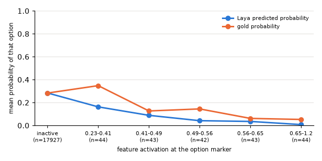

# Feature 11280

Critérios em que aparece: corr_error

**Interpretação (preencher):** 

---

## Maiores ativações

**tr_customer_service_000257 / needs_human** (noul, customer_service) | ativação 15.133 em `estado` | opções ['false', 'true'] | Laya: **true** [0.072, 0.928] | gabarito: **false**

```
<bos> noul question: This conversation requires a human agent rather than automated handling.<eos>
▸ <mask> false: Automation can carry this to resolution.
▸ <mask> true: A human must take over: judgement, authority or empathy is required.

<eos>

 {"account": {"lifetime_value_usd": 131, "prior_tickets_90d": 1, "seats": 1, "tenure_months": 5, "tier": "standard"}, "orders": [{"amount_usd": 447, "date": "2026-03-22", "id": "A-40460", "status": "settled"}, {"amount_usd": 447, "date": "2026-02-25", "id": "A-64478", "status": "failed"}], "thread": [{"role": "customer", "text": "What the hell? I ordered the deluxe headset⟦ for⟧ $447 and you sent me a basic mouse instead. This is unacceptable."}, {"role": "agent", "text": "I’m sorry you received the wrong item. Can you tell me the order number so I can look into the mix‑up?"}, {"role": "customer", "text": "Order #B5544LM. I need the correct headset sent to me immediately."}]}<eos>
```

**tr_customer_service_000257 / category** (choice, customer_service) | ativação 15.000 em `estado` | opções ['account', 'billing', 'delivery', 'refund', 'technical'] | Laya: **billing** [0.021, 0.742, 0.029, 0.125, 0.083] | gabarito: **delivery**

```
<bos> choice question: What is this customer conversation primarily about?<eos>
▸ <mask> account: Login, plan changes, profile or access management.
▸ <mask> billing: A charge, invoice, subscription or payment problem.
▸ <mask> delivery: Shipping, fulfilment or delivery of a physical item.
▸ <mask> refund: The customer is explicitly asking for money back.
▸ <mask> technical: The product or service is not working as expected.

<eos>

 {"account": {"lifetime_value_usd": 131, "prior_tickets_90d": 1, "seats": 1, "tenure_months": 5, "tier": "standard"}, "orders": [{"amount_usd": 447, "date": "2026-03-22", "id": "A-40460", "status": "settled"}, {"amount_usd": 447, "date": "2026-02-25", "id": "A-64478", "status": "failed"}], "thread": [{"role": "customer", "text": "What the hell? I ordered the deluxe headset⟦ for⟧ $447 and you sent me a basic mouse instead. This is unacceptable."}, {"role": "agent", "text": "I’m sorry you received the wrong item. Can you tell me the order number so I can look into the mix‑up?"}, {"role": "customer", "text": "Order #B5544LM. I need the correct headset sent to me immediately."}]}<eos>
```

**tr_customer_service_000257 / action** (choice, customer_service) | ativação 14.734 em `estado` | opções ['answer_directly', 'close_no_action', 'escalate_to_human', 'execute_refund', 'request_information'] | Laya: **execute_refund** [0.074, 0.013, 0.002, 0.91, 0.001] | gabarito: **answer_directly**

```
<bos> choice question: What should the assistant do next with this conversation?<eos>
▸ <mask> answer_directly: The assistant can resolve this itself with information it already has.
▸ <mask> close_no_action: No further action is warranted; the matter is settled.
▸ <mask> escalate_to_human: Hand off to a human agent with the appropriate authority.
▸ <mask> execute_refund: Issue the refund or credit the customer is owed.
▸ <mask> request_information: More detail is needed from the customer before anything can be done.

<eos>

 {"account": {"lifetime_value_usd": 131, "prior_tickets_90d": 1, "seats": 1, "tenure_months": 5, "tier": "standard"}, "orders": [{"amount_usd": 447, "date": "2026-03-22", "id": "A-40460", "status": "settled"}, {"amount_usd": 447, "date": "2026-02-25", "id": "A-64478", "status": "failed"}], "thread": [{"role": "customer", "text": "What the hell? I ordered the deluxe headset⟦ for⟧ $447 and you sent me a basic mouse instead. This is unacceptable."}, {"role": "agent", "text": "I’m sorry you received the wrong item. Can you tell me the order number so I can look into the mix‑up?"}, {"role": "customer", "text": "Order #B5544LM. I need the correct headset sent to me immediately."}]}<eos>
```

**tr_customer_service_000257 / churn_risk** (score, customer_service) | ativação 14.656 em `estado` | opções ['0', '1', '2', '3'] | Laya: **2** [0.122, 0.268, 0.498, 0.112] | gabarito: **2**

```
<bos> score question: How likely is this customer to stop doing business with us because of this interaction?<eos>
▸ <mask> level 0: No sign of dissatisfaction.
▸ <mask> level 1: Mild frustration, but the relationship is intact.
▸ <mask> level 2: Clearly unhappy; repeat problems or explicit complaints.
▸ <mask> level 3: Imminent: threatening to cancel, dispute or leave.

<eos>

 {"account": {"lifetime_value_usd": 131, "prior_tickets_90d": 1, "seats": 1, "tenure_months": 5, "tier": "standard"}, "orders": [{"amount_usd": 447, "date": "2026-03-22", "id": "A-40460", "status": "settled"}, {"amount_usd": 447, "date": "2026-02-25", "id": "A-64478", "status": "failed"}], "thread": [{"role": "customer", "text": "What the hell? I ordered the deluxe headset⟦ for⟧ $447 and you sent me a basic mouse instead. This is unacceptable."}, {"role": "agent", "text": "I’m sorry you received the wrong item. Can you tell me the order number so I can look into the mix‑up?"}, {"role": "customer", "text": "Order #B5544LM. I need the correct headset sent to me immediately."}]}<eos>
```

**tr_customer_service_000257 / urgency** (score, customer_service) | ativação 14.500 em `estado` | opções ['0', '1', '2', '3'] | Laya: **2** [0.05, 0.28, 0.507, 0.162] | gabarito: **3**

```
<bos> score question: How time-sensitive is this conversation?<eos>
▸ <mask> level 0: No time pressure; can wait indefinitely.
▸ <mask> level 1: Routine; handle within the normal queue.
▸ <mask> level 2: Elevated; should be handled within the same week.
▸ <mask> level 3: Critical; requires action within the same day.

<eos>

 {"account": {"lifetime_value_usd": 131, "prior_tickets_90d": 1, "seats": 1, "tenure_months": 5, "tier": "standard"}, "orders": [{"amount_usd": 447, "date": "2026-03-22", "id": "A-40460", "status": "settled"}, {"amount_usd": 447, "date": "2026-02-25", "id": "A-64478", "status": "failed"}], "thread": [{"role": "customer", "text": "What the hell? I ordered the deluxe headset⟦ for⟧ $447 and you sent me a basic mouse instead. This is unacceptable."}, {"role": "agent", "text": "I’m sorry you received the wrong item. Can you tell me the order number so I can look into the mix‑up?"}, {"role": "customer", "text": "Order #B5544LM. I need the correct headset sent to me immediately."}]}<eos>
```

## Ativações medianas (faixa 40-60%, mediana 1.272)

**tr_invoice_processing_000030 / discrepancy_severity** (score, invoice_processing) | ativação 1.185 em `estado` | opções ['0', '1', '2', '3'] | Laya: **2** [0.057, 0.329, 0.57, 0.043] | gabarito: **2**

```
<bos> score question: How material is any discrepancy between the invoice, the order and the delivery?<eos>
▸ <mask> level 0: None: everything reconciles.
▸ <mask> level 1: Trivial: rounding or a cosmetic difference.
▸ <mask> level 2: Moderate: a real difference worth confirming.
▸ <mask> level 3: Material: a large or unexplained difference.

<eos>

 {"delivery": {"condition": "accepted", "date": "2026-03-15", "received_qty": 395}, "invoice": {"currency": "USD", "id": "INV-2026-7485", "lines": [{"qty": 395, "sku": "SKU-439", "total_usd": 123820.65, "unit_usd": 313.47}], "total_usd": 123820.65, "vendor": "Orbit Logistics"}, "payment": {"days_until_due": 44, "discount_expires_in_days": null, "early_payment_discount_pct": null, "status": "scheduled", "terms": "net 60"}, "purchase_order": {"freight_terms": "freight prepaid by vendor, not separately billable", "id": "PO-8050", "lines": [{"qty": 400, "unit_⟦usd⟧": 313.47}], "total_usd": 125388.0}, "vendor_history": {"disputes_12m": 2, "invoices_12m": 31, "prior_invoice_ids": ["INV-2026-6077", "INV-2026-4627"]}}<eos>
```

**tr_invoice_processing_000036 / discrepancy_severity** (score, invoice_processing) | ativação 1.143 em `estado` | opções ['0', '1', '2', '3'] | Laya: **2** [0.066, 0.337, 0.552, 0.045] | gabarito: **2**

```
<bos> score question: How material is any discrepancy between the invoice, the order and the delivery?<eos>
▸ <mask> level 0: None: everything reconciles.
▸ <mask> level 1: Trivial: rounding or a cosmetic difference.
▸ <mask> level 2: Moderate: a real difference worth confirming.
▸ <mask> level 3: Material: a large or unexplained difference.

<eos>

 {"delivery": {"condition": "accepted", "date": "2026-03-15", "received_qty": 250}, "invoice": {"currency": "USD", "id": "INV-2026-5401", "lines": [{"qty": 250, "sku": "SKU-440", "total_usd": 1204⟦5⟧.0, "unit_usd": 48.18}, {"qty": 1, "sku": "FREIGHT", "total_usd": 646.19, "unit_usd": 646.19}], "total_usd": 12691.19, "vendor": "Orbit Logistics"}, "payment": {"days_until_due": 27, "discount_expires_in_days": 7, "early_payment_discount_pct": 2.0, "status": "scheduled", "terms": "net 30"}, "purchase_order": {"freight_terms": "freight prepaid by vendor, not separately billable", "id": "PO-4489", "lines": [{"qty": 250, "unit_usd": 48.18}], "total_usd": 12045.0}, "vendor_history": {"disputes_12m": 1, "invoices_12m": 53, "prior_invoice_ids": ["INV-2026-1271", "INV-2026-5652", "INV-2026-6719", "INV-2026-7885"]}}<eos>
```

**tr_customer_service_000107 / churn_risk** (score, customer_service) | ativação 1.466 em `estado` | opções ['0', '1', '2', '3'] | Laya: **1** [0.173, 0.58, 0.162, 0.085] | gabarito: **2**

```
<bos> score question: How likely is this customer to stop doing business with us because of this interaction?<eos>
▸ <mask> level 0: No sign of dissatisfaction.
▸ <mask> level 1: Mild frustration, but the relationship is intact.
▸ <mask> level 2: Clearly unhappy; repeat problems or explicit complaints.
▸ <mask> level 3: Imminent: threatening to cancel, dispute or leave.

<eos>

 {"account": {"lifetime_value_usd": 224, "prior_tickets_90d": 0, "seats": 1, "tenure_months": 8, "tier": "premium"}, "thread": [{"role": "customer", "text": "I received the item yesterday and it⟦ was⟧ damaged. After eight months on the premium plan, this is the last thing I need!"}]}<eos>
```

**tr_invoice_processing_000243 / urgency** (score, invoice_processing) | ativação 1.146 em `estado` | opções ['0', '1', '2', '3'] | Laya: **1** [0.104, 0.435, 0.316, 0.145] | gabarito: **1**

```
<bos> score question: How time-sensitive is processing this invoice?<eos>
▸ <mask> level 0: No time pressure; can wait indefinitely.
▸ <mask> level 1: Routine; handle within the normal queue.
▸ <mask> level 2: Elevated; should be handled within the same week.
▸ <mask> level 3: Critical; requires action within the same day.

<eos>

 {"delivery": {"condition": "accepted", "date": "2026-03-21", "received_qty": 1000}, "invoice": {"currency": "USD", "id": "INV-2026-2996", "lines": [{"qty": 1000, "sku": "SKU-704", "total_⟦usd⟧": 347130.0, "unit_usd": 347.13}, {"qty": 1, "sku": "FREIGHT", "total_usd": 328.32, "unit_usd": 328.32}], "total_usd": 347458.32, "vendor": "Orbit Logistics"}, "payment": {"days_until_due": 0, "discount_expires_in_days": null, "early_payment_discount_pct": null, "status": "scheduled", "terms": "net 30"}, "purchase_order": {"freight_terms": "freight prepaid by vendor, not separately billable", "id": "PO-9513", "lines": [{"qty": 1000, "unit_usd": 347.13}], "total_usd": 347130.0}, "vendor_history": {"disputes_12m": 2, "invoices_12m": 16, "prior_invoice_ids": ["INV-2026-2361", "INV-2026-8993", "INV-2026-3050"]}}<eos>
```

**tr_invoice_processing_000080 / urgency** (score, invoice_processing) | ativação 1.295 em `estado` | opções ['0', '1', '2', '3'] | Laya: **1** [0.084, 0.544, 0.23, 0.142] | gabarito: **1**

```
<bos> score question: How time-sensitive is processing this invoice?<eos>
▸ <mask> level 0: No time pressure; can wait indefinitely.
▸ <mask> level 1: Routine; handle within the normal queue.
▸ <mask> level 2: Elevated; should be handled within the same week.
▸ <mask> level 3: Critical; requires action within the same day.

<eos>

 {"delivery": {"condition": "accepted", "date": "2026-03-28", "received_qty": 10}, "invoice": {"currency": "USD", "id": "INV-2026-1868", "lines": [{"qty": 10, "sku": "SKU-800", "total_usd": 3965.4, "unit_usd": 396.54}], "total_usd": 3965.4, "vendor": "Northwind Components"}, "payment": {"days_until_due": 27, "discount_expires_in_days": null, "early_payment_discount_pct": null, "status": "scheduled", "terms": "net 30"}, "purchase_order": {"freight_terms": "freight prepaid by vendor, not separately billable", "id": "PO-2745", "lines": [{"qty": 10, "unit_usd⟦":⟧ 396.54}], "total_usd": 3965.4}, "vendor_history": {"disputes_12m": 0, "invoices_12m": 47, "prior_invoice_ids": ["INV-2026-5326", "INV-2026-4195", "INV-2026-1644", "INV-2026-9397"]}}<eos>
```

## Estatísticas (conjunto de descoberta, dev e teste)

**pred / error**

| split | decisões | ativas | ativas e Laya errou | taxa | lift | q (BH) | OR (CMH) | q (CMH) |
|---|---|---|---|---|---|---|---|---|
| discovery | 5100 | 5 | 5 | 1.000 | 1.55 | nan | nan | nan |
| dev | 900 | 1 | 0 | 0.000 | 0.00 | nan | nan | nan |
| test | 2000 | 1 | 1 | 1.000 | 1.54 | nan | nan | nan |

**corr / error**

| split | decisões | ativas | ativas e Laya errou | taxa | lift | q (BH) | OR (CMH) | q (CMH) |
|---|---|---|---|---|---|---|---|---|
| discovery | 5100 | 30 | 30 | 1.000 | 1.55 | 7.89e-06 | inf | 0.282 |
| dev | 900 | 6 | 5 | 0.833 | 1.24 | nan | nan | nan |
| test | 2000 | 11 | 11 | 1.000 | 1.54 | nan | nan | nan |

**state / error**

| split | decisões | ativas | ativas e Laya errou | taxa | lift | q (BH) | OR (CMH) | q (CMH) |
|---|---|---|---|---|---|---|---|---|
| discovery | 5100 | 3700 | 2390 | 0.646 | 1.00 | 0.753 | 0.89 | 0.416 |
| dev | 900 | 688 | 466 | 0.677 | 1.01 | 0.91 | 0.80 | 0.667 |
| test | 2000 | 1415 | 929 | 0.657 | 1.01 | 0.698 | 0.96 | 0.903 |

**pred / probe_right_laya_wrong**

| split | decisões | ativas | ativas e Laya errou | taxa | lift | q (BH) | OR (CMH) | q (CMH) |
|---|---|---|---|---|---|---|---|---|
| discovery | 2932 | 3 | 3 | 1.000 | 1.65 | nan | nan | nan |
| dev | 523 | 0 | 0 | nan | nan | nan | nan | nan |
| test | 1149 | 0 | 0 | nan | nan | nan | nan | nan |

**corr / probe_right_laya_wrong**

| split | decisões | ativas | ativas e Laya errou | taxa | lift | q (BH) | OR (CMH) | q (CMH) |
|---|---|---|---|---|---|---|---|---|
| discovery | 2932 | 4 | 4 | 1.000 | 1.65 | nan | nan | nan |
| dev | 523 | 2 | 2 | 1.000 | 1.55 | nan | nan | nan |
| test | 1149 | 2 | 2 | 1.000 | 1.64 | nan | nan | nan |

**state / probe_right_laya_wrong**

| split | decisões | ativas | ativas e Laya errou | taxa | lift | q (BH) | OR (CMH) | q (CMH) |
|---|---|---|---|---|---|---|---|---|
| discovery | 2932 | 2141 | 1321 | 0.617 | 1.02 | 0.0818 | 0.90 | 0.565 |
| dev | 523 | 415 | 273 | 0.658 | 1.02 | 0.652 | 0.88 | 0.857 |
| test | 1149 | 829 | 500 | 0.603 | 0.99 | 0.675 | 0.67 | 0.14 |

Confusão mais sobre-representada (pred): `true_positive|0>1` (n=3, lift 139.09, p=nan). Formato `pergunta|índice previsto>índice correto`.

Confusão mais sobre-representada (corr): `outcome|3>1` (n=12, lift 56.67, p=1.57e-19). Formato `pergunta|índice previsto>índice correto`.

Confusão mais sobre-representada (state): `duplicate|1>0` (n=217, lift 1.38, p=9.45e-32). Formato `pergunta|índice previsto>índice correto`.



