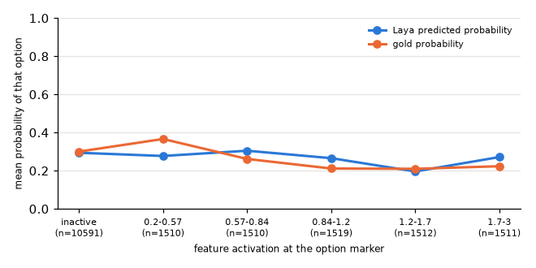

# Feature 11303

Critérios em que aparece: attribution_toward_wrong

**Interpretação (preencher):** 

---

## Maiores ativações

**tr_invoice_processing_000115 / discrepancy_severity** (score, invoice_processing) | ativação 3.807 em `opção` | opções ['0', '1', '2', '3'] | Laya: **2** [0.062, 0.438, 0.468, 0.032] | gabarito: **2**

```
<bos> score question: How material is any discrepancy between the invoice, the order and the delivery?<eos>
▸ <mask> level 0: None: everything reconciles.
▸ <mask> level 1⟦:⟧ Trivial: rounding or a cosmetic difference.
▸ <mask> level 2: Moderate: a real difference worth confirming.
▸ <mask> level 3: Material: a large or unexplained difference.

<eos>

 {"delivery": {"condition": "accepted", "date": "2026-03-01", "received_qty": 250}, "invoice": {"currency": "USD", "id": "INV-2026-2237", "lines": [{"qty": 250, "sku": "SKU-253", "total_usd": 43517.5, "unit_usd": 174.07}], "total_usd": 43517.5, "vendor": "Acme Fabrication"}, "payment": {"days_until_due": -21, "discount_expires_in_days": 6, "early_payment_discount_pct": 2.0, "status": "overdue", "terms": "net 15"}, "purchase_order": {"freight_terms": "freight prepaid by vendor, not separately billable", "id": "PO-2032", "lines": [{"qty": 250, "unit_usd": 169.0}], "total_usd": 42250.0}, "vendor_history": {"disputes_12m": 1, "invoices_12m": 42, "prior_invoice_ids": ["INV-2026-7782", "INV-2026-3580", "INV-2026-5842"]}}<eos>
```

**tr_invoice_processing_000100 / discrepancy_severity** (score, invoice_processing) | ativação 3.791 em `opção` | opções ['0', '1', '2', '3'] | Laya: **2** [0.058, 0.238, 0.648, 0.057] | gabarito: **0**

```
<bos> score question: How material is any discrepancy between the invoice, the order and the delivery?<eos>
▸ <mask> level 0: None: everything reconciles.
▸ <mask> level 1⟦:⟧ Trivial: rounding or a cosmetic difference.
▸ <mask> level 2: Moderate: a real difference worth confirming.
▸ <mask> level 3: Material: a large or unexplained difference.

<eos>

 {"delivery": {"condition": "accepted", "date": "2026-03-06", "received_qty": 25}, "invoice": {"currency": "USD", "id": "INV-2026-3933", "lines": [{"qty": 25, "sku": "SKU-346", "total_usd": 5973.25, "unit_usd": 238.93}], "total_usd": 5973.25, "vendor": "Acme Fabrication"}, "payment": {"days_until_due": 44, "discount_expires_in_days": 3, "early_payment_discount_pct": 2.0, "status": "scheduled", "terms": "net 30"}, "purchase_order": {"freight_terms": "freight prepaid by vendor, not separately billable", "id": null, "lines": [{"qty": 25, "unit_usd": 238.93}], "total_usd": 5973.25}, "vendor_history": {"disputes_12m": 1, "invoices_12m": 6, "prior_invoice_ids": ["INV-2026-7649"]}}<eos>
```

**tr_invoice_processing_000297 / discrepancy_severity** (score, invoice_processing) | ativação 3.770 em `opção` | opções ['0', '1', '2', '3'] | Laya: **2** [0.093, 0.329, 0.533, 0.045] | gabarito: **2**

```
<bos> score question: How material is any discrepancy between the invoice, the order and the delivery?<eos>
▸ <mask> level 0: None: everything reconciles.
▸ <mask> level 1⟦:⟧ Trivial: rounding or a cosmetic difference.
▸ <mask> level 2: Moderate: a real difference worth confirming.
▸ <mask> level 3: Material: a large or unexplained difference.

<eos>

 {"delivery": {"condition": "accepted with exceptions", "date": "2026-03-24", "received_qty": 1000}, "invoice": {"currency": "USD", "id": "INV-2026-9367", "lines": [{"qty": 1000, "sku": "SKU-121", "total_usd": 324400.0, "unit_usd": 324.4}], "total_usd": 324400.0, "vendor": "Pallas Industrial"}, "payment": {"days_until_due": 27, "discount_expires_in_days": null, "early_payment_discount_pct": null, "status": "scheduled", "terms": "net 30"}, "purchase_order": {"freight_terms": "freight prepaid by vendor, not separately billable", "id": "PO-8518", "lines": [{"qty": 1000, "unit_usd": 314.95}], "total_usd": 314950.0}, "vendor_history": {"disputes_12m": 0, "invoices_12m": 28, "prior_invoice_ids": ["INV-2026-2134"]}}<eos>
```

**tr_invoice_processing_000091 / urgency** (score, invoice_processing) | ativação 3.740 em `opção` | opções ['0', '1', '2', '3'] | Laya: **1** [0.113, 0.51, 0.225, 0.152] | gabarito: **3**

```
<bos> score question: How time-sensitive is processing this invoice?<eos>
▸ <mask> level 0: No time pressure; can wait indefinitely.
▸ <mask>⟦ level⟧ 1: Routine; handle within the normal queue.
▸ <mask> level 2: Elevated; should be handled within the same week.
▸ <mask> level 3: Critical; requires action within the same day.

<eos>

 {"delivery": {"condition": "accepted", "date": "2026-03-05", "received_qty": 50}, "invoice": {"currency": "USD", "id": "INV-2026-1102", "lines": [{"qty": 50, "sku": "SKU-658", "total_usd": 15868.0, "unit_usd": 317.36}], "total_usd": 15868.0, "vendor": "Acme Fabrication"}, "payment": {"days_until_due": -9, "discount_expires_in_days": 4, "early_payment_discount_pct": 2.0, "status": "overdue", "terms": "net 15"}, "purchase_order": {"freight_terms": "freight prepaid by vendor, not separately billable", "id": "PO-1320", "lines": [{"qty": 50, "unit_usd": 317.36}], "total_usd": 15868.0}, "vendor_history": {"disputes_12m": 1, "invoices_12m": 1, "prior_invoice_ids": ["INV-2026-1102", "INV-2026-8587", "INV-2026-9515"]}}<eos>
```

**tr_invoice_processing_000076 / discrepancy_severity** (score, invoice_processing) | ativação 3.730 em `opção` | opções ['0', '1', '2', '3'] | Laya: **2** [0.064, 0.306, 0.594, 0.037] | gabarito: **3**

```
<bos> score question: How material is any discrepancy between the invoice, the order and the delivery?<eos>
▸ <mask> level 0: None: everything reconciles.
▸ <mask> level 1⟦:⟧ Trivial: rounding or a cosmetic difference.
▸ <mask> level 2: Moderate: a real difference worth confirming.
▸ <mask> level 3: Material: a large or unexplained difference.

<eos>

 {"delivery": {"condition": "accepted", "date": "2026-03-03", "received_qty": 50}, "invoice": {"currency": "USD", "id": "INV-2026-7325", "lines": [{"qty": 50, "sku": "SKU-282", "total_usd": 24438.5, "unit_usd": 488.77}], "total_usd": 24438.5, "vendor": "Pallas Industrial"}, "payment": {"days_until_due": 11, "discount_expires_in_days": null, "early_payment_discount_pct": null, "status": "scheduled", "terms": "net 30"}, "purchase_order": {"freight_terms": "freight prepaid by vendor, not separately billable", "id": "PO-3572", "lines": [{"qty": 50, "unit_usd": 436.4}], "total_usd": 21820.0}, "vendor_history": {"disputes_12m": 0, "invoices_12m": 20, "prior_invoice_ids": ["INV-2026-6186", "INV-2026-6194", "INV-2026-8302"]}}<eos>
```

## Ativações medianas (faixa 40-60%, mediana 0.886)

**tr_customer_service_000101 / urgency** (score, customer_service) | ativação 0.739 em `estado` | opções ['0', '1', '2', '3'] | Laya: **1** [0.044, 0.536, 0.272, 0.148] | gabarito: **1**

```
<bos> score question: How time-sensitive is this conversation?<eos>
▸ <mask> level 0: No time pressure; can wait indefinitely.
▸ <mask> level 1: Routine; handle within the normal queue.
▸ <mask> level 2: Elevated; should be handled within the same week.
▸ <mask> level 3: Critical; requires action within the same day.

<eos>

 {"account": {"lifetime_value_usd": 1434, "prior_tickets_90d": 0, "seats": 1, "tenure_months": 19, "tier": "free"}, "orders": [{"amount_usd": 299, "date": "2026-01-27", "id": "A-79408", "status": "settled"}, {"amount_usd": 299, "date": "2026-01-08", "id": "A-76545", "status": "refunded"}, {"amount_usd": 299, "date": "2026-03-21", "id": "A-26681", "status": "settled"}], "thread": [{"role": "customer", "text": "Um, I’m a bit lost here. I ordered something that cost about $299 a few weeks ago on my free account (been with you 19 months), but the package I opened doesn’t match what I thought I bought."}, {"role": "agent", "text⟦":⟧ "I understand the confusion. Can you tell me the order reference and describe the item you received compared to what you expected?"}, {"role": "customer", "text": "The reference is #B12345. I was expecting the deluxe headset, but the box contains a basic speaker set. What can be done about this?"}]}<eos>
```

**tr_invoice_processing_000109 / discrepancy_severity** (score, invoice_processing) | ativação 0.745 em `marcador` | opções ['0', '1', '2', '3'] | Laya: **2** [0.065, 0.33, 0.539, 0.065] | gabarito: **3**

```
<bos> score question: How material is any discrepancy between the invoice, the order and the delivery?<eos>
▸ <mask> level 0: None: everything reconciles.
▸ <mask> level 1: Trivial: rounding or a cosmetic difference.
▸ ⟦<mask>⟧ level 2: Moderate: a real difference worth confirming.
▸ <mask> level 3: Material: a large or unexplained difference.

<eos>

 {"delivery": {"condition": "accepted", "date": "2026-03-13", "received_qty": 50}, "invoice": {"currency": "USD", "id": "INV-2026-1558", "lines": [{"qty": 100, "sku": "SKU-351", "total_usd": 8003.0, "unit_usd": 80.03}], "total_usd": 8003.0, "vendor": "Vantage Materials"}, "payment": {"days_until_due": 44, "discount_expires_in_days": null, "early_payment_discount_pct": null, "status": "scheduled", "terms": "net 30"}, "purchase_order": {"freight_terms": "freight prepaid by vendor, not separately billable", "id": "PO-3499", "lines": [{"qty": 50, "unit_usd": 80.03}], "total_usd": 4001.5}, "vendor_history": {"disputes_12m": 0, "invoices_12m": 9, "prior_invoice_ids": ["INV-2026-2254", "INV-2026-7618", "INV-2026-3837", "INV-2026-2225"]}}<eos>
```

**tr_customer_service_000296 / urgency** (score, customer_service) | ativação 0.915 em `opção` | opções ['0', '1', '2', '3'] | Laya: **1** [0.268, 0.344, 0.15, 0.237] | gabarito: **3**

```
<bos> score question: How time-sensitive is this conversation?<eos>
▸ <mask> level 0: No time pressure; can wait indefinitely⟦.⟧
▸ <mask> level 1: Routine; handle within the normal queue.
▸ <mask> level 2: Elevated; should be handled within the same week.
▸ <mask> level 3: Critical; requires action within the same day.

<eos>

 {"account": {"lifetime_value_usd": 154, "prior_tickets_90d": 0, "seats": 1, "tenure_months": 2, "tier": "free"}, "thread": [{"role": "customer", "text": "We have a launch in two hours and need to reassign seats on our free plan—add three new users and remove two that left. This has to happen now."}, {"role": "agent", "text": "I understand the timing is tight. Could you give me the email addresses of the users you’d like to add and the ones you want removed?"}, {"role": "customer", "text": "Add: alice@example.com, bob@example.com, carol@example.com. Remove: dave@example.com and eve@example.com. I need the changes reflected instantly."}, {"role": "agent", "text": "Thanks for the list. I’ll process those seat changes right away. Would you like a confirmation email once the updates are applied?"}, {"role": "customer", "text": "Yes, send the confirmation now and make sure the seats are active before our launch; we can’t afford any delay."}]}<eos>
```

**tr_customer_service_000056 / churn_risk** (score, customer_service) | ativação 0.790 em `estado` | opções ['0', '1', '2', '3'] | Laya: **3** [0.03, 0.118, 0.12, 0.732] | gabarito: **3**

```
<bos> score question: How likely is this customer to stop doing business with us because of this interaction?<eos>
▸ <mask> level 0: No sign of dissatisfaction.
▸ <mask> level 1: Mild frustration, but the relationship is intact.
▸ <mask> level 2: Clearly unhappy; repeat problems or explicit complaints.
▸ <mask> level 3: Imminent: threatening to cancel, dispute or leave.

<eos>

 {"account": {"lifetime_value_usd": 2311, "prior_tickets_90d": 1, "seats": 1, "tenure_months": 26, "tier": "premium"}, "thread": [{"role": "customer", "text": "I’ve been a premium member for 26 months and the package I got today is completely wrong – it’s not even the model I ordered."}, {"role": "agent", "text": "I’m sorry to hear that. Could you share the order number so I can look into it?"⟦},⟧ {"role": "customer", "text": "It’s the same issue we fought over in ticket #12345 – you promised it would be fixed and now you’ve shipped the wrong item again. I’m done with this."}, {"role": "agent", "text": "I understand your frustration. Would you be able to send a photo of what you received?"}, {"role": "customer", "text": "I’ve been paying for the premium plan for over two years and I expect this to be sorted out fast, otherwise I’m walking away."}, {"role": "agent", "text": "I hear you. I’ll forward this to our escalation team right away. Could you confirm the shipping address on the account?"}, {"role": "customer", "text": "I need this sorted now, or I’m out."}]}<eos>
```

**tr_customer_service_000034 / category** (choice, customer_service) | ativação 0.942 em `opção` | opções ['account', 'billing', 'delivery', 'refund', 'technical'] | Laya: **delivery** [0.0, 0.0, 0.997, 0.0, 0.002] | gabarito: **delivery**

```
<bos> choice question: What is this customer conversation primarily about?<eos>
▸ <mask> account: Login, plan changes, profile or access management.
▸ <mask> billing: A charge, invoice, subscription or payment problem⟦.⟧
▸ <mask> delivery: Shipping, fulfilment or delivery of a physical item.
▸ <mask> refund: The customer is explicitly asking for money back.
▸ <mask> technical: The product or service is not working as expected.

<eos>

 {"account": {"lifetime_value_usd": 102, "prior_tickets_90d": 1, "seats": 1, "tenure_months": 2, "tier": "standard"}, "thread": [{"role": "customer", "text": "I just opened my delivery and the item is in pieces, but the shipping box looks totally fine? I don't understand how this happened. I have a hard deadline for a project this Friday and if this isn't resolved by then, I'm closing my account and going to a competitor."}, {"role": "agent", "text": "I'm sorry to hear that your item arrived damaged. Could you please provide a few more details about the state of the internal protective packaging when you first opened it?"}, {"role": "customer", "text": "The bubble wrap was there but it clearly didn't do anything. I've only been with you for two months and my first ticket about the setup is still unresolved; I really can't afford to wait past Friday for a solution on this."}]}<eos>
```

## Estatísticas (conjunto de descoberta, dev e teste)

**pred / error**

| split | decisões | ativas | ativas e Laya errou | taxa | lift | q (BH) | OR (CMH) | q (CMH) |
|---|---|---|---|---|---|---|---|---|
| discovery | 5100 | 2009 | 1355 | 0.674 | 1.05 | 0.000735 | 0.91 | 0.738 |
| dev | 900 | 399 | 276 | 0.692 | 1.03 | 0.491 | 0.74 | 0.774 |
| test | 2000 | 801 | 572 | 0.714 | 1.10 | 9.82e-06 | 0.87 | 0.921 |

**corr / error**

| split | decisões | ativas | ativas e Laya errou | taxa | lift | q (BH) | OR (CMH) | q (CMH) |
|---|---|---|---|---|---|---|---|---|
| discovery | 5100 | 1919 | 1265 | 0.659 | 1.02 | 0.101 | 0.89 | 0.556 |
| dev | 900 | 371 | 248 | 0.668 | 0.99 | 0.946 | 0.69 | 0.627 |
| test | 2000 | 716 | 487 | 0.680 | 1.05 | 0.0588 | 0.90 | 0.895 |

**state / error**

| split | decisões | ativas | ativas e Laya errou | taxa | lift | q (BH) | OR (CMH) | q (CMH) |
|---|---|---|---|---|---|---|---|---|
| discovery | 5100 | 4176 | 2655 | 0.636 | 0.99 | 0.0402 | 0.88 | 0.44 |
| dev | 900 | 781 | 522 | 0.668 | 0.99 | 0.906 | 0.76 | 0.651 |
| test | 2000 | 1700 | 1095 | 0.644 | 0.99 | 0.439 | 0.91 | 0.832 |

**pred / probe_right_laya_wrong**

| split | decisões | ativas | ativas e Laya errou | taxa | lift | q (BH) | OR (CMH) | q (CMH) |
|---|---|---|---|---|---|---|---|---|
| discovery | 2932 | 1074 | 678 | 0.631 | 1.04 | 0.0516 | 0.72 | 0.331 |
| dev | 523 | 197 | 131 | 0.665 | 1.03 | 0.706 | 0.66 | 0.87 |
| test | 1149 | 424 | 286 | 0.675 | 1.10 | 0.00248 | 0.40 | 0.235 |

**corr / probe_right_laya_wrong**

| split | decisões | ativas | ativas e Laya errou | taxa | lift | q (BH) | OR (CMH) | q (CMH) |
|---|---|---|---|---|---|---|---|---|
| discovery | 2932 | 1117 | 721 | 0.645 | 1.07 | 0.000916 | 0.71 | 0.224 |
| dev | 523 | 216 | 150 | 0.694 | 1.07 | 0.0979 | 0.83 | 0.827 |
| test | 1149 | 410 | 272 | 0.663 | 1.09 | 0.0127 | 0.41 | 0.0534 |

**state / probe_right_laya_wrong**

| split | decisões | ativas | ativas e Laya errou | taxa | lift | q (BH) | OR (CMH) | q (CMH) |
|---|---|---|---|---|---|---|---|---|
| discovery | 2932 | 2388 | 1431 | 0.599 | 0.99 | 0.271 | 0.89 | 0.602 |
| dev | 523 | 452 | 288 | 0.637 | 0.99 | 0.654 | 0.63 | 0.472 |
| test | 1149 | 985 | 596 | 0.605 | 0.99 | 0.614 | 0.88 | 0.79 |

Confusão mais sobre-representada (pred): `urgency|1>2` (n=209, lift 2.54, p=0). Formato `pergunta|índice previsto>índice correto`.

Confusão mais sobre-representada (corr): `discrepancy_severity|2>0` (n=108, lift 2.66, p=0). Formato `pergunta|índice previsto>índice correto`.

Confusão mais sobre-representada (state): `duplicate|1>0` (n=217, lift 1.22, p=5.09e-20). Formato `pergunta|índice previsto>índice correto`.



