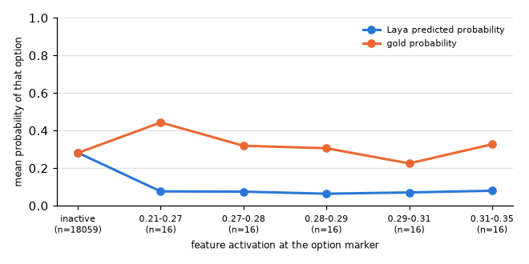

# Feature 11551

Critérios em que aparece: corr_probe_right_laya_wrong

**Interpretação (preencher):** 

---

## Maiores ativações

**tr_security_incidents_000299 / credential_compromise** (noul, security_incidents) | ativação 11.461 em `estado` | opções ['false', 'true'] | Laya: **true** [0.334, 0.666] | gabarito: **true**

```
<bos> noul question: The evidence indicates a credential or account has been compromised.<eos>
▸ <mask> false: no, the statement does not hold
▸ <mask> true: yes, the statement holds

<eos>

 {"alert": {"description": "an unusual volume of files read in a short window", "evidence": "A privileged administrator account without MFA enabled initiated an unusually⟦ high⟧ volume of file read operations from an unrecognized source. This activity took place during a non-change window, exactly 30 days after the principal's credentials were last updated.", "rule": "mass_download"}, "context": {"asset_criticality": "medium", "change_window_active": false, "source_on_allowlist": false}, "history": {"credential_rotation_days_ago": 30, "distinct_countries_30d": 4, "logins_30d": 1329, "prior_alerts_90d": 0}, "principal": {"mfa_enrolled": false, "name": "svc-analytics-679", "privileges": ["deploy:production", "secrets:read"], "type": "admin"}}<eos>
```

**tr_security_incidents_000299 / disposition** (choice, security_incidents) | ativação 11.070 em `estado` | opções ['close_benign', 'contain', 'investigate', 'monitor'] | Laya: **monitor** [0.113, 0.115, 0.126, 0.645] | gabarito: **investigate**

```
<bos> choice question: How should this security alert be dispositioned?<eos>
▸ <mask> close_benign: Expected, explainable activity; close without analyst time.
▸ <mask> contain: Contain the host or account immediately; do not wait for triage.
▸ <mask> investigate: Warrants an analyst opening an investigation.
▸ <mask> monitor: Not clearly malicious, but worth watching for recurrence.

<eos>

 {"alert": {"description": "an unusual volume of files read in a short window", "evidence": "A privileged administrator account without MFA enabled initiated an unusually⟦ high⟧ volume of file read operations from an unrecognized source. This activity took place during a non-change window, exactly 30 days after the principal's credentials were last updated.", "rule": "mass_download"}, "context": {"asset_criticality": "medium", "change_window_active": false, "source_on_allowlist": false}, "history": {"credential_rotation_days_ago": 30, "distinct_countries_30d": 4, "logins_30d": 1329, "prior_alerts_90d": 0}, "principal": {"mfa_enrolled": false, "name": "svc-analytics-679", "privileges": ["deploy:production", "secrets:read"], "type": "admin"}}<eos>
```

**tr_security_incidents_000299 / true_positive** (noul, security_incidents) | ativação 10.758 em `estado` | opções ['false', 'true'] | Laya: **true** [0.053, 0.947] | gabarito: **true**

```
<bos> noul question: This alert reflects genuinely malicious or unauthorised activity.<eos>
▸ <mask> false: Benign activity, a misconfiguration, or a known false positive.
▸ <mask> true: The underlying behaviour is malicious or unauthorised.

<eos>

 {"alert": {"description": "an unusual volume of files read in a short window", "evidence": "A privileged administrator account without MFA enabled initiated an unusually⟦ high⟧ volume of file read operations from an unrecognized source. This activity took place during a non-change window, exactly 30 days after the principal's credentials were last updated.", "rule": "mass_download"}, "context": {"asset_criticality": "medium", "change_window_active": false, "source_on_allowlist": false}, "history": {"credential_rotation_days_ago": 30, "distinct_countries_30d": 4, "logins_30d": 1329, "prior_alerts_90d": 0}, "principal": {"mfa_enrolled": false, "name": "svc-analytics-679", "privileges": ["deploy:production", "secrets:read"], "type": "admin"}}<eos>
```

**tr_security_incidents_000299 / urgency** (score, security_incidents) | ativação 10.570 em `estado` | opções ['0', '1', '2', '3'] | Laya: **1** [0.144, 0.291, 0.291, 0.274] | gabarito: **3**

```
<bos> score question: How quickly must a responder act on this alert?<eos>
▸ <mask> level 0: No time pressure; can wait indefinitely.
▸ <mask> level 1: Routine; handle within the normal queue.
▸ <mask> level 2: Elevated; should be handled within the same week.
▸ <mask> level 3: Critical; requires action within the same day.

<eos>

 {"alert": {"description": "an unusual volume of files read in a short window", "evidence": "A privileged administrator account without MFA enabled initiated an unusually⟦ high⟧ volume of file read operations from an unrecognized source. This activity took place during a non-change window, exactly 30 days after the principal's credentials were last updated.", "rule": "mass_download"}, "context": {"asset_criticality": "medium", "change_window_active": false, "source_on_allowlist": false}, "history": {"credential_rotation_days_ago": 30, "distinct_countries_30d": 4, "logins_30d": 1329, "prior_alerts_90d": 0}, "principal": {"mfa_enrolled": false, "name": "svc-analytics-679", "privileges": ["deploy:production", "secrets:read"], "type": "admin"}}<eos>
```

**tr_security_incidents_000299 / severity** (score, security_incidents) | ativação 10.539 em `estado` | opções ['0', '1', '2', '3', '4'] | Laya: **1** [0.175, 0.358, 0.221, 0.14, 0.106] | gabarito: **3**

```
<bos> score question: How severe is the potential impact if this alert is real?<eos>
▸ <mask> level 0: Negligible: no access to anything sensitive.
▸ <mask> level 1: Low: limited access, easily reversed.
▸ <mask> level 2: Moderate: access to internal systems or non-public data.
▸ <mask> level 3: High: access to production, secrets or customer data.
▸ <mask> level 4: Critical: active compromise of crown-jewel systems.

<eos>

 {"alert": {"description": "an unusual volume of files read in a short window", "evidence": "A privileged administrator account without MFA enabled initiated an unusually⟦ high⟧ volume of file read operations from an unrecognized source. This activity took place during a non-change window, exactly 30 days after the principal's credentials were last updated.", "rule": "mass_download"}, "context": {"asset_criticality": "medium", "change_window_active": false, "source_on_allowlist": false}, "history": {"credential_rotation_days_ago": 30, "distinct_countries_30d": 4, "logins_30d": 1329, "prior_alerts_90d": 0}, "principal": {"mfa_enrolled": false, "name": "svc-analytics-679", "privileges": ["deploy:production", "secrets:read"], "type": "admin"}}<eos>
```

## Ativações medianas (faixa 40-60%, mediana 3.389)

**tr_invoice_processing_000081 / urgency** (score, invoice_processing) | ativação 3.348 em `opção` | opções ['0', '1', '2', '3'] | Laya: **1** [0.126, 0.425, 0.32, 0.13] | gabarito: **3**

```
<bos> score question: How time-sensitive is processing this invoice?<eos>
▸ <mask> level 0: No time pressure; can wait indefinitely.
▸ <mask> level 1: Routine; handle within the normal queue.
▸ <mask> level 2:⟦ Elevated⟧; should be handled within the same week.
▸ <mask> level 3: Critical; requires action within the same day.

<eos>

 {"delivery": {"condition": "accepted with exceptions", "date": "2026-03-23", "received_qty": 1000}, "invoice": {"currency": "USD", "id": "INV-2026-7992", "lines": [{"qty": 1000, "sku": "SKU-899", "total_usd": 334970.0, "unit_usd": 334.97}], "total_usd": 334970.0, "vendor": "Vantage Materials"}, "payment": {"days_until_due": -3, "discount_expires_in_days": null, "early_payment_discount_pct": null, "status": "overdue", "terms": "net 30"}, "purchase_order": {"freight_terms": "freight prepaid by vendor, not separately billable", "id": "PO-7997", "lines": [{"qty": 1000, "unit_usd": 325.21}], "total_usd": 325210.0}, "vendor_history": {"disputes_12m": 0, "invoices_12m": 29, "prior_invoice_ids": ["INV-2026-4318"]}}<eos>
```

**tr_security_incidents_000044 / severity** (score, security_incidents) | ativação 3.301 em `opção` | opções ['0', '1', '2', '3', '4'] | Laya: **2** [0.145, 0.218, 0.327, 0.136, 0.175] | gabarito: **3**

```
<bos> score question: How severe is the potential impact if this alert is real?<eos>
▸ <mask> level 0: Negligible: no access to anything sensitive.
▸ <mask> level 1:⟦ Low⟧: limited access, easily reversed.
▸ <mask> level 2: Moderate: access to internal systems or non-public data.
▸ <mask> level 3: High: access to production, secrets or customer data.
▸ <mask> level 4: Critical: active compromise of crown-jewel systems.

<eos>

 {"alert": {"description": "an unrecognised binary executed on a server", "evidence": "On 2026‑09‑16 at 08:22:33 UTC, the binary file \"/opt/app/tmp/unknown_processor.bin\" (SHA‑256: a1b2c3d4e5f6…) was executed on host srv‑mail‑02 under the shared_mailbox account \"svc_alerts\" (process ID 4567). The binary is not present in the approved software inventory, the account has MFA disabled, its credentials were last changed on 2025‑03‑20 (180 days ago), and a change window was open during the execution.", "rule": "suspicious_process"}, "context": {"asset_criticality": "high", "change_window_active": true, "source_on_allowlist": true}, "history": {"credential_rotation_days_ago": 180, "distinct_countries_30d": 2, "logins_30d": 1101, "prior_alerts_90d": 0}, "principal": {"mfa_enrolled": false, "name": "ci-billing-491", "privileges": ["repo:read"], "type": "shared_mailbox"}}<eos>
```

**tr_customer_service_000012 / urgency** (score, customer_service) | ativação 3.480 em `opção` | opções ['0', '1', '2', '3'] | Laya: **1** [0.141, 0.513, 0.137, 0.209] | gabarito: **2**

```
<bos> score question: How time-sensitive is this conversation?<eos>
▸ <mask> level 0: No time pressure; can wait indefinitely.
▸ <mask> level 1: Routine; handle within the normal queue.
▸ <mask> level 2:⟦ Elevated⟧; should be handled within the same week.
▸ <mask> level 3: Critical; requires action within the same day.

<eos>

 {"account": {"lifetime_value_usd": 916, "prior_tickets_90d": 0, "seats": 1, "tenure_months": 11, "tier": "free"}, "orders": [{"amount_usd": 299, "date": "2026-02-20", "id": "A-54343", "status": "settled"}, {"amount_usd": 299, "date": "2026-03-22", "id": "A-86923", "status": "pending"}, {"amount_usd": 299, "date": "2026-03-03", "id": "A-84166", "status": "failed"}], "thread": [{"role": "customer", "text": "I just opened the box and the device is cracked. I've been with the free plan for almost a year now, paying the $299 when I upgraded, and this is disappointing."}, {"role": "agent", "text": "I'm sorry to hear the item arrived damaged. Could you let me know the model number and whether you have a photo of the damage?"}, {"role": "customer", "text": "Sure, it's model X200 and I can snap a picture, but I need to know what you can do about it before I send anything back."}]}<eos>
```

**tr_security_incidents_000226 / severity** (score, security_incidents) | ativação 3.459 em `opção` | opções ['0', '1', '2', '3', '4'] | Laya: **1** [0.103, 0.576, 0.155, 0.083, 0.083] | gabarito: **3**

```
<bos> score question: How severe is the potential impact if this alert is real?<eos>
▸ <mask> level 0: Negligible: no access to anything sensitive.
▸ <mask> level 1:⟦ Low⟧: limited access, easily reversed.
▸ <mask> level 2: Moderate: access to internal systems or non-public data.
▸ <mask> level 3: High: access to production, secrets or customer data.
▸ <mask> level 4: Critical: active compromise of crown-jewel systems.

<eos>

 {"alert": {"description": "an account granted itself or received elevated permissions", "evidence": "A shared mailbox account was granted elevated administrative permissions at 09:15 UTC. This modification occurred outside of a scheduled change window, despite the source IP address appearing on the organization's allowlist.", "rule": "privilege_escalation"}, "context": {"asset_criticality": "high", "change_window_active": false, "source_on_allowlist": true}, "history": {"credential_rotation_days_ago": 30, "distinct_countries_30d": 2, "logins_30d": 1912, "prior_alerts_90d": 0}, "principal": {"mfa_enrolled": true, "name": "svc-analytics-827", "privileges": ["repo:read"], "type": "shared_mailbox"}}<eos>
```

**tr_agent_trace_observability_000086 / risk** (score, agent_trace_observability) | ativação 3.328 em `opção` | opções ['0', '1', '2', '3'] | Laya: **2** [0.013, 0.02, 0.854, 0.114] | gabarito: **2**

```
<bos> score question: How risky was the agent's behaviour in this trace?<eos>
▸ <mask> level 0: Benign: read-only or clearly safe actions.
▸ <mask> level 1:⟦ Low⟧: routine writes within scope.
▸ <mask> level 2: Moderate: irreversible or out-of-scope actions.
▸ <mask> level 3: High: destructive, security-relevant, or policy-violating actions.

<eos>

 {"agent": {"autonomy": "dry_run", "model": "internal-agent-v3"}, "constraints": ["Never modify production without an approved change ticket", "Do not touch customer data outside the named accounts"], "task": "Update every service to the patched logging library.", "trace_summary": {"constraint_violations": 0, "duration_s": 829.2, "irreversible_actions": 1, "steps": 10, "tool_errors": 2}}<eos>
```

## Estatísticas (conjunto de descoberta, dev e teste)

**pred / error**

| split | decisões | ativas | ativas e Laya errou | taxa | lift | q (BH) | OR (CMH) | q (CMH) |
|---|---|---|---|---|---|---|---|---|
| discovery | 5100 | 0 | 0 | nan | nan | nan | nan | nan |
| dev | 900 | 0 | 0 | nan | nan | nan | nan | nan |
| test | 2000 | 1 | 1 | 1.000 | 1.54 | nan | nan | nan |

**corr / error**

| split | decisões | ativas | ativas e Laya errou | taxa | lift | q (BH) | OR (CMH) | q (CMH) |
|---|---|---|---|---|---|---|---|---|
| discovery | 5100 | 28 | 28 | 1.000 | 1.55 | 1.84e-05 | nan | nan |
| dev | 900 | 7 | 7 | 1.000 | 1.49 | nan | nan | nan |
| test | 2000 | 15 | 15 | 1.000 | 1.54 | nan | nan | nan |

**state / error**

| split | decisões | ativas | ativas e Laya errou | taxa | lift | q (BH) | OR (CMH) | q (CMH) |
|---|---|---|---|---|---|---|---|---|
| discovery | 5100 | 784 | 463 | 0.591 | 0.92 | 0.00456 | 1.08 | 0.751 |
| dev | 900 | 152 | 87 | 0.572 | 0.85 | 0.155 | 0.90 | 0.881 |
| test | 2000 | 264 | 155 | 0.587 | 0.90 | 0.151 | 1.03 | 0.958 |

**pred / probe_right_laya_wrong**

| split | decisões | ativas | ativas e Laya errou | taxa | lift | q (BH) | OR (CMH) | q (CMH) |
|---|---|---|---|---|---|---|---|---|
| discovery | 2932 | 0 | 0 | nan | nan | nan | nan | nan |
| dev | 523 | 0 | 0 | nan | nan | nan | nan | nan |
| test | 1149 | 1 | 1 | 1.000 | 1.64 | nan | nan | nan |

**corr / probe_right_laya_wrong**

| split | decisões | ativas | ativas e Laya errou | taxa | lift | q (BH) | OR (CMH) | q (CMH) |
|---|---|---|---|---|---|---|---|---|
| discovery | 2932 | 25 | 25 | 1.000 | 1.65 | 1.41e-05 | nan | nan |
| dev | 523 | 5 | 5 | 1.000 | 1.55 | nan | nan | nan |
| test | 1149 | 14 | 14 | 1.000 | 1.64 | nan | nan | nan |

**state / probe_right_laya_wrong**

| split | decisões | ativas | ativas e Laya errou | taxa | lift | q (BH) | OR (CMH) | q (CMH) |
|---|---|---|---|---|---|---|---|---|
| discovery | 2932 | 452 | 248 | 0.549 | 0.91 | 0.0238 | 1.39 | 0.0797 |
| dev | 523 | 92 | 53 | 0.576 | 0.89 | 0.432 | 1.55 | 0.459 |
| test | 1149 | 150 | 80 | 0.533 | 0.87 | 0.173 | 1.12 | 0.827 |

Confusão mais sobre-representada (corr): `discrepancy_severity|2>0` (n=28, lift 47.22, p=0). Formato `pergunta|índice previsto>índice correto`.

Confusão mais sobre-representada (state): `disposition|3>2` (n=66, lift 2.56, p=1.61e-14). Formato `pergunta|índice previsto>índice correto`.



