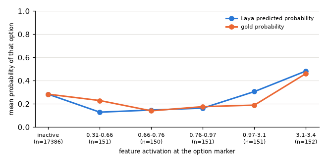

# Feature 11595

Critérios em que aparece: attribution_toward_wrong

**Interpretação (preencher):** 

---

## Maiores ativações

**tr_invoice_processing_000092 / disposition** (choice, invoice_processing) | ativação 4.578 em `opção` | opções ['approve', 'hold', 'manual_review', 'reject'] | Laya: **reject** [0.266, 0.088, 0.016, 0.63] | gabarito: **approve**

```
<bos> choice question: How should this vendor invoice be dispositioned?<eos>
▸ <mask> approve⟦:⟧ Matches the order and delivery; approve for payment.
▸ <mask> hold: Something needs confirming before payment; hold pending clarification.
▸ <mask> manual_review: A human in finance must review the discrepancy.
▸ <mask> reject: Should not be paid: duplicate, unauthorised or materially wrong.

<eos>

 {"delivery": {"condition": "accepted with exceptions", "date": "2026-03-12", "received_qty": 400}, "invoice": {"currency": "USD", "id": "INV-2026-1498", "lines": [{"qty": 400, "sku": "SKU-530", "total_usd": 130404.0, "unit_usd": 326.01}], "total_usd": 130404.0, "vendor": "Kestrel Supply"}, "payment": {"days_until_due": -3, "discount_expires_in_days": null, "early_payment_discount_pct": null, "status": "overdue", "terms": "net 45"}, "purchase_order": {"freight_terms": "freight prepaid by vendor, not separately billable", "id": "PO-9335", "lines": [{"qty": 400, "unit_usd": 326.01}], "total_usd": 130404.0}, "vendor_history": {"disputes_12m": 0, "invoices_12m": 35, "prior_invoice_ids": ["INV-2026-6617", "INV-2026-4776", "INV-2026-9752", "INV-2026-1479"]}}<eos>
```

**tr_invoice_processing_000068 / disposition** (choice, invoice_processing) | ativação 4.570 em `opção` | opções ['approve', 'hold', 'manual_review', 'reject'] | Laya: **reject** [0.386, 0.132, 0.045, 0.437] | gabarito: **hold**

```
<bos> choice question: How should this vendor invoice be dispositioned?<eos>
▸ <mask> approve⟦:⟧ Matches the order and delivery; approve for payment.
▸ <mask> hold: Something needs confirming before payment; hold pending clarification.
▸ <mask> manual_review: A human in finance must review the discrepancy.
▸ <mask> reject: Should not be paid: duplicate, unauthorised or materially wrong.

<eos>

 {"delivery": {"condition": "accepted with exceptions", "date": "2026-03-18", "received_qty": 50}, "invoice": {"currency": "USD", "id": "INV-2026-5355", "lines": [{"qty": 50, "sku": "SKU-380", "total_usd": 1136.5, "unit_usd": 22.73}], "total_usd": 1136.5, "vendor": "Vantage Materials"}, "payment": {"days_until_due": 27, "discount_expires_in_days": 3, "early_payment_discount_pct": 2.0, "status": "scheduled", "terms": "net 45"}, "purchase_order": {"freight_terms": "freight prepaid by vendor, not separately billable", "id": null, "lines": [{"qty": 50, "unit_usd": 22.73}], "total_usd": 1136.5}, "vendor_history": {"disputes_12m": 1, "invoices_12m": 33, "prior_invoice_ids": ["INV-2026-2856", "INV-2026-9344"]}}<eos>
```

**tr_invoice_processing_000294 / disposition** (choice, invoice_processing) | ativação 4.566 em `opção` | opções ['approve', 'hold', 'manual_review', 'reject'] | Laya: **approve** [0.49, 0.109, 0.028, 0.372] | gabarito: **manual_review**

```
<bos> choice question: How should this vendor invoice be dispositioned?<eos>
▸ <mask> approve⟦:⟧ Matches the order and delivery; approve for payment.
▸ <mask> hold: Something needs confirming before payment; hold pending clarification.
▸ <mask> manual_review: A human in finance must review the discrepancy.
▸ <mask> reject: Should not be paid: duplicate, unauthorised or materially wrong.

<eos>

 {"delivery": {"condition": "accepted with exceptions", "date": "2026-03-02", "received_qty": 100}, "invoice": {"currency": "USD", "id": "INV-2026-3359", "lines": [{"qty": 120, "sku": "SKU-891", "total_usd": 49472.4, "unit_usd": 412.27}], "total_usd": 49472.4, "vendor": "Northwind Components"}, "payment": {"days_until_due": -9, "discount_expires_in_days": null, "early_payment_discount_pct": null, "status": "overdue", "terms": "net 30"}, "purchase_order": {"freight_terms": "freight prepaid by vendor, not separately billable", "id": "PO-3955", "lines": [{"qty": 100, "unit_usd": 412.27}], "total_usd": 41227.0}, "vendor_history": {"disputes_12m": 0, "invoices_12m": 13, "prior_invoice_ids": ["INV-2026-2480", "INV-2026-4309"]}}<eos>
```

**tr_invoice_processing_000087 / disposition** (choice, invoice_processing) | ativação 4.562 em `opção` | opções ['approve', 'hold', 'manual_review', 'reject'] | Laya: **approve** [0.541, 0.14, 0.015, 0.305] | gabarito: **manual_review**

```
<bos> choice question: How should this vendor invoice be dispositioned?<eos>
▸ <mask> approve⟦:⟧ Matches the order and delivery; approve for payment.
▸ <mask> hold: Something needs confirming before payment; hold pending clarification.
▸ <mask> manual_review: A human in finance must review the discrepancy.
▸ <mask> reject: Should not be paid: duplicate, unauthorised or materially wrong.

<eos>

 {"delivery": {"condition": "accepted", "date": "2026-03-14", "received_qty": 10}, "invoice": {"currency": "USD", "id": "INV-2026-8813", "lines": [{"qty": 10, "sku": "SKU-990", "total_usd": 2939.4, "unit_usd": 293.94}, {"qty": 1, "sku": "FREIGHT", "total_usd": 993.06, "unit_usd": 993.06}], "total_usd": 3932.46, "vendor": "Kestrel Supply"}, "payment": {"days_until_due": -21, "discount_expires_in_days": null, "early_payment_discount_pct": null, "status": "overdue", "terms": "net 15"}, "purchase_order": {"freight_terms": "freight prepaid by vendor, not separately billable", "id": "PO-1536", "lines": [{"qty": 10, "unit_usd": 293.94}], "total_usd": 2939.4}, "vendor_history": {"disputes_12m": 2, "invoices_12m": 30, "prior_invoice_ids": ["INV-2026-3053"]}}<eos>
```

**tr_invoice_processing_000239 / disposition** (choice, invoice_processing) | ativação 4.559 em `opção` | opções ['approve', 'hold', 'manual_review', 'reject'] | Laya: **reject** [0.372, 0.084, 0.019, 0.526] | gabarito: **approve**

```
<bos> choice question: How should this vendor invoice be dispositioned?<eos>
▸ <mask> approve⟦:⟧ Matches the order and delivery; approve for payment.
▸ <mask> hold: Something needs confirming before payment; hold pending clarification.
▸ <mask> manual_review: A human in finance must review the discrepancy.
▸ <mask> reject: Should not be paid: duplicate, unauthorised or materially wrong.

<eos>

 {"delivery": {"condition": "accepted with exceptions", "date": "2026-03-09", "received_qty": 25}, "invoice": {"currency": "USD", "id": "INV-2026-6058", "lines": [{"qty": 25, "sku": "SKU-229", "total_usd": 10799.0, "unit_usd": 431.96}], "total_usd": 10799.0, "vendor": "Kestrel Supply"}, "payment": {"days_until_due": -3, "discount_expires_in_days": null, "early_payment_discount_pct": null, "status": "overdue", "terms": "net 15"}, "purchase_order": {"freight_terms": "freight prepaid by vendor, not separately billable", "id": "PO-3159", "lines": [{"qty": 25, "unit_usd": 431.96}], "total_usd": 10799.0}, "vendor_history": {"disputes_12m": 2, "invoices_12m": 2, "prior_invoice_ids": ["INV-2026-6719", "INV-2026-4543", "INV-2026-1306"]}}<eos>
```

## Ativações medianas (faixa 40-60%, mediana 0.905)

**tr_invoice_processing_000157 / matches_order** (noul, invoice_processing) | ativação 1.088 em `pergunta` | opções ['false', 'true'] | Laya: **true** [0.038, 0.962] | gabarito: **false**

```
<bos> noul question⟦:⟧ The invoice reconciles with the purchase order and the recorded delivery.<eos>
▸ <mask> false: There is a discrepancy against the order or the delivery.
▸ <mask> true: Line items, quantities and amounts reconcile.

<eos>

 {"delivery": {"condition": "accepted with exceptions", "date": "2026-03-23", "received_qty": 50}, "invoice": {"currency": "USD", "id": "INV-2026-5230", "lines": [{"qty": 50, "sku": "SKU-951", "total_usd": 24145.0, "unit_usd": 482.9}], "total_usd": 24145.0, "vendor": "Kestrel Supply"}, "payment": {"days_until_due": 2, "discount_expires_in_days": null, "early_payment_discount_pct": null, "status": "scheduled", "terms": "net 15"}, "purchase_order": {"freight_terms": "freight prepaid by vendor, not separately billable", "id": "PO-1756", "lines": [{"qty": 50, "unit_usd": 431.16}], "total_usd": 21558.0}, "vendor_history": {"disputes_12m": 0, "invoices_12m": 15, "prior_invoice_ids": ["INV-2026-5413", "INV-2026-8200", "INV-2026-6317"]}}<eos>
```

**tr_security_incidents_000089 / disposition** (choice, security_incidents) | ativação 0.966 em `marcador` | opções ['close_benign', 'contain', 'investigate', 'monitor'] | Laya: **contain** [0.169, 0.566, 0.044, 0.221] | gabarito: **close_benign**

```
<bos> choice question: How should this security alert be dispositioned?<eos>
▸ ⟦<mask>⟧ close_benign: Expected, explainable activity; close without analyst time.
▸ <mask> contain: Contain the host or account immediately; do not wait for triage.
▸ <mask> investigate: Warrants an analyst opening an investigation.
▸ <mask> monitor: Not clearly malicious, but worth watching for recurrence.

<eos>

 {"alert": {"description": "a long-unused account became active", "evidence": "Employee account e12345, which had no login activity since 2021-04-01, logged in from allowed subnet IP 10.0.0.5 at 2026-09-15T09:05:27Z. The authentication succeeded with MFA enabled.", "rule": "dormant_account_use"}, "context": {"asset_criticality": "medium", "change_window_active": false, "source_on_allowlist": true}, "history": {"credential_rotation_days_ago": 412, "distinct_countries_30d": 1, "logins_30d": 44, "prior_alerts_90d": 0}, "principal": {"mfa_enrolled": true, "name": "adm-deploy-118", "privileges": ["repo:read"], "type": "employee"}}<eos>
```

**tr_invoice_processing_000184 / duplicate** (noul, invoice_processing) | ativação 0.907 em `opção` | opções ['false', 'true'] | Laya: **true** [0.02, 0.98] | gabarito: **false**

```
<bos> noul question: This invoice appears to duplicate an invoice already submitted.<eos>
▸ <mask> false: no, the statement does not hold
▸ <mask> true⟦:⟧ yes, the statement holds

<eos>

 {"delivery": {"condition": "accepted with exceptions", "date": "2026-03-25", "received_qty": 25}, "invoice": {"currency": "USD", "id": "INV-2026-6432", "lines": [{"qty": 25, "sku": "SKU-453", "total_usd": 8260.5, "unit_usd": 330.42}], "total_usd": 8260.5, "vendor": "Acme Fabrication"}, "payment": {"days_until_due": 27, "discount_expires_in_days": null, "early_payment_discount_pct": null, "status": "scheduled", "terms": "net 30"}, "purchase_order": {"freight_terms": "freight prepaid by vendor, not separately billable", "id": "PO-9538", "lines": [{"qty": 25, "unit_usd": 330.42}], "total_usd": 8260.5}, "vendor_history": {"disputes_12m": 0, "invoices_12m": 57, "prior_invoice_ids": ["INV-2026-8793"]}}<eos>
```

**tr_invoice_processing_000073 / matches_order** (noul, invoice_processing) | ativação 1.035 em `pergunta` | opções ['false', 'true'] | Laya: **true** [0.025, 0.975] | gabarito: **false**

```
<bos> noul question⟦:⟧ The invoice reconciles with the purchase order and the recorded delivery.<eos>
▸ <mask> false: There is a discrepancy against the order or the delivery.
▸ <mask> true: Line items, quantities and amounts reconcile.

<eos>

 {"delivery": {"condition": "accepted", "date": "2026-03-01", "received_qty": 100}, "invoice": {"currency": "EUR", "id": "INV-2026-9369", "lines": [{"qty": 100, "sku": "SKU-485", "total_usd": 35742.0, "unit_usd": 357.42}], "total_usd": 35742.0, "vendor": "Vantage Materials"}, "payment": {"days_until_due": 18, "discount_expires_in_days": 1, "early_payment_discount_pct": 2.0, "status": "scheduled", "terms": "net 60"}, "purchase_order": {"freight_terms": "freight prepaid by vendor, not separately billable", "id": "PO-8320", "lines": [{"qty": 100, "unit_usd": 357.42}], "total_usd": 35742.0}, "vendor_history": {"disputes_12m": 0, "invoices_12m": 44, "prior_invoice_ids": ["INV-2026-7453"]}}<eos>
```

**tr_security_incidents_000148 / disposition** (choice, security_incidents) | ativação 0.940 em `marcador` | opções ['close_benign', 'contain', 'investigate', 'monitor'] | Laya: **investigate** [0.23, 0.158, 0.382, 0.23] | gabarito: **investigate**

```
<bos> choice question: How should this security alert be dispositioned?<eos>
▸ ⟦<mask>⟧ close_benign: Expected, explainable activity; close without analyst time.
▸ <mask> contain: Contain the host or account immediately; do not wait for triage.
▸ <mask> investigate: Warrants an analyst opening an investigation.
▸ <mask> monitor: Not clearly malicious, but worth watching for recurrence.

<eos>

 {"alert": {"description": "an unrecognised binary executed on a server", "evidence": "On 2026-09-15 22:45:33 UTC, the executable \"C:\\Temp\\svchost64.exe\" was launched on server \"app-prod-02\" with PID 5472. The binary is not present in the approved software inventory, the run was performed by a contractor user without privileged access, MFA was turned off, and the account's password was last changed 14 days ago; the originating host is on the allowlist and no change window was in effect.", "rule": "suspicious_process"}, "context": {"asset_criticality": "medium", "change_window_active": false, "source_on_allowlist": true}, "history": {"credential_rotation_days_ago": 14, "distinct_countries_30d": 3, "logins_30d": 557, "prior_alerts_90d": 0}, "principal": {"mfa_enrolled": false, "name": "adm-billing-238", "privileges": ["repo:read"], "type": "contractor"}}<eos>
```

## Estatísticas (conjunto de descoberta, dev e teste)

**pred / error**

| split | decisões | ativas | ativas e Laya errou | taxa | lift | q (BH) | OR (CMH) | q (CMH) |
|---|---|---|---|---|---|---|---|---|
| discovery | 5100 | 172 | 87 | 0.506 | 0.79 | 0.00069 | 0.24 | 0.162 |
| dev | 900 | 39 | 22 | 0.564 | 0.84 | 0.384 | 0.00 | 0.36 |
| test | 2000 | 74 | 34 | 0.459 | 0.71 | 0.00308 | 0.00 | 0.0103 |

**corr / error**

| split | decisões | ativas | ativas e Laya errou | taxa | lift | q (BH) | OR (CMH) | q (CMH) |
|---|---|---|---|---|---|---|---|---|
| discovery | 5100 | 172 | 87 | 0.506 | 0.79 | 0.000399 | 2.00 | 0.383 |
| dev | 900 | 36 | 19 | 0.528 | 0.79 | 0.15 | 0.00 | 0.773 |
| test | 2000 | 63 | 23 | 0.365 | 0.56 | 1.49e-05 | 1.82 | 0.731 |

**state / error**

| split | decisões | ativas | ativas e Laya errou | taxa | lift | q (BH) | OR (CMH) | q (CMH) |
|---|---|---|---|---|---|---|---|---|
| discovery | 5100 | 23 | 17 | 0.739 | 1.15 | 0.627 | 2.45 | 0.24 |
| dev | 900 | 4 | 0 | 0.000 | 0.00 | nan | nan | nan |
| test | 2000 | 8 | 4 | 0.500 | 0.77 | nan | nan | nan |

**pred / probe_right_laya_wrong**

| split | decisões | ativas | ativas e Laya errou | taxa | lift | q (BH) | OR (CMH) | q (CMH) |
|---|---|---|---|---|---|---|---|---|
| discovery | 2932 | 111 | 38 | 0.342 | 0.57 | 1.07e-07 | inf | 0.47 |
| dev | 523 | 26 | 10 | 0.385 | 0.60 | 0.0294 | nan | nan |
| test | 1149 | 47 | 15 | 0.319 | 0.52 | 0.000247 | nan | nan |

**corr / probe_right_laya_wrong**

| split | decisões | ativas | ativas e Laya errou | taxa | lift | q (BH) | OR (CMH) | q (CMH) |
|---|---|---|---|---|---|---|---|---|
| discovery | 2932 | 86 | 13 | 0.151 | 0.25 | 1.94e-17 | inf | 0.133 |
| dev | 523 | 19 | 3 | 0.158 | 0.24 | nan | nan | nan |
| test | 1149 | 36 | 4 | 0.111 | 0.18 | 3.75e-09 | inf | 0.743 |

**state / probe_right_laya_wrong**

| split | decisões | ativas | ativas e Laya errou | taxa | lift | q (BH) | OR (CMH) | q (CMH) |
|---|---|---|---|---|---|---|---|---|
| discovery | 2932 | 15 | 12 | 0.800 | 1.32 | nan | nan | nan |
| dev | 523 | 3 | 0 | 0.000 | 0.00 | nan | nan | nan |
| test | 1149 | 3 | 2 | 0.667 | 1.09 | nan | nan | nan |

Confusão mais sobre-representada (pred): `disposition|0>2` (n=58, lift 29.65, p=0). Formato `pergunta|índice previsto>índice correto`.

Confusão mais sobre-representada (corr): `disposition|3>0` (n=36, lift 29.65, p=0). Formato `pergunta|índice previsto>índice correto`.

Confusão mais sobre-representada (state): `urgency|2>3` (n=2, lift 23.34, p=0.00318). Formato `pergunta|índice previsto>índice correto`.



