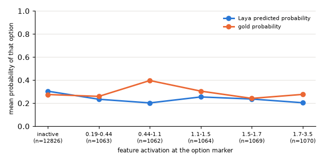

# Feature 11737

Critérios em que aparece: attribution_toward_correct

**Interpretação (preencher):** 

---

## Maiores ativações

**tr_invoice_processing_000021 / duplicate** (noul, invoice_processing) | ativação 6.629 em `pergunta` | opções ['false', 'true'] | Laya: **true** [0.025, 0.975] | gabarito: **false**

```
<bos> n⟦oul⟧ question: This invoice appears to duplicate an invoice already submitted.<eos>
▸ <mask> false: no, the statement does not hold
▸ <mask> true: yes, the statement holds

<eos>

 {"delivery": {"condition": "accepted", "date": "2026-03-07", "received_qty": 100}, "invoice": {"currency": "USD", "id": "INV-2026-1810", "lines": [{"qty": 100, "sku": "SKU-868", "total_usd": 40841.0, "unit_usd": 408.41}], "total_usd": 40841.0, "vendor": "Vantage Materials"}, "payment": {"days_until_due": 0, "discount_expires_in_days": null, "early_payment_discount_pct": null, "status": "scheduled", "terms": "net 45"}, "purchase_order": {"freight_terms": "freight prepaid by vendor, not separately billable", "id": "PO-3491", "lines": [{"qty": 100, "unit_usd": 408.41}], "total_usd": 40841.0}, "vendor_history": {"disputes_12m": 0, "invoices_12m": 57, "prior_invoice_ids": ["INV-2026-1810", "INV-2026-7846", "INV-2026-5769", "INV-2026-7710"]}}<eos>
```

**tr_invoice_processing_000288 / duplicate** (noul, invoice_processing) | ativação 6.586 em `pergunta` | opções ['false', 'true'] | Laya: **true** [0.02, 0.98] | gabarito: **false**

```
<bos> n⟦oul⟧ question: This invoice appears to duplicate an invoice already submitted.<eos>
▸ <mask> false: no, the statement does not hold
▸ <mask> true: yes, the statement holds

<eos>

 {"delivery": {"condition": "accepted", "date": "2026-03-18", "received_qty": 1000}, "invoice": {"currency": "USD", "id": "INV-2026-4845", "lines": [{"qty": 1000, "sku": "SKU-946", "total_usd": 365740.0, "unit_usd": 365.74}], "total_usd": 365740.0, "vendor": "Northwind Components"}, "payment": {"days_until_due": 18, "discount_expires_in_days": 1, "early_payment_discount_pct": 2.0, "status": "scheduled", "terms": "net 15"}, "purchase_order": {"freight_terms": "freight prepaid by vendor, not separately billable", "id": "PO-3908", "lines": [{"qty": 1000, "unit_usd": 365.74}], "total_usd": 365740.0}, "vendor_history": {"disputes_12m": 0, "invoices_12m": 45, "prior_invoice_ids": ["INV-2026-4845", "INV-2026-1550", "INV-2026-3604"]}}<eos>
```

**tr_invoice_processing_000231 / duplicate** (noul, invoice_processing) | ativação 6.578 em `pergunta` | opções ['false', 'true'] | Laya: **true** [0.02, 0.98] | gabarito: **false**

```
<bos> n⟦oul⟧ question: This invoice appears to duplicate an invoice already submitted.<eos>
▸ <mask> false: no, the statement does not hold
▸ <mask> true: yes, the statement holds

<eos>

 {"delivery": {"condition": "accepted", "date": "2026-03-09", "received_qty": 1000}, "invoice": {"currency": "USD", "id": "INV-2026-9015", "lines": [{"qty": 1000, "sku": "SKU-432", "total_usd": 32720.0, "unit_usd": 32.72}], "total_usd": 32720.0, "vendor": "Acme Fabrication"}, "payment": {"days_until_due": 5, "discount_expires_in_days": null, "early_payment_discount_pct": null, "status": "scheduled", "terms": "net 30"}, "purchase_order": {"freight_terms": "freight prepaid by vendor, not separately billable", "id": "PO-9916", "lines": [{"qty": 1000, "unit_usd": 32.72}], "total_usd": 32720.0}, "vendor_history": {"disputes_12m": 0, "invoices_12m": 11, "prior_invoice_ids": ["INV-2026-5519", "INV-2026-4133", "INV-2026-6013", "INV-2026-5468"]}}<eos>
```

**tr_invoice_processing_000133 / duplicate** (noul, invoice_processing) | ativação 6.520 em `pergunta` | opções ['false', 'true'] | Laya: **true** [0.01, 0.99] | gabarito: **false**

```
<bos> n⟦oul⟧ question: This invoice appears to duplicate an invoice already submitted.<eos>
▸ <mask> false: no, the statement does not hold
▸ <mask> true: yes, the statement holds

<eos>

 {"delivery": {"condition": "accepted", "date": "2026-03-09", "received_qty": 400}, "invoice": {"currency": "USD", "id": "INV-2026-2601", "lines": [{"qty": 400, "sku": "SKU-512", "total_usd": 143232.0, "unit_usd": 358.08}], "total_usd": 143232.0, "vendor": "Acme Fabrication"}, "payment": {"days_until_due": 0, "discount_expires_in_days": 8, "early_payment_discount_pct": 2.0, "status": "scheduled", "terms": "net 60"}, "purchase_order": {"freight_terms": "freight prepaid by vendor, not separately billable", "id": "PO-7672", "lines": [{"qty": 400, "unit_usd": 358.08}], "total_usd": 143232.0}, "vendor_history": {"disputes_12m": 0, "invoices_12m": 58, "prior_invoice_ids": ["INV-2026-9795", "INV-2026-1976", "INV-2026-9982", "INV-2026-7392"]}}<eos>
```

**tr_invoice_processing_000214 / duplicate** (noul, invoice_processing) | ativação 6.504 em `pergunta` | opções ['false', 'true'] | Laya: **true** [0.012, 0.988] | gabarito: **false**

```
<bos> n⟦oul⟧ question: This invoice appears to duplicate an invoice already submitted.<eos>
▸ <mask> false: no, the statement does not hold
▸ <mask> true: yes, the statement holds

<eos>

 {"delivery": {"condition": "accepted", "date": "2026-03-07", "received_qty": 100}, "invoice": {"currency": "USD", "id": "INV-2026-1869", "lines": [{"qty": 100, "sku": "SKU-904", "total_usd": 19005.0, "unit_usd": 190.05}], "total_usd": 19005.0, "vendor": "Vantage Materials"}, "payment": {"days_until_due": 44, "discount_expires_in_days": 6, "early_payment_discount_pct": 2.0, "status": "scheduled", "terms": "net 15"}, "purchase_order": {"freight_terms": "freight prepaid by vendor, not separately billable", "id": "PO-8011", "lines": [{"qty": 100, "unit_usd": 190.05}], "total_usd": 19005.0}, "vendor_history": {"disputes_12m": 1, "invoices_12m": 54, "prior_invoice_ids": ["INV-2026-3002", "INV-2026-1460", "INV-2026-8867", "INV-2026-8047"]}}<eos>
```

## Ativações medianas (faixa 40-60%, mediana 1.586)

**tr_invoice_processing_000068 / urgency** (score, invoice_processing) | ativação 1.479 em `marcador` | opções ['0', '1', '2', '3'] | Laya: **1** [0.103, 0.493, 0.25, 0.154] | gabarito: **2**

```
<bos> score question: How time-sensitive is processing this invoice?<eos>
▸ <mask> level 0: No time pressure; can wait indefinitely.
▸ <mask> level 1: Routine; handle within the normal queue.
▸ ⟦<mask>⟧ level 2: Elevated; should be handled within the same week.
▸ <mask> level 3: Critical; requires action within the same day.

<eos>

 {"delivery": {"condition": "accepted with exceptions", "date": "2026-03-18", "received_qty": 50}, "invoice": {"currency": "USD", "id": "INV-2026-5355", "lines": [{"qty": 50, "sku": "SKU-380", "total_usd": 1136.5, "unit_usd": 22.73}], "total_usd": 1136.5, "vendor": "Vantage Materials"}, "payment": {"days_until_due": 27, "discount_expires_in_days": 3, "early_payment_discount_pct": 2.0, "status": "scheduled", "terms": "net 45"}, "purchase_order": {"freight_terms": "freight prepaid by vendor, not separately billable", "id": null, "lines": [{"qty": 50, "unit_usd": 22.73}], "total_usd": 1136.5}, "vendor_history": {"disputes_12m": 1, "invoices_12m": 33, "prior_invoice_ids": ["INV-2026-2856", "INV-2026-9344"]}}<eos>
```

**tr_invoice_processing_000026 / disposition** (choice, invoice_processing) | ativação 1.530 em `opção` | opções ['approve', 'hold', 'manual_review', 'reject'] | Laya: **approve** [0.458, 0.215, 0.027, 0.3] | gabarito: **approve**

```
<bos> choice question: How should this vendor invoice be dispositioned?<eos>
▸ <mask> approve: Matches the order and delivery; approve for payment.
▸ <mask> hold: Something needs confirming before payment; hold pending clarification.
▸ <mask> manual⟦_⟧review: A human in finance must review the discrepancy.
▸ <mask> reject: Should not be paid: duplicate, unauthorised or materially wrong.

<eos>

 {"delivery": {"condition": "accepted", "date": "2026-03-01", "received_qty": 25}, "invoice": {"currency": "USD", "id": "INV-2026-4433", "lines": [{"qty": 25, "sku": "SKU-294", "total_usd": 8313.5, "unit_usd": 332.54}], "total_usd": 8313.5, "vendor": "Kestrel Supply"}, "payment": {"days_until_due": 2, "discount_expires_in_days": null, "early_payment_discount_pct": null, "status": "scheduled", "terms": "net 45"}, "purchase_order": {"freight_terms": "freight prepaid by vendor, not separately billable", "id": "PO-2485", "lines": [{"qty": 25, "unit_usd": 332.54}], "total_usd": 8313.5}, "vendor_history": {"disputes_12m": 5, "invoices_12m": 55, "prior_invoice_ids": ["INV-2026-2147"]}}<eos>
```

**tr_invoice_processing_000055 / matches_order** (noul, invoice_processing) | ativação 1.626 em `marcador` | opções ['false', 'true'] | Laya: **true** [0.049, 0.951] | gabarito: **true**

```
<bos> noul question: The invoice reconciles with the purchase order and the recorded delivery.<eos>
▸ ⟦<mask>⟧ false: There is a discrepancy against the order or the delivery.
▸ <mask> true: Line items, quantities and amounts reconcile.

<eos>

 {"delivery": {"condition": "accepted", "date": "2026-03-24", "received_qty": 10}, "invoice": {"currency": "USD", "id": "INV-2026-2278", "lines": [{"qty": 10, "sku": "SKU-174", "total_usd": 2565.3, "unit_usd": 256.53}], "total_usd": 2565.3, "vendor": "Orbit Logistics"}, "payment": {"days_until_due": 44, "discount_expires_in_days": null, "early_payment_discount_pct": null, "status": "scheduled", "terms": "net 15"}, "purchase_order": {"freight_terms": "freight prepaid by vendor, not separately billable", "id": "PO-1729", "lines": [{"qty": 10, "unit_usd": 256.53}], "total_usd": 2565.3}, "vendor_history": {"disputes_12m": 2, "invoices_12m": 35, "prior_invoice_ids": ["INV-2026-2466", "INV-2026-1629", "INV-2026-2511", "INV-2026-3620"]}}<eos>
```

**tr_customer_service_000065 / needs_human** (noul, customer_service) | ativação 1.472 em `pergunta` | opções ['false', 'true'] | Laya: **true** [0.317, 0.683] | gabarito: **false**

```
<bos> n⟦oul⟧ question: This conversation requires a human agent rather than automated handling.<eos>
▸ <mask> false: Automation can carry this to resolution.
▸ <mask> true: A human must take over: judgement, authority or empathy is required.

<eos>

 {"account": {"lifetime_value_usd": 586, "prior_tickets_90d": 0, "seats": 1, "tenure_months": 19, "tier": "standard"}, "orders": [{"amount_usd": 99, "date": "2026-02-21", "id": "A-35676", "status": "settled"}, {"amount_usd": 99, "date": "2026-02-28", "id": "A-65097", "status": "failed"}, {"amount_usd": 99, "date": "2026-03-26", "id": "A-82387", "status": "refunded"}], "thread": [{"role": "customer", "text": "I'm trying to export my data and I can't find any option to do it. This is confusing, and if I can't get it sorted by Friday, I'm going to have to look elsewhere."}, {"role": "agent", "text": "Sorry for the trouble. Could you let me know which data set you're after and whether you need it in CSV or JSON format?"}, {"role": "customer", "text": "I need the full activity log for the past six months in CSV. It's critical for my reporting deadline this Friday."}]}<eos>
```

**tr_invoice_processing_000182 / disposition** (choice, invoice_processing) | ativação 1.662 em `opção` | opções ['approve', 'hold', 'manual_review', 'reject'] | Laya: **approve** [0.479, 0.078, 0.021, 0.421] | gabarito: **hold**

```
<bos> choice question: How should this vendor invoice be dispositioned?<eos>
▸ <mask> approve: Matches the order and delivery; approve for payment.
▸ <mask> hold: Something needs confirming before payment; hold pending clarification.
▸ <mask> manual⟦_⟧review: A human in finance must review the discrepancy.
▸ <mask> reject: Should not be paid: duplicate, unauthorised or materially wrong.

<eos>

 {"delivery": {"condition": "accepted with exceptions", "date": "2026-03-16", "received_qty": 25}, "invoice": {"currency": "USD", "id": "INV-2026-1869", "lines": [{"qty": 25, "sku": "SKU-634", "total_usd": 7297.25, "unit_usd": 291.89}], "total_usd": 7297.25, "vendor": "Kestrel Supply"}, "payment": {"days_until_due": 0, "discount_expires_in_days": null, "early_payment_discount_pct": null, "status": "scheduled", "terms": "net 60"}, "purchase_order": {"freight_terms": "freight prepaid by vendor, not separately billable", "id": "PO-8882", "lines": [{"qty": 25, "unit_usd": 291.89}], "total_usd": 7297.25}, "vendor_history": {"disputes_12m": 1, "invoices_12m": 11, "prior_invoice_ids": ["INV-2026-5214", "INV-2026-5412", "INV-2026-2686", "INV-2026-8750"]}}<eos>
```

## Estatísticas (conjunto de descoberta, dev e teste)

**pred / error**

| split | decisões | ativas | ativas e Laya errou | taxa | lift | q (BH) | OR (CMH) | q (CMH) |
|---|---|---|---|---|---|---|---|---|
| discovery | 5100 | 1192 | 746 | 0.626 | 0.97 | 0.226 | 0.52 | 1.48e-05 |
| dev | 900 | 255 | 177 | 0.694 | 1.03 | 0.622 | 0.64 | 0.625 |
| test | 2000 | 475 | 319 | 0.672 | 1.03 | 0.395 | 0.55 | 0.139 |

**corr / error**

| split | decisões | ativas | ativas e Laya errou | taxa | lift | q (BH) | OR (CMH) | q (CMH) |
|---|---|---|---|---|---|---|---|---|
| discovery | 5100 | 1613 | 1167 | 0.723 | 1.12 | 1.85e-15 | 0.81 | 0.151 |
| dev | 900 | 348 | 270 | 0.776 | 1.15 | 9.11e-07 | 0.90 | 0.888 |
| test | 2000 | 624 | 468 | 0.750 | 1.15 | 1.41e-09 | 0.84 | 0.63 |

**state / error**

| split | decisões | ativas | ativas e Laya errou | taxa | lift | q (BH) | OR (CMH) | q (CMH) |
|---|---|---|---|---|---|---|---|---|
| discovery | 5100 | 190 | 130 | 0.684 | 1.06 | 0.423 | 0.78 | 0.556 |
| dev | 900 | 36 | 31 | 0.861 | 1.28 | 0.204 | 4.86 | 0.155 |
| test | 2000 | 68 | 49 | 0.721 | 1.11 | 0.558 | 1.54 | 0.591 |

**pred / probe_right_laya_wrong**

| split | decisões | ativas | ativas e Laya errou | taxa | lift | q (BH) | OR (CMH) | q (CMH) |
|---|---|---|---|---|---|---|---|---|
| discovery | 2932 | 654 | 358 | 0.547 | 0.90 | 0.0016 | 0.34 | 8.01e-08 |
| dev | 523 | 136 | 88 | 0.647 | 1.00 | 1 | 0.29 | 0.268 |
| test | 1149 | 246 | 143 | 0.581 | 0.95 | 0.443 | 0.25 | 0.00405 |

**corr / probe_right_laya_wrong**

| split | decisões | ativas | ativas e Laya errou | taxa | lift | q (BH) | OR (CMH) | q (CMH) |
|---|---|---|---|---|---|---|---|---|
| discovery | 2932 | 1030 | 734 | 0.713 | 1.18 | 8.86e-18 | 0.69 | 0.121 |
| dev | 523 | 221 | 173 | 0.783 | 1.21 | 1.47e-07 | 1.22 | 0.827 |
| test | 1149 | 393 | 290 | 0.738 | 1.21 | 8.83e-10 | 0.65 | 0.357 |

**state / probe_right_laya_wrong**

| split | decisões | ativas | ativas e Laya errou | taxa | lift | q (BH) | OR (CMH) | q (CMH) |
|---|---|---|---|---|---|---|---|---|
| discovery | 2932 | 150 | 108 | 0.720 | 1.19 | 0.0111 | 0.48 | 0.0523 |
| dev | 523 | 29 | 25 | 0.862 | 1.33 | 0.115 | 3.53 | 0.274 |
| test | 1149 | 57 | 42 | 0.737 | 1.21 | 0.2 | 1.78 | 0.489 |

Confusão mais sobre-representada (pred): `discrepancy_severity|2>0` (n=108, lift 4.28, p=0). Formato `pergunta|índice previsto>índice correto`.

Confusão mais sobre-representada (corr): `discrepancy_severity|2>0` (n=108, lift 3.16, p=0). Formato `pergunta|índice previsto>índice correto`.

Confusão mais sobre-representada (state): `duplicate|1>0` (n=82, lift 10.14, p=0). Formato `pergunta|índice previsto>índice correto`.



