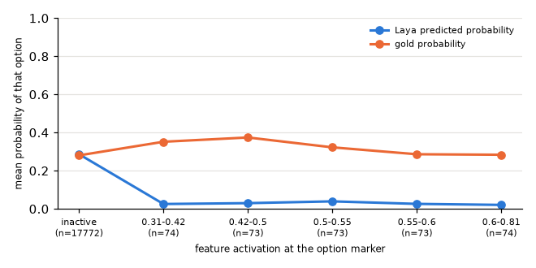

# Feature 11985

Critérios em que aparece: corr_error

**Interpretação (preencher):** 

---

## Maiores ativações

**tr_customer_service_000101 / category** (choice, customer_service) | ativação 5.176 em `estado` | opções ['account', 'billing', 'delivery', 'refund', 'technical'] | Laya: **account** [0.526, 0.126, 0.29, 0.036, 0.023] | gabarito: **delivery**

```
<bos> choice question: What is this customer conversation primarily about?<eos>
▸ <mask> account: Login, plan changes, profile or access management.
▸ <mask> billing: A charge, invoice, subscription or payment problem.
▸ <mask> delivery: Shipping, fulfilment or delivery of a physical item.
▸ <mask> refund: The customer is explicitly asking for money back.
▸ <mask> technical: The product or service is not working as expected.

<eos>

 {"account": {"lifetime_value_usd": 1434, "prior_tickets_90d": 0, "seats": 1, "tenure_months": 19, "tier": "free"}, "orders": [{"amount_usd": 299, "date": "2026-01-27", "id": "A-79408", "status": "settled"}, {"amount_usd": 299, "date": "2026-01-08", "id": "A-76545", "status": "refunded"}, {"amount_usd": 299, "date": "2026-03-21", "id": "A-26681", "status": "settled"}], "thread": [{"role": "customer", "text": "Um, I’m a bit lost here. I ordered something that cost about $299 a few weeks ago on my free account (been with you 19 months), but the package I opened doesn’t match what I thought I bought."}, {"role": "agent", "text": "I understand the confusion. Can you tell me the order reference and describe the item you received compared to what you expected?"}, {"role": "customer", "text": "The reference is #B12345. I was expecting the deluxe headset, but the box contains⟦ a⟧ basic speaker set. What can be done about this?"}]}<eos>
```

**tr_customer_service_000101 / urgency** (score, customer_service) | ativação 5.082 em `estado` | opções ['0', '1', '2', '3'] | Laya: **1** [0.044, 0.536, 0.272, 0.148] | gabarito: **1**

```
<bos> score question: How time-sensitive is this conversation?<eos>
▸ <mask> level 0: No time pressure; can wait indefinitely.
▸ <mask> level 1: Routine; handle within the normal queue.
▸ <mask> level 2: Elevated; should be handled within the same week.
▸ <mask> level 3: Critical; requires action within the same day.

<eos>

 {"account": {"lifetime_value_usd": 1434, "prior_tickets_90d": 0, "seats": 1, "tenure_months": 19, "tier": "free"}, "orders": [{"amount_usd": 299, "date": "2026-01-27", "id": "A-79408", "status": "settled"}, {"amount_usd": 299, "date": "2026-01-08", "id": "A-76545", "status": "refunded"}, {"amount_usd": 299, "date": "2026-03-21", "id": "A-26681", "status": "settled"}], "thread": [{"role": "customer", "text": "Um, I’m a bit lost here. I ordered something that cost about $299 a few weeks ago on my free account (been with you 19 months), but the package I opened doesn’t match what I thought I bought."}, {"role": "agent", "text": "I understand the confusion. Can you tell me the order reference and describe the item you received compared to what you expected?"}, {"role": "customer", "text": "The reference is #B12345. I was expecting the deluxe headset, but the box contains⟦ a⟧ basic speaker set. What can be done about this?"}]}<eos>
```

**tr_customer_service_000101 / churn_risk** (score, customer_service) | ativação 4.711 em `estado` | opções ['0', '1', '2', '3'] | Laya: **2** [0.115, 0.42, 0.423, 0.042] | gabarito: **1**

```
<bos> score question: How likely is this customer to stop doing business with us because of this interaction?<eos>
▸ <mask> level 0: No sign of dissatisfaction.
▸ <mask> level 1: Mild frustration, but the relationship is intact.
▸ <mask> level 2: Clearly unhappy; repeat problems or explicit complaints.
▸ <mask> level 3: Imminent: threatening to cancel, dispute or leave.

<eos>

 {"account": {"lifetime_value_usd": 1434, "prior_tickets_90d": 0, "seats": 1, "tenure_months": 19, "tier": "free"}, "orders": [{"amount_usd": 299, "date": "2026-01-27", "id": "A-79408", "status": "settled"}, {"amount_usd": 299, "date": "2026-01-08", "id": "A-76545", "status": "refunded"}, {"amount_usd": 299, "date": "2026-03-21", "id": "A-26681", "status": "settled"}], "thread": [{"role": "customer", "text": "Um, I’m a bit lost here. I ordered something that cost about $299 a few weeks ago on my free account (been with you 19 months), but the package I opened doesn’t match what I thought I bought."}, {"role": "agent", "text": "I understand the confusion. Can you tell me the order reference and describe the item you received compared to what you expected?"}, {"role": "customer", "text": "The reference is #B12345. I was expecting the deluxe headset, but the box contains a basic speaker⟦ set⟧. What can be done about this?"}]}<eos>
```

**tr_customer_service_000101 / churn_risk** (score, customer_service) | ativação 4.602 em `estado` | opções ['0', '1', '2', '3'] | Laya: **2** [0.115, 0.42, 0.423, 0.042] | gabarito: **1**

```
<bos> score question: How likely is this customer to stop doing business with us because of this interaction?<eos>
▸ <mask> level 0: No sign of dissatisfaction.
▸ <mask> level 1: Mild frustration, but the relationship is intact.
▸ <mask> level 2: Clearly unhappy; repeat problems or explicit complaints.
▸ <mask> level 3: Imminent: threatening to cancel, dispute or leave.

<eos>

 {"account": {"lifetime_value_usd": 1434, "prior_tickets_90d": 0, "seats": 1, "tenure_months": 19, "tier": "free"}, "orders": [{"amount_usd": 299, "date": "2026-01-27", "id": "A-79408", "status": "settled"}, {"amount_usd": 299, "date": "2026-01-08", "id": "A-76545", "status": "refunded"}, {"amount_usd": 299, "date": "2026-03-21", "id": "A-26681", "status": "settled"}], "thread": [{"role": "customer", "text": "Um, I’m a bit lost here. I ordered something that cost about $299 a few weeks ago on my free account (been with you 19 months), but the package I opened doesn’t match what I thought I bought."}, {"role": "agent", "text": "I understand the confusion. Can you tell me the order reference and describe the item you received compared to what you expected?"}, {"role": "customer", "text": "The reference is #B12345. I was expecting the deluxe headset, but the box contains⟦ a⟧ basic speaker set. What can be done about this?"}]}<eos>
```

**tr_customer_service_000101 / urgency** (score, customer_service) | ativação 4.449 em `estado` | opções ['0', '1', '2', '3'] | Laya: **1** [0.044, 0.536, 0.272, 0.148] | gabarito: **1**

```
<bos> score question: How time-sensitive is this conversation?<eos>
▸ <mask> level 0: No time pressure; can wait indefinitely.
▸ <mask> level 1: Routine; handle within the normal queue.
▸ <mask> level 2: Elevated; should be handled within the same week.
▸ <mask> level 3: Critical; requires action within the same day.

<eos>

 {"account": {"lifetime_value_usd": 1434, "prior_tickets_90d": 0, "seats": 1, "tenure_months": 19, "tier": "free"}, "orders": [{"amount_usd": 299, "date": "2026-01-27", "id": "A-79408", "status": "settled"}, {"amount_usd": 299, "date": "2026-01-08", "id": "A-76545", "status": "refunded"}, {"amount_usd": 299, "date": "2026-03-21", "id": "A-26681", "status": "settled"}], "thread": [{"role": "customer", "text": "Um, I’m a bit lost here. I ordered something that cost about $299 a few weeks ago on my free account (been with you 19 months), but the package I opened doesn’t match what I thought I bought."}, {"role": "agent", "text": "I understand the confusion. Can you tell me the order reference and describe the item you received compared to what you expected?"}, {"role": "customer", "text": "The reference is #B12345. I was expecting the deluxe headset, but the box contains a basic speaker⟦ set⟧. What can be done about this?"}]}<eos>
```

## Ativações medianas (faixa 40-60%, mediana 0.732)

**tr_customer_service_000056 / action** (choice, customer_service) | ativação 0.815 em `opção` | opções ['answer_directly', 'close_no_action', 'escalate_to_human', 'execute_refund', 'request_information'] | Laya: **escalate_to_human** [0.133, 0.006, 0.849, 0.012, 0.001] | gabarito: **escalate_to_human**

```
<bos> choice question: What should the assistant do next with this conversation?<eos>
▸ <mask> answer_directly: The assistant can resolve this itself with information it already has.
▸ <mask> close_no_action: No further action is warranted; the matter is settled.
▸ <mask> escalate_to_human: Hand⟦ off⟧ to a human agent with the appropriate authority.
▸ <mask> execute_refund: Issue the refund or credit the customer is owed.
▸ <mask> request_information: More detail is needed from the customer before anything can be done.

<eos>

 {"account": {"lifetime_value_usd": 2311, "prior_tickets_90d": 1, "seats": 1, "tenure_months": 26, "tier": "premium"}, "thread": [{"role": "customer", "text": "I’ve been a premium member for 26 months and the package I got today is completely wrong – it’s not even the model I ordered."}, {"role": "agent", "text": "I’m sorry to hear that. Could you share the order number so I can look into it?"}, {"role": "customer", "text": "It’s the same issue we fought over in ticket #12345 – you promised it would be fixed and now you’ve shipped the wrong item again. I’m done with this."}, {"role": "agent", "text": "I understand your frustration. Would you be able to send a photo of what you received?"}, {"role": "customer", "text": "I’ve been paying for the premium plan for over two years and I expect this to be sorted out fast, otherwise I’m walking away."}, {"role": "agent", "text": "I hear you. I’ll forward this to our escalation team right away. Could you confirm the shipping address on the account?"}, {"role": "customer", "text": "I need this sorted now, or I’m out."}]}<eos>
```

**tr_invoice_processing_000242 / disposition** (choice, invoice_processing) | ativação 0.841 em `estado` | opções ['approve', 'hold', 'manual_review', 'reject'] | Laya: **reject** [0.357, 0.125, 0.034, 0.484] | gabarito: **hold**

```
<bos> choice question: How should this vendor invoice be dispositioned?<eos>
▸ <mask> approve: Matches the order and delivery; approve for payment.
▸ <mask> hold: Something needs confirming before payment; hold pending clarification.
▸ <mask> manual_review: A human in finance must review the discrepancy.
▸ <mask> reject: Should not be paid: duplicate, unauthorised or materially wrong.

<eos>

 {"delivery": {"condition": "accepted⟦ with⟧ exceptions", "date": "2026-03-12", "received_qty": 50}, "invoice": {"currency": "USD", "id": "INV-2026-3717", "lines": [{"qty": 50, "sku": "SKU-987", "total_usd": 19059.0, "unit_usd": 381.18}], "total_usd": 19059.0, "vendor": "Orbit Logistics"}, "payment": {"days_until_due": 2, "discount_expires_in_days": null, "early_payment_discount_pct": null, "status": "scheduled", "terms": "net 15"}, "purchase_order": {"freight_terms": "freight prepaid by vendor, not separately billable", "id": "PO-1610", "lines": [{"qty": 50, "unit_usd": 381.18}], "total_usd": 19059.0}, "vendor_history": {"disputes_12m": 0, "invoices_12m": 45, "prior_invoice_ids": ["INV-2026-6274", "INV-2026-6538"]}}<eos>
```

**tr_security_incidents_000268 / true_positive** (noul, security_incidents) | ativação 0.720 em `estado` | opções ['false', 'true'] | Laya: **true** [0.155, 0.845] | gabarito: **true**

```
<bos> noul question: This alert reflects genuinely malicious or unauthorised activity.<eos>
▸ <mask> false: Benign activity, a misconfiguration, or a known false positive.
▸ <mask> true: The underlying behaviour is malicious or unauthorised.

<eos>

 {"alert": {"description": "audit logging was turned off on a host", "evidence": "Audit logging was disabled on host 10.0.5.7 at 2026-09-16 03:07:55 UTC. The change was issued by CI runner account \"gitlab-runner-23\", which has no privileged rights,⟦ with⟧ MFA enabled; the runner’s credentials were last rotated on 2026-09-13, and the originating source host was not recognized.", "rule": "disabled_logging"}, "context": {"asset_criticality": "medium", "change_window_active": false, "source_on_allowlist": false}, "history": {"credential_rotation_days_ago": 3, "distinct_countries_30d": 1, "logins_30d": 370, "prior_alerts_90d": 3}, "principal": {"mfa_enrolled": true, "name": "adm-support-681", "privileges": ["repo:read"], "type": "ci_runner"}}<eos>
```

**tr_customer_service_000076 / needs_human** (noul, customer_service) | ativação 0.812 em `pergunta` | opções ['false', 'true'] | Laya: **true** [0.067, 0.933] | gabarito: **true**

```
<bos> noul question: This conversation requires a⟦ human⟧ agent rather than automated handling.<eos>
▸ <mask> false: Automation can carry this to resolution.
▸ <mask> true: A human must take over: judgement, authority or empathy is required.

<eos>

 {"account": {"lifetime_value_usd": 2408, "prior_tickets_90d": 1, "seats": 1, "tenure_months": 72, "tier": "standard"}, "orders": [{"amount_usd": 298, "date": "2026-02-13", "id": "A-26883", "status": "refunded"}, {"amount_usd": 298, "date": "2026-02-21", "id": "A-47417", "status": "failed"}], "thread": [{"role": "customer", "text": "I’ve been paying for the standard plan for six years now, yet my $298 order is nowhere to be found. This delivery is late again, just like the last issue I had to open a ticket for."}, {"role": "agent", "text": "I see your history with us and I'm sorry to hear that this delivery is experiencing a delay. Could you please provide your order number so I can take a look at the current status?"}, {"role": "customer", "text": "It’s #99284. I don't care what you see in the system, I just want to know where my stuff is since it clearly didn't arrive when it was supposed to."}]}<eos>
```

**tr_invoice_processing_000153 / matches_order** (noul, invoice_processing) | ativação 0.800 em `estado` | opções ['false', 'true'] | Laya: **true** [0.023, 0.977] | gabarito: **false**

```
<bos> noul question: The invoice reconciles with the purchase order and the recorded delivery.<eos>
▸ <mask> false: There is a discrepancy against the order or the delivery.
▸ <mask> true: Line items, quantities and amounts reconcile.

<eos>

 {"delivery": {"condition": "accepted⟦ with⟧ exceptions", "date": null, "received_qty": 0}, "invoice": {"currency": "USD", "id": "INV-2026-9865", "lines": [{"qty": 1000, "sku": "SKU-844", "total_usd": 237850.0, "unit_usd": 237.85}], "total_usd": 237850.0, "vendor": "Kestrel Supply"}, "payment": {"days_until_due": 18, "discount_expires_in_days": 4, "early_payment_discount_pct": 2.0, "status": "scheduled", "terms": "net 15"}, "purchase_order": {"freight_terms": "freight prepaid by vendor, not separately billable", "id": "PO-9394", "lines": [{"qty": 1000, "unit_usd": 237.85}], "total_usd": 237850.0}, "vendor_history": {"disputes_12m": 1, "invoices_12m": 13, "prior_invoice_ids": ["INV-2026-5658", "INV-2026-4550", "INV-2026-8891"]}}<eos>
```

## Estatísticas (conjunto de descoberta, dev e teste)

**pred / error**

| split | decisões | ativas | ativas e Laya errou | taxa | lift | q (BH) | OR (CMH) | q (CMH) |
|---|---|---|---|---|---|---|---|---|
| discovery | 5100 | 3 | 3 | 1.000 | 1.55 | nan | nan | nan |
| dev | 900 | 0 | 0 | nan | nan | nan | nan | nan |
| test | 2000 | 0 | 0 | nan | nan | nan | nan | nan |

**corr / error**

| split | decisões | ativas | ativas e Laya errou | taxa | lift | q (BH) | OR (CMH) | q (CMH) |
|---|---|---|---|---|---|---|---|---|
| discovery | 5100 | 127 | 127 | 1.000 | 1.55 | 4.38e-24 | inf | 0.0192 |
| dev | 900 | 34 | 34 | 1.000 | 1.49 | 1.05e-05 | inf | 0.64 |
| test | 2000 | 59 | 59 | 1.000 | 1.54 | 8.51e-11 | inf | 0.0985 |

**state / error**

| split | decisões | ativas | ativas e Laya errou | taxa | lift | q (BH) | OR (CMH) | q (CMH) |
|---|---|---|---|---|---|---|---|---|
| discovery | 5100 | 1948 | 1250 | 0.642 | 1.00 | 0.926 | 1.23 | 0.0373 |
| dev | 900 | 347 | 224 | 0.646 | 0.96 | 0.564 | 1.09 | 0.858 |
| test | 2000 | 735 | 468 | 0.637 | 0.98 | 0.643 | 1.20 | 0.427 |

**pred / probe_right_laya_wrong**

| split | decisões | ativas | ativas e Laya errou | taxa | lift | q (BH) | OR (CMH) | q (CMH) |
|---|---|---|---|---|---|---|---|---|
| discovery | 2932 | 1 | 1 | 1.000 | 1.65 | nan | nan | nan |
| dev | 523 | 0 | 0 | nan | nan | nan | nan | nan |
| test | 1149 | 0 | 0 | nan | nan | nan | nan | nan |

**corr / probe_right_laya_wrong**

| split | decisões | ativas | ativas e Laya errou | taxa | lift | q (BH) | OR (CMH) | q (CMH) |
|---|---|---|---|---|---|---|---|---|
| discovery | 2932 | 80 | 80 | 1.000 | 1.65 | 2.13e-17 | inf | 0.0894 |
| dev | 523 | 20 | 20 | 1.000 | 1.55 | 0.000621 | inf | 0.775 |
| test | 1149 | 41 | 41 | 1.000 | 1.64 | 9.75e-09 | inf | 0.276 |

**state / probe_right_laya_wrong**

| split | decisões | ativas | ativas e Laya errou | taxa | lift | q (BH) | OR (CMH) | q (CMH) |
|---|---|---|---|---|---|---|---|---|
| discovery | 2932 | 1111 | 654 | 0.589 | 0.97 | 0.26 | 1.32 | 0.0236 |
| dev | 523 | 200 | 121 | 0.605 | 0.94 | 0.417 | 1.23 | 0.666 |
| test | 1149 | 429 | 258 | 0.601 | 0.98 | 0.861 | 1.60 | 0.0308 |

Confusão mais sobre-representada (pred): `disposition|3>2` (n=2, lift 20.24, p=nan). Formato `pergunta|índice previsto>índice correto`.

Confusão mais sobre-representada (corr): `disposition|0>2` (n=48, lift 33.23, p=0). Formato `pergunta|índice previsto>índice correto`.

Confusão mais sobre-representada (state): `true_positive|1>0` (n=55, lift 2.06, p=4.65e-12). Formato `pergunta|índice previsto>índice correto`.



