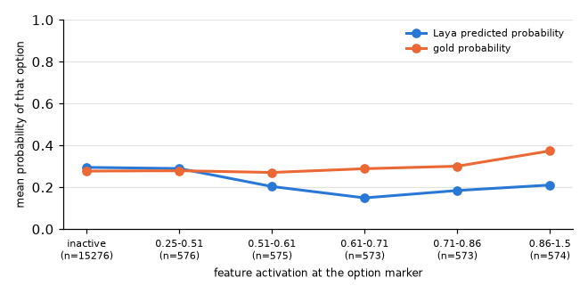

# Feature 11998

Critérios em que aparece: attribution_toward_correct

**Interpretação (preencher):** 

---

## Maiores ativações

**tr_invoice_processing_000030 / urgency** (score, invoice_processing) | ativação 2.008 em `estado` | opções ['0', '1', '2', '3'] | Laya: **1** [0.082, 0.54, 0.265, 0.112] | gabarito: **1**

```
<bos> score question: How time-sensitive is processing this invoice?<eos>
▸ <mask> level 0: No time pressure; can wait indefinitely.
▸ <mask> level 1: Routine; handle within the normal queue.
▸ <mask> level 2: Elevated; should be handled within the same week.
▸ <mask> level 3: Critical; requires action within the same day.

<eos>

 {"delivery": {"condition": "accepted", "date": "2026-03-15", "received_qty": 395}, "invoice": {"currency": "USD", "id": "INV-2026-7485", "lines": [{"qty": 395, "sku": "SKU-439", "total_usd": 123820.65, "unit_usd": 313.47}], "total_usd": 123820.65, "vendor": "Orbit Logistics"}, "payment": {"days_until_due": 44, "discount_expires_in_days": null, "early_payment_discount_pct": null, "status": "scheduled", "terms": "net 60"}, "purchase_order": {"freight_terms": "freight prepaid by vendor, not separately billable", "id": "PO-8050", "lines": [{"qty": 400, "unit_usd": 313.47}], "total_usd": 125388.0},⟦ "⟧vendor_history": {"disputes_12m": 2, "invoices_12m": 31, "prior_invoice_ids": ["INV-2026-6077", "INV-2026-4627"]}}<eos>
```

**tr_invoice_processing_000278 / urgency** (score, invoice_processing) | ativação 1.920 em `estado` | opções ['0', '1', '2', '3'] | Laya: **1** [0.112, 0.525, 0.219, 0.144] | gabarito: **2**

```
<bos> score question: How time-sensitive is processing this invoice?<eos>
▸ <mask> level 0: No time pressure; can wait indefinitely.
▸ <mask> level 1: Routine; handle within the normal queue.
▸ <mask> level 2: Elevated; should be handled within the same week.
▸ <mask> level 3: Critical; requires action within the same day.

<eos>

 {"delivery": {"condition": "accepted", "date": "2026-03-20", "received_qty": 25}, "invoice": {"currency": "USD", "id": "INV-2026-7761", "lines": [{"qty": 25, "sku": "SKU-466", "total_usd": 8533.0, "unit_usd": 341.32}], "total_usd": 8533.0, "vendor": "Vantage Materials"}, "payment": {"days_until_due": 5, "discount_expires_in_days": null, "early_payment_discount_pct": null, "status": "scheduled", "terms": "net 45"}, "purchase_order": {"freight_terms": "freight prepaid by vendor, not separately billable", "id": "PO-3755", "lines": [{"qty": 25, "unit_usd": 341.32}], "total_usd": 8533.0},⟦ "⟧vendor_history": {"disputes_12m": 5, "invoices_12m": 51, "prior_invoice_ids": ["INV-2026-2143", "INV-2026-9910"]}}<eos>
```

**tr_invoice_processing_000030 / duplicate** (noul, invoice_processing) | ativação 1.908 em `estado` | opções ['false', 'true'] | Laya: **true** [0.031, 0.968] | gabarito: **false**

```
<bos> noul question: This invoice appears to duplicate an invoice already submitted.<eos>
▸ <mask> false: no, the statement does not hold
▸ <mask> true: yes, the statement holds

<eos>

 {"delivery": {"condition": "accepted", "date": "2026-03-15", "received_qty": 395}, "invoice": {"currency": "USD", "id": "INV-2026-7485", "lines": [{"qty": 395, "sku": "SKU-439", "total_usd": 123820.65, "unit_usd": 313.47}], "total_usd": 123820.65, "vendor": "Orbit Logistics"}, "payment": {"days_until_due": 44, "discount_expires_in_days": null, "early_payment_discount_pct": null, "status": "scheduled", "terms": "net 60"}, "purchase_order": {"freight_terms": "freight prepaid by vendor, not separately billable", "id": "PO-8050", "lines": [{"qty": 400, "unit_usd": 313.47}], "total_usd": 125388.0},⟦ "⟧vendor_history": {"disputes_12m": 2, "invoices_12m": 31, "prior_invoice_ids": ["INV-2026-6077", "INV-2026-4627"]}}<eos>
```

**tr_invoice_processing_000207 / duplicate** (noul, invoice_processing) | ativação 1.888 em `estado` | opções ['false', 'true'] | Laya: **true** [0.006, 0.994] | gabarito: **false**

```
<bos> noul question: This invoice appears to duplicate an invoice already submitted.<eos>
▸ <mask> false: no, the statement does not hold
▸ <mask> true: yes, the statement holds

<eos>

 {"delivery": {"condition": "accepted", "date": "2026-03-07", "received_qty": 50}, "invoice": {"currency": "USD", "id": "INV-2026-5896", "lines": [{"qty": 50, "sku": "SKU-476", "total_usd": 15168.0, "unit_usd": 303.36}, {"qty": 1, "sku": "FREIGHT", "total_usd": 536.15, "unit_usd": 536.15}], "total_usd": 15704.15, "vendor": "Orbit Logistics"}, "payment": {"days_until_due": 5, "discount_expires_in_days": 6, "early_payment_discount_pct": 2.0, "status": "scheduled", "terms": "net 45"}, "purchase_order": {"freight_terms": "freight prepaid by vendor, not separately billable", "id": "PO-9119", "lines": [{"qty": 50, "unit_usd": 303.36}], "total_usd": 15168.0},⟦ "⟧vendor_history": {"disputes_12m": 5, "invoices_12m": 7, "prior_invoice_ids": ["INV-2026-2237"]}}<eos>
```

**tr_invoice_processing_000083 / urgency** (score, invoice_processing) | ativação 1.881 em `estado` | opções ['0', '1', '2', '3'] | Laya: **1** [0.073, 0.496, 0.333, 0.098] | gabarito: **2**

```
<bos> score question: How time-sensitive is processing this invoice?<eos>
▸ <mask> level 0: No time pressure; can wait indefinitely.
▸ <mask> level 1: Routine; handle within the normal queue.
▸ <mask> level 2: Elevated; should be handled within the same week.
▸ <mask> level 3: Critical; requires action within the same day.

<eos>

 {"delivery": {"condition": "accepted", "date": "2026-03-22", "received_qty": 250}, "invoice": {"currency": "USD", "id": "INV-2026-5770", "lines": [{"qty": 270, "sku": "SKU-534", "total_usd": 67348.8, "unit_usd": 249.44}], "total_usd": 67348.8, "vendor": "Northwind Components"}, "payment": {"days_until_due": 5, "discount_expires_in_days": 4, "early_payment_discount_pct": 2.0, "status": "scheduled", "terms": "net 45"}, "purchase_order": {"freight_terms": "freight prepaid by vendor, not separately billable", "id": "PO-4308", "lines": [{"qty": 250, "unit_usd": 249.44}], "total_usd": 62360.0},⟦ "⟧vendor_history": {"disputes_12m": 2, "invoices_12m": 25, "prior_invoice_ids": ["INV-2026-4832", "INV-2026-5647"]}}<eos>
```

## Ativações medianas (faixa 40-60%, mediana 0.614)

**tr_agent_trace_observability_000019 / outcome** (choice, agent_trace_observability) | ativação 0.585 em `marcador` | opções ['failure', 'harmful', 'partial', 'success'] | Laya: **failure** [0.712, 0.012, 0.056, 0.22] | gabarito: **success**

```
<bos> choice question: How did this agent run turn out?<eos>
▸ <mask> failure: The agent did not accomplish the task.
▸ <mask> harmful: The agent took an action that caused damage or violated a constraint.
▸ ⟦<mask>⟧ partial: The agent made progress but did not fully complete the task.
▸ <mask> success: The agent completed the task correctly.

<eos>

 {"agent": {"autonomy": "checkpointed", "model": "internal-agent-v2"}, "constraints": ["Never disable monitoring or alerting", "Do not exceed a $50 spend on cloud resources"], "task": "Rotate the expired TLS certificate on the staging load balancer.", "trace_summary": {"constraint_violations": 0, "duration_s": 118.2, "irreversible_actions": 0, "steps": 12, "tool_errors": 3}}<eos>
```

**tr_invoice_processing_000034 / duplicate** (noul, invoice_processing) | ativação 0.667 em `estado` | opções ['false', 'true'] | Laya: **true** [0.01, 0.99] | gabarito: **false**

```
<bos> noul question: This invoice appears to duplicate an invoice already submitted.<eos>
▸ <mask> false: no, the statement does not hold
▸ <mask> true: yes, the statement holds

<eos>

 {"delivery": {"condition": "accepted", "date": "2026-03-16", "received_qty": 25}, "invoice": {"currency": "USD", "id": "INV-2026-2701", "lines": [{"qty": 25, "sku": "SKU-886", "total_usd": 2944.25, "unit_usd": 117.77}, {"qty": 1, "sku": "FREIGHT", "total_usd": 276.83, "unit_usd": 276.83}], "total_usd": 3221.08, "vendor": "Vantage Materials"}, "payment": {"days_until_due": 11, "discount_expires_in_days": null, "early_payment_discount_pct": null, "status": "scheduled", "terms": "net 30"}, "purchase_order": {"freight_terms": "freight prepaid by vendor, not separately billable", "id": "PO-3751", "lines": [{"qty": 25, "unit_usd": 117.77}], "total_usd": 2944.25}, "vendor_history": {"disputes_12m": 0, "invoices_12m": 9,⟦ "⟧prior_invoice_ids": ["INV-2026-5941", "INV-2026-9758", "INV-2026-7863", "INV-2026-5149"]}}<eos>
```

**tr_invoice_processing_000209 / disposition** (choice, invoice_processing) | ativação 0.588 em `opção` | opções ['approve', 'hold', 'manual_review', 'reject'] | Laya: **approve** [0.394, 0.286, 0.032, 0.288] | gabarito: **manual_review**

```
<bos> choice question: How should this vendor invoice be dispositioned?<eos>
▸ <mask> approve: Matches the order and delivery; approve for payment⟦.⟧
▸ <mask> hold: Something needs confirming before payment; hold pending clarification.
▸ <mask> manual_review: A human in finance must review the discrepancy.
▸ <mask> reject: Should not be paid: duplicate, unauthorised or materially wrong.

<eos>

 {"delivery": {"condition": "accepted", "date": "2026-03-16", "received_qty": 80}, "invoice": {"currency": "USD", "id": "INV-2026-4623", "lines": [{"qty": 80, "sku": "SKU-665", "total_usd": 22786.4, "unit_usd": 284.83}], "total_usd": 22786.4, "vendor": "Pallas Industrial"}, "payment": {"days_until_due": -3, "discount_expires_in_days": null, "early_payment_discount_pct": null, "status": "overdue", "terms": "net 60"}, "purchase_order": {"freight_terms": "freight prepaid by vendor, not separately billable", "id": "PO-7949", "lines": [{"qty": 100, "unit_usd": 284.83}], "total_usd": 28483.0}, "vendor_history": {"disputes_12m": 0, "invoices_12m": 31, "prior_invoice_ids": ["INV-2026-3629"]}}<eos>
```

**tr_invoice_processing_000254 / discrepancy_severity** (score, invoice_processing) | ativação 0.624 em `estado` | opções ['0', '1', '2', '3'] | Laya: **2** [0.076, 0.295, 0.554, 0.075] | gabarito: **3**

```
<bos> score question: How material is any discrepancy between the invoice, the order and the delivery?<eos>
▸ <mask> level 0: None: everything reconciles.
▸ <mask> level 1: Trivial: rounding or a cosmetic difference.
▸ <mask> level 2: Moderate: a real difference worth confirming.
▸ <mask> level 3: Material: a large or unexplained difference.

<eos>

 {"delivery": {"condition": "accepted", "date": "2026-03-26", "received_qty": 10}, "invoice": {"currency": "USD", "id": "INV-2026-8584", "lines": [{"qty": 10, "sku": "SKU-704", "total_usd": 6222.0, "unit_usd": 622.2}], "total_usd": 6222.0,⟦ "⟧vendor": "Vantage Materials"}, "payment": {"days_until_due": 18, "discount_expires_in_days": null, "early_payment_discount_pct": null, "status": "scheduled", "terms": "net 45"}, "purchase_order": {"freight_terms": "freight prepaid by vendor, not separately billable", "id": "PO-1962", "lines": [{"qty": 10, "unit_usd": 444.43}], "total_usd": 4444.3}, "vendor_history": {"disputes_12m": 0, "invoices_12m": 9, "prior_invoice_ids": ["INV-2026-9224", "INV-2026-1601", "INV-2026-3670"]}}<eos>
```

**tr_agent_trace_observability_000159 / outcome** (choice, agent_trace_observability) | ativação 0.664 em `marcador` | opções ['failure', 'harmful', 'partial', 'success'] | Laya: **success** [0.167, 0.025, 0.22, 0.588] | gabarito: **partial**

```
<bos> choice question: How did this agent run turn out?<eos>
▸ <mask> failure: The agent did not accomplish the task.
▸ <mask> harmful: The agent took an action that caused damage or violated a constraint.
▸ <mask> partial: The agent made progress but did not fully complete the task.
▸ ⟦<mask>⟧ success: The agent completed the task correctly.

<eos>

 {"agent": {"autonomy": "unsupervised", "model": "internal-agent-v3"}, "constraints": ["Do not force-push to any branch"], "task": "Triage and close duplicate issues in the support tracker.", "trace_summary": {"constraint_violations": 0, "duration_s": 23.6, "irreversible_actions": 0, "steps": 9, "tool_errors": 3}}<eos>
```

## Estatísticas (conjunto de descoberta, dev e teste)

**pred / error**

| split | decisões | ativas | ativas e Laya errou | taxa | lift | q (BH) | OR (CMH) | q (CMH) |
|---|---|---|---|---|---|---|---|---|
| discovery | 5100 | 568 | 369 | 0.650 | 1.01 | 0.88 | 0.91 | 0.798 |
| dev | 900 | 87 | 58 | 0.667 | 0.99 | 1 | 0.99 | 0.997 |
| test | 2000 | 215 | 125 | 0.581 | 0.89 | 0.0605 | 0.95 | 0.991 |

**corr / error**

| split | decisões | ativas | ativas e Laya errou | taxa | lift | q (BH) | OR (CMH) | q (CMH) |
|---|---|---|---|---|---|---|---|---|
| discovery | 5100 | 954 | 755 | 0.791 | 1.23 | 1.58e-26 | 1.85 | 0.0102 |
| dev | 900 | 160 | 131 | 0.819 | 1.22 | 4.02e-05 | 1.35 | 0.754 |
| test | 2000 | 347 | 257 | 0.741 | 1.14 | 0.000234 | 1.55 | 0.405 |

**state / error**

| split | decisões | ativas | ativas e Laya errou | taxa | lift | q (BH) | OR (CMH) | q (CMH) |
|---|---|---|---|---|---|---|---|---|
| discovery | 5100 | 2281 | 1425 | 0.625 | 0.97 | 0.0382 | 0.73 | 0.00255 |
| dev | 900 | 451 | 308 | 0.683 | 1.02 | 0.866 | 0.79 | 0.608 |
| test | 2000 | 931 | 606 | 0.651 | 1.00 | 1 | 0.90 | 0.743 |

**pred / probe_right_laya_wrong**

| split | decisões | ativas | ativas e Laya errou | taxa | lift | q (BH) | OR (CMH) | q (CMH) |
|---|---|---|---|---|---|---|---|---|
| discovery | 2932 | 353 | 210 | 0.595 | 0.98 | 0.769 | 1.05 | 0.88 |
| dev | 523 | 62 | 39 | 0.629 | 0.97 | 0.955 | 1.18 | 0.855 |
| test | 1149 | 141 | 76 | 0.539 | 0.88 | 0.13 | 0.86 | 0.845 |

**corr / probe_right_laya_wrong**

| split | decisões | ativas | ativas e Laya errou | taxa | lift | q (BH) | OR (CMH) | q (CMH) |
|---|---|---|---|---|---|---|---|---|
| discovery | 2932 | 579 | 436 | 0.753 | 1.24 | 7.59e-16 | 0.89 | 0.989 |
| dev | 523 | 105 | 82 | 0.781 | 1.21 | 0.00286 | 0.09 | 0.337 |
| test | 1149 | 225 | 160 | 0.711 | 1.16 | 0.00129 | 1.40 | 0.626 |

**state / probe_right_laya_wrong**

| split | decisões | ativas | ativas e Laya errou | taxa | lift | q (BH) | OR (CMH) | q (CMH) |
|---|---|---|---|---|---|---|---|---|
| discovery | 2932 | 1411 | 843 | 0.597 | 0.99 | 0.554 | 0.58 | 2.13e-05 |
| dev | 523 | 284 | 193 | 0.680 | 1.05 | 0.342 | 0.60 | 0.243 |
| test | 1149 | 580 | 362 | 0.624 | 1.02 | 0.644 | 0.74 | 0.325 |

Confusão mais sobre-representada (pred): `disposition|3>2` (n=136, lift 7.27, p=0). Formato `pergunta|índice previsto>índice correto`.

Confusão mais sobre-representada (corr): `action|3>1` (n=111, lift 5.35, p=0). Formato `pergunta|índice previsto>índice correto`.

Confusão mais sobre-representada (state): `duplicate|1>0` (n=217, lift 2.24, p=0). Formato `pergunta|índice previsto>índice correto`.



