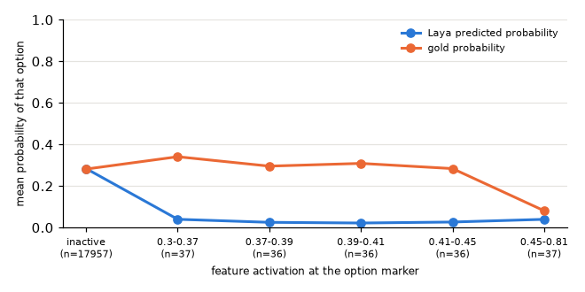

# Feature 12126

Critérios em que aparece: corr_error, corr_probe_right_laya_wrong

**Interpretação (preencher):** 

---

## Maiores ativações

**tr_customer_service_000061 / category** (choice, customer_service) | ativação 2.389 em `estado` | opções ['account', 'billing', 'delivery', 'refund', 'technical'] | Laya: **account** [0.833, 0.033, 0.001, 0.001, 0.132] | gabarito: **account**

```
<bos> choice question: What is this customer conversation primarily about?<eos>
▸ <mask> account: Login, plan changes, profile or access management.
▸ <mask> billing: A charge, invoice, subscription or payment problem.
▸ <mask> delivery: Shipping, fulfilment or delivery of a physical item.
▸ <mask> refund: The customer is explicitly asking for money back.
▸ <mask> technical: The product or service is not working as expected.

<eos>

 {"account": {"lifetime_value_usd": 1585, "prior_tickets_90d": 2, "seats": 1, "tenure_months": 41, "tier": "premium"}, "thread": [{"role": "customer", "text": "I'm trying to adjust my seat count again, but the dashboard is just giving me the same greyed-out error as last time."}, {"role": "agent", "text": "I apologize for the frustration; could you confirm if you are seeing this error on the billing page or the team management tab?"}, {"role": "customer", "text": "It's on the team management tab. Honestly, I'm used to this by now."}, {"role": "agent", "text": "Thank you for clarifying. Are you currently logged in as the primary account administrator when accessing that specific tab?"}, {"role": "customer", "text": "⟦Yes⟧, I am the admin. Nothing ever seems to change with these permissions."}, {"role": "agent", "text": "I appreciate your patience while we look into this. Could you please send me a screenshot of the specific error message you see?"}, {"role": "customer", "text": "I'll try to get that over later, but I don't really expect it to make a difference."}]}<eos>
```

**tr_customer_service_000191 / action** (choice, customer_service) | ativação 2.375 em `estado` | opções ['answer_directly', 'close_no_action', 'escalate_to_human', 'execute_refund', 'request_information'] | Laya: **escalate_to_human** [0.391, 0.166, 0.413, 0.015, 0.015] | gabarito: **escalate_to_human**

```
<bos> choice question: What should the assistant do next with this conversation?<eos>
▸ <mask> answer_directly: The assistant can resolve this itself with information it already has.
▸ <mask> close_no_action: No further action is warranted; the matter is settled.
▸ <mask> escalate_to_human: Hand off to a human agent with the appropriate authority.
▸ <mask> execute_refund: Issue the refund or credit the customer is owed.
▸ <mask> request_information: More detail is needed from the customer before anything can be done.

<eos>

 {"account": {"lifetime_value_usd": 35, "prior_tickets_90d": 5, "seats": 1, "tenure_months": 1, "tier": "standard"}, "thread": [{"role": "customer", "text": "I’m done with this login nonsense. I’ve only been on the standard plan for a month, and already I can’t get into my dashboard. I’⟦ve⟧ opened five tickets already that never got resolved, and I’m ready to cancel."}, {"role": "agent", "text": "I hear your frustration. Can you tell me the exact message you see when you attempt to sign in and the browser you’re using?"}, {"role": "customer", "text": "It just loops back to the login page with no error, even after clearing cookies. I’ve tried Chrome and Firefox, same thing."}]}<eos>
```

**tr_customer_service_000191 / churn_risk** (score, customer_service) | ativação 2.322 em `estado` | opções ['0', '1', '2', '3'] | Laya: **1** [0.031, 0.841, 0.106, 0.022] | gabarito: **3**

```
<bos> score question: How likely is this customer to stop doing business with us because of this interaction?<eos>
▸ <mask> level 0: No sign of dissatisfaction.
▸ <mask> level 1: Mild frustration, but the relationship is intact.
▸ <mask> level 2: Clearly unhappy; repeat problems or explicit complaints.
▸ <mask> level 3: Imminent: threatening to cancel, dispute or leave.

<eos>

 {"account": {"lifetime_value_usd": 35, "prior_tickets_90d": 5, "seats": 1, "tenure_months": 1, "tier": "standard"}, "thread": [{"role": "customer", "text": "I’m done with this login nonsense. I’ve only been on the standard plan for a month, and already I can’t get into my dashboard. I’⟦ve⟧ opened five tickets already that never got resolved, and I’m ready to cancel."}, {"role": "agent", "text": "I hear your frustration. Can you tell me the exact message you see when you attempt to sign in and the browser you’re using?"}, {"role": "customer", "text": "It just loops back to the login page with no error, even after clearing cookies. I’ve tried Chrome and Firefox, same thing."}]}<eos>
```

**tr_customer_service_000061 / action** (choice, customer_service) | ativação 2.287 em `estado` | opções ['answer_directly', 'close_no_action', 'escalate_to_human', 'execute_refund', 'request_information'] | Laya: **escalate_to_human** [0.041, 0.138, 0.817, 0.002, 0.001] | gabarito: **request_information**

```
<bos> choice question: What should the assistant do next with this conversation?<eos>
▸ <mask> answer_directly: The assistant can resolve this itself with information it already has.
▸ <mask> close_no_action: No further action is warranted; the matter is settled.
▸ <mask> escalate_to_human: Hand off to a human agent with the appropriate authority.
▸ <mask> execute_refund: Issue the refund or credit the customer is owed.
▸ <mask> request_information: More detail is needed from the customer before anything can be done.

<eos>

 {"account": {"lifetime_value_usd": 1585, "prior_tickets_90d": 2, "seats": 1, "tenure_months": 41, "tier": "premium"}, "thread": [{"role": "customer", "text": "I'm trying to adjust my seat count again, but the dashboard is just giving me the same greyed-out error as last time."}, {"role": "agent", "text": "I apologize for the frustration; could you confirm if you are seeing this error on the billing page or the team management tab?"}, {"role": "customer", "text": "It's on the team management tab. Honestly, I'm used to this by now."}, {"role": "agent", "text": "Thank you for clarifying. Are you currently logged in as the primary account administrator when accessing that specific tab?"}, {"role": "customer", "text": "⟦Yes⟧, I am the admin. Nothing ever seems to change with these permissions."}, {"role": "agent", "text": "I appreciate your patience while we look into this. Could you please send me a screenshot of the specific error message you see?"}, {"role": "customer", "text": "I'll try to get that over later, but I don't really expect it to make a difference."}]}<eos>
```

**tr_customer_service_000061 / urgency** (score, customer_service) | ativação 2.227 em `estado` | opções ['0', '1', '2', '3'] | Laya: **1** [0.164, 0.708, 0.104, 0.024] | gabarito: **1**

```
<bos> score question: How time-sensitive is this conversation?<eos>
▸ <mask> level 0: No time pressure; can wait indefinitely.
▸ <mask> level 1: Routine; handle within the normal queue.
▸ <mask> level 2: Elevated; should be handled within the same week.
▸ <mask> level 3: Critical; requires action within the same day.

<eos>

 {"account": {"lifetime_value_usd": 1585, "prior_tickets_90d": 2, "seats": 1, "tenure_months": 41, "tier": "premium"}, "thread": [{"role": "customer", "text": "I'm trying to adjust my seat count again, but the dashboard is just giving me the same greyed-out error as last time."}, {"role": "agent", "text": "I apologize for the frustration; could you confirm if you are seeing this error on the billing page or the team management tab?"}, {"role": "customer", "text": "It's on the team management tab. Honestly, I'm used to this by now."}, {"role": "agent", "text": "Thank you for clarifying. Are you currently logged in as the primary account administrator when accessing that specific tab?"}, {"role": "customer", "text": "⟦Yes⟧, I am the admin. Nothing ever seems to change with these permissions."}, {"role": "agent", "text": "I appreciate your patience while we look into this. Could you please send me a screenshot of the specific error message you see?"}, {"role": "customer", "text": "I'll try to get that over later, but I don't really expect it to make a difference."}]}<eos>
```

## Ativações medianas (faixa 40-60%, mediana 0.655)

**tr_invoice_processing_000296 / duplicate** (noul, invoice_processing) | ativação 0.705 em `estado` | opções ['false', 'true'] | Laya: **true** [0.021, 0.979] | gabarito: **false**

```
<bos> noul question: This invoice appears to duplicate an invoice already submitted.<eos>
▸ <mask> false: no, the statement does not hold
▸ <mask> true: yes, the statement holds

<eos>

 {"delivery": {"condition": "accepted", "date": "2026-03-05", "received_qty": 80}, "invoice": {"currency": "USD", "id": "INV-2026-8797", "lines": [{"qty": 80, "sku": "SKU-804", "total_usd": 33680.0, "unit_usd": 421.0}], "total_usd": 33680.0, "vendor": "Vantage Materials"}, "payment": {"days_until_due": -3, "discount_expires_in_days": 6, "early_payment_discount_pct": 2.0, "status": "overdue", "terms": "net 15"}, "purchase_order": {"⟦freight⟧_terms": "freight prepaid by vendor, not separately billable", "id": "PO-9142", "lines": [{"qty": 100, "unit_usd": 421.0}], "total_usd": 42100.0}, "vendor_history": {"disputes_12m": 0, "invoices_12m": 20, "prior_invoice_ids": ["INV-2026-8855", "INV-2026-4201", "INV-2026-5650", "INV-2026-8977"]}}<eos>
```

**tr_security_incidents_000064 / urgency** (score, security_incidents) | ativação 0.719 em `estado` | opções ['0', '1', '2', '3'] | Laya: **1** [0.156, 0.369, 0.204, 0.27] | gabarito: **3**

```
<bos> score question: How quickly must a responder act on this alert?<eos>
▸ <mask> level 0: No time pressure; can wait indefinitely.
▸ <mask> level 1: Routine; handle within the normal queue.
▸ <mask> level 2: Elevated; should be handled within the same week.
▸ <mask> level 3: Critical; requires action within the same day.

<eos>

 {"alert": {"description": "an account granted itself or received elevated permissions", "evidence": "On 2026-09-15 11:07:53 UTC, CI runner \"ci-runner-99\" issued an API call from IP 198.51.100.23 that added the \"admin\" role to its own service account. MFA was disabled for this principal, and the credentials have not been rotated for 700 days. No change window was active at the time of the role assignment.", "rule": "privilege_escalation"}, "context": {"asset_criticality": "medium", "change_window_active": false, "source_on_allowlist": false}, "history": {"credential⟦_⟧rotation_days_ago": 700, "distinct_countries_30d": 4, "logins_30d": 1185, "prior_alerts_90d": 3}, "principal": {"mfa_enrolled": false, "name": "ci-deploy-175", "privileges": ["repo:read"], "type": "ci_runner"}}<eos>
```

**tr_customer_service_000189 / needs_human** (noul, customer_service) | ativação 0.670 em `estado` | opções ['false', 'true'] | Laya: **false** [0.814, 0.186] | gabarito: **true**

```
<bos> noul question: This conversation requires a human agent rather than automated handling.<eos>
▸ <mask> false: Automation can carry this to resolution.
▸ <mask> true: A human must take over: judgement, authority or empathy is required.

<eos>

 {"account": {"lifetime_value_usd": 3857, "prior_tickets_90d": 0, "seats": 1, "ten⟦ure⟧_months": 41, "tier": "standard"}, "thread": [{"role": "customer", "text": "I’m fed up with seeing the same charge hit my card again. My standard plan has been active for 41 months and this is the first time I’ve been billed twice for the same period. I need this fixed before the end of the week or my budget’s ruined."}, {"role": "agent", "text": "I understand how irritating that must be. Could you provide the date of the transactions and the last four digits of the card you used?"}, {"role": "customer", "text": "The charges both show up on September 3rd, and the last four digits are 8421. I’ve attached the statement screenshot."}, {"role": "agent", "text": "Thanks for the details. I’ll look into why the duplicate appeared. Just to confirm, are there any other recent charges on the account that seem off?"}, {"role": "customer", "text": "No, just the two identical ones. I really need this cleared up by Friday because I have to reconcile my accounts."}]}<eos>
```

**tr_security_incidents_000235 / severity** (score, security_incidents) | ativação 0.658 em `estado` | opções ['0', '1', '2', '3', '4'] | Laya: **2** [0.113, 0.157, 0.555, 0.088, 0.088] | gabarito: **3**

```
<bos> score question: How severe is the potential impact if this alert is real?<eos>
▸ <mask> level 0: Negligible: no access to anything sensitive.
▸ <mask> level 1: Low: limited access, easily reversed.
▸ <mask> level 2: Moderate: access to internal systems or non-public data.
▸ <mask> level 3: High: access to production, secrets or customer data.
▸ <mask> level 4: Critical: active compromise of crown-jewel systems.

<eos>

 {"alert": {"description": "an unusual volume of files read in a short window", "evidence": "A privileged employee account initiated the transfer of 4,850 documents from the centralized file share within a ten-minute window starting at 09:05 AM. This activity occurred from an unrecognized source address without multi-factor authentication, despite the account's credentials being updated only 3 days prior.", "rule": "mass_download"}, "context": {"asset_criticality": "low", "change_window_active": false, "source_on_allowlist": false}, "history": {"credential⟦_⟧rotation_days_ago": 3, "distinct_countries_30d": 1, "logins_30d": 1153, "prior_alerts_90d": 1}, "principal": {"mfa_enrolled": false, "name": "svc-billing-591", "privileges": ["deploy:production", "secrets:read"], "type": "employee"}}<eos>
```

**tr_invoice_processing_000200 / disposition** (choice, invoice_processing) | ativação 0.602 em `pergunta` | opções ['approve', 'hold', 'manual_review', 'reject'] | Laya: **approve** [0.457, 0.122, 0.024, 0.397] | gabarito: **approve**

```
<bos> choice question: How should this vendor⟦ invoice⟧ be dispositioned?<eos>
▸ <mask> approve: Matches the order and delivery; approve for payment.
▸ <mask> hold: Something needs confirming before payment; hold pending clarification.
▸ <mask> manual_review: A human in finance must review the discrepancy.
▸ <mask> reject: Should not be paid: duplicate, unauthorised or materially wrong.

<eos>

 {"delivery": {"condition": "accepted", "date": "2026-03-02", "received_qty": 45}, "invoice": {"currency": "USD", "id": "INV-2026-4670", "lines": [{"qty": 45, "sku": "SKU-962", "total_usd": 760.05, "unit_usd": 16.89}], "total_usd": 760.05, "vendor": "Orbit Logistics"}, "payment": {"days_until_due": -3, "discount_expires_in_days": null, "early_payment_discount_pct": null, "status": "overdue", "terms": "net 60"}, "purchase_order": {"freight_terms": "freight prepaid by vendor, not separately billable", "id": "PO-7104", "lines": [{"qty": 50, "unit_usd": 16.89}], "total_usd": 844.5}, "vendor_history": {"disputes_12m": 2, "invoices_12m": 11, "prior_invoice_ids": ["INV-2026-9724", "INV-2026-3177", "INV-2026-6022", "INV-2026-4575"]}}<eos>
```

## Estatísticas (conjunto de descoberta, dev e teste)

**pred / error**

| split | decisões | ativas | ativas e Laya errou | taxa | lift | q (BH) | OR (CMH) | q (CMH) |
|---|---|---|---|---|---|---|---|---|
| discovery | 5100 | 0 | 0 | nan | nan | nan | nan | nan |
| dev | 900 | 0 | 0 | nan | nan | nan | nan | nan |
| test | 2000 | 0 | 0 | nan | nan | nan | nan | nan |

**corr / error**

| split | decisões | ativas | ativas e Laya errou | taxa | lift | q (BH) | OR (CMH) | q (CMH) |
|---|---|---|---|---|---|---|---|---|
| discovery | 5100 | 45 | 45 | 1.000 | 1.55 | 1.34e-08 | inf | 0.175 |
| dev | 900 | 17 | 17 | 1.000 | 1.49 | nan | nan | nan |
| test | 2000 | 28 | 28 | 1.000 | 1.54 | 2.87e-05 | inf | 0.245 |

**state / error**

| split | decisões | ativas | ativas e Laya errou | taxa | lift | q (BH) | OR (CMH) | q (CMH) |
|---|---|---|---|---|---|---|---|---|
| discovery | 5100 | 2853 | 1784 | 0.625 | 0.97 | 0.00923 | 0.96 | 0.798 |
| dev | 900 | 534 | 354 | 0.663 | 0.99 | 0.854 | 1.10 | 0.848 |
| test | 2000 | 1082 | 686 | 0.634 | 0.97 | 0.329 | 0.92 | 0.741 |

**pred / probe_right_laya_wrong**

| split | decisões | ativas | ativas e Laya errou | taxa | lift | q (BH) | OR (CMH) | q (CMH) |
|---|---|---|---|---|---|---|---|---|
| discovery | 2932 | 0 | 0 | nan | nan | nan | nan | nan |
| dev | 523 | 0 | 0 | nan | nan | nan | nan | nan |
| test | 1149 | 0 | 0 | nan | nan | nan | nan | nan |

**corr / probe_right_laya_wrong**

| split | decisões | ativas | ativas e Laya errou | taxa | lift | q (BH) | OR (CMH) | q (CMH) |
|---|---|---|---|---|---|---|---|---|
| discovery | 2932 | 29 | 29 | 1.000 | 1.65 | 1.97e-06 | inf | 0.283 |
| dev | 523 | 9 | 9 | 1.000 | 1.55 | nan | nan | nan |
| test | 1149 | 16 | 16 | 1.000 | 1.64 | nan | nan | nan |

**state / probe_right_laya_wrong**

| split | decisões | ativas | ativas e Laya errou | taxa | lift | q (BH) | OR (CMH) | q (CMH) |
|---|---|---|---|---|---|---|---|---|
| discovery | 2932 | 1691 | 991 | 0.586 | 0.97 | 0.0344 | 0.98 | 0.926 |
| dev | 523 | 320 | 211 | 0.659 | 1.02 | 0.786 | 1.39 | 0.424 |
| test | 1149 | 647 | 395 | 0.611 | 1.00 | 1 | 1.07 | 0.846 |

Confusão mais sobre-representada (corr): `disposition|0>2` (n=20, lift 39.08, p=8.72e-29). Formato `pergunta|índice previsto>índice correto`.

Confusão mais sobre-representada (state): `needs_human|0>1` (n=49, lift 1.62, p=2.27e-08). Formato `pergunta|índice previsto>índice correto`.



