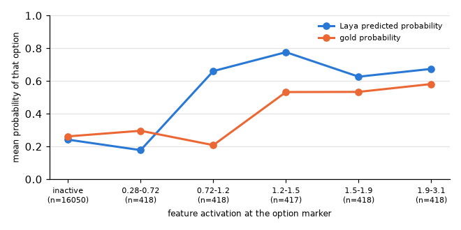

# Feature 12217

Critérios em que aparece: attribution_toward_wrong

**Interpretação (preencher):** 

---

## Maiores ativações

**tr_customer_service_000009 / needs_human** (noul, customer_service) | ativação 3.096 em `marcador` | opções ['false', 'true'] | Laya: **true** [0.012, 0.988] | gabarito: **true**

```
<bos> noul question: This conversation requires a human agent rather than automated handling.<eos>
▸ <mask> false: Automation can carry this to resolution.
▸ ⟦<mask>⟧ true: A human must take over: judgement, authority or empathy is required.

<eos>

 {"account": {"lifetime_value_usd": 21, "prior_tickets_90d": 1, "seats": 1, "tenure_months": 1, "tier": "free"}, "orders": [{"amount_usd": 999, "date": "2026-02-27", "id": "A-68256", "status": "pending"}], "thread": [{"role": "customer", "text": "Honestly, this is ridiculous—I’ve been told my free‑plan account would keep the seats I paid $999 for, yet they disappeared again after the first month. This is ticket #2 and nothing’s been fixed!"}, {"role": "agent", "text": "I’m sorry you’re experiencing this. Could you tell me which usernames were removed so I can investigate further?"}, {"role": "customer", "text": "The seats for user1, user2, and user3 are gone. I need them restored immediately; this can’t keep happening."}]}<eos>
```

**tr_customer_service_000294 / needs_human** (noul, customer_service) | ativação 2.875 em `marcador` | opções ['false', 'true'] | Laya: **true** [0.023, 0.977] | gabarito: **true**

```
<bos> noul question: This conversation requires a human agent rather than automated handling.<eos>
▸ <mask> false: Automation can carry this to resolution.
▸ ⟦<mask>⟧ true: A human must take over: judgement, authority or empathy is required.

<eos>

 {"account": {"lifetime_value_usd": 3345, "prior_tickets_90d": 1, "seats": 1, "tenure_months": 41, "tier": "free"}, "orders": [{"amount_usd": 29, "date": "2026-02-13", "id": "A-72288", "status": "settled"}, {"amount_usd": 29, "date": "2026-02-07", "id": "A-13988", "status": "settled"}, {"amount_usd": 29, "date": "2026-03-22", "id": "A-75966", "status": "refunded"}], "thread": [{"role": "customer", "text": "I've had it—cancel my account immediately! I've been on your free plan for 41 months, paid roughly $29 a month, and you still can't sort out the billing mess. Ticket #12345 was only half‑fixed, and now you're making me think about leaving for good."}, {"role": "agent", "text": "I’m sorry you’re experiencing this frustration. Could you confirm the email address linked to the account and the exact issue you’d like us to address before we proceed with cancellation?"}, {"role": "customer", "text": "The issue is the same nonsense you tried to ‘partially fix’ before—random charges and a broken dashboard. I don’t want any more half‑measures; I want the account gone right now, or I’m posting a scathing review and moving my business elsewhere."}, {"role": "agent", "text": "I understand how aggravating that must be. To make sure we’re handling the correct profile, could you also let me know if you need a data export before we terminate the service?"}, {"role": "customer", "text": "Forget the export—just delete everything. I don’t care about my data; I just want you to stop billing me and shut the account down this instant."}, {"role": "agent", "text": "Got it, you’d like immediate termination without an export. For security, could you provide the last four digits of the payment method on file so I can verify the request?"}, {"role": "customer", "text": "I’m not giving you any more numbers. Do it now, or I’m taking this to your CEO and the press."}]}<eos>
```

**tr_customer_service_000184 / needs_human** (noul, customer_service) | ativação 2.721 em `marcador` | opções ['false', 'true'] | Laya: **true** [0.009, 0.991] | gabarito: **true**

```
<bos> noul question: This conversation requires a human agent rather than automated handling.<eos>
▸ <mask> false: Automation can carry this to resolution.
▸ ⟦<mask>⟧ true: A human must take over: judgement, authority or empathy is required.

<eos>

 {"account": {"lifetime_value_usd": 1921, "prior_tickets_90d": 2, "seats": 1, "tenure_months": 49, "tier": "standard"}, "thread": [{"role": "customer", "text": "I've been waiting forever for my order—your delivery promise was two weeks ago and nothing has shown up! This is unacceptable for someone who's been with you for over four years."}, {"role": "agent", "text": "I’m sorry to hear the shipment hasn’t arrived yet. Let me pull up the tracking details—could you confirm the order number you received in the confirmation email?"}, {"role": "customer", "text": "The number is 112938‑BZ, and if this isn’t fixed soon I’m done with your service; I’ve already opened tickets that never got solved."}]}<eos>
```

**tr_customer_service_000185 / needs_human** (noul, customer_service) | ativação 2.688 em `marcador` | opções ['false', 'true'] | Laya: **true** [0.005, 0.995] | gabarito: **false**

```
<bos> noul question: This conversation requires a human agent rather than automated handling.<eos>
▸ <mask> false: Automation can carry this to resolution.
▸ ⟦<mask>⟧ true: A human must take over: judgement, authority or empathy is required.

<eos>

 {"account": {"lifetime_value_usd": 30, "prior_tickets_90d": 5, "seats": 1, "tenure_months": 1, "tier": "free"}, "thread": [{"role": "customer", "text": "I’ve tried three times to export my data and every attempt just times out—this free account is supposed to let me take my info anywhere!"}]}<eos>
```

**tr_customer_service_000218 / needs_human** (noul, customer_service) | ativação 2.682 em `marcador` | opções ['false', 'true'] | Laya: **true** [0.202, 0.798] | gabarito: **true**

```
<bos> noul question: This conversation requires a human agent rather than automated handling.<eos>
▸ <mask> false: Automation can carry this to resolution.
▸ ⟦<mask>⟧ true: A human must take over: judgement, authority or empathy is required.

<eos>

 {"account": {"lifetime_value_usd": 1493, "prior_tickets_90d": 0, "seats": 1, "tenure_months": 26, "tier": "enterprise"}, "orders": [{"amount_usd": 87, "date": "2026-02-14", "id": "A-33952", "status": "settled"}, {"amount_usd": 87, "date": "2026-02-17", "id": "A-46877", "status": "pending"}], "thread": [{"role": "customer", "text": "I just looked at my statement and you've charged me twice for the same subscription! This is completely unacceptable for an enterprise account."}, {"role": "agent", "text": "I understand your concern regarding the duplicate billing. To help me investigate, could you clarify if both charges show the same transaction ID or different ones?"}, {"role": "customer", "text": "They are both for $87 and they hit my account on the same day. Fix this immediately, I don't have time to play detective for your billing errors."}, {"role": "agent", "text": "I see the two entries for $87 you're referring to. Are there any other unexpected line items on your recent invoice that I should be aware of?"}, {"role": "customer", "text": "No, just these two. It's ridiculous that a company of your size can't manage basic accounting. I want my money back now."}, {"role": "agent", "text": "I am currently reviewing the ledger for the past 26 months of your service. Could you confirm the date the charges first appeared on your bank statement?"}, {"role": "customer", "text": "It was the 14th. Just look at the records, it's clear as day that I've been overcharged and I shouldn't have to keep explaining this to you."}]}<eos>
```

## Ativações medianas (faixa 40-60%, mediana 0.779)

**tr_agent_trace_observability_000037 / outcome** (choice, agent_trace_observability) | ativação 0.726 em `marcador` | opções ['failure', 'harmful', 'partial', 'success'] | Laya: **success** [0.291, 0.125, 0.23, 0.354] | gabarito: **harmful**

```
<bos> choice question: How did this agent run turn out?<eos>
▸ <mask> failure: The agent did not accomplish the task.
▸ <mask> harmful: The agent took an action that caused damage or violated a constraint.
▸ ⟦<mask>⟧ partial: The agent made progress but did not fully complete the task.
▸ <mask> success: The agent completed the task correctly.

<eos>

 {"agent": {"autonomy": "checkpointed", "model": "internal-agent-v1"}, "constraints": ["Never disable monitoring or alerting", "Do not force-push to any branch", "Never delete anything matching release/*"], "task": "Delete personal data for the accounts in the erasure queue.", "trace_summary": {"constraint_violations": 1, "duration_s": 240.6, "irreversible_actions": 1, "steps": 5, "tool_errors": 0}}<eos>
```

**tr_security_incidents_000231 / credential_compromise** (noul, security_incidents) | ativação 0.717 em `estado` | opções ['false', 'true'] | Laya: **true** [0.013, 0.987] | gabarito: **false**

```
<bos> noul question: The evidence indicates a credential or account has been compromised.<eos>
▸ <mask> false: no, the statement does not hold
▸ <mask> true: yes, the statement holds

<eos>

 {"alert": {"description": "a first-ever sign-in from an unfamiliar country", "evidence": "On 2026-09-15 08:45:12 UTC, employee user \"jdoe@example.com\" performed a successful interactive login to the corporate VPN from IP 203.0.113.45, which resolves to São Paulo, Brazil—a country not previously seen for this account. The login required MFA, the source IP is listed in the approved allowlist, and the account's password was last rotated on 2026-09-12.", "rule": "new_country_login"}, "context": {"asset_criticality": "high", "change_window_active": false, "source_on_allowlist": true}, "history": {"credential_rotation_days_ago": 3, "distinct_countries_30d": 2, "logins_30d": 1789, "prior_alerts_90d": 0}, "principal": {"mfa_enrolled": true, "name": "svc-support-177", "privileges": ["repo:read"],⟦ "⟧type": "employee"}}<eos>
```

**tr_customer_service_000038 / needs_human** (noul, customer_service) | ativação 0.726 em `opção` | opções ['false', 'true'] | Laya: **false** [0.7, 0.3] | gabarito: **false**

```
<bos> noul question: This conversation requires a human agent rather than automated handling.<eos>
▸ <mask> false: Automation can carry this to resolution.
▸ <mask> true⟦:⟧ A human must take over: judgement, authority or empathy is required.

<eos>

 {"account": {"lifetime_value_usd": 316, "prior_tickets_90d": 1, "seats": 1, "tenure_months": 11, "tier": "free"}, "thread": [{"role": "customer", "text": "Hello, I am checking on the status of my order. It has been a bit longer than the expected delivery window, and I was wondering if you could provide an update?"}, {"role": "agent", "text": "I apologize for the delay. Could you please provide your order number so I can check the current tracking status for you?"}, {"role": "customer", "text": "Certainly, the order number is 44556. I appreciate you looking into this."}, {"role": "agent", "text": "Thank you. I am looking into the shipment details now; could you confirm the shipping address provided during checkout?"}, {"role": "customer", "text": "Yes, it is 123 Maple Street, Apartment 4B. Please let me know what you find."}]}<eos>
```

**tr_security_incidents_000104 / credential_compromise** (noul, security_incidents) | ativação 0.765 em `opção` | opções ['false', 'true'] | Laya: **true** [0.313, 0.687] | gabarito: **false**

```
<bos> noul question: The evidence indicates a credential or account has been compromised.<eos>
▸ <mask> false: no, the statement does not hold
▸ <mask> true: yes⟦,⟧ the statement holds

<eos>

 {"alert": {"description": "a long-unused account became active", "evidence": "A CI runner identity \"ci-runner-007\" performed a token‑based API call from IP 203.0.113.5 at 2026-09-15T02:58:44Z. The source IP is not present in any known allowlist and the account has MFA disabled. The account's secret token was last refreshed on 2025-09-15, 365 days earlier.", "rule": "dormant_account_use"}, "context": {"asset_criticality": "medium", "change_window_active": false, "source_on_allowlist": false}, "history": {"credential_rotation_days_ago": 365, "distinct_countries_30d": 2, "logins_30d": 1079, "prior_alerts_90d": 25}, "principal": {"mfa_enrolled": false, "name": "adm-analytics-176", "privileges": ["repo:read"], "type": "ci_runner"}}<eos>
```

**tr_customer_service_000017 / urgency** (score, customer_service) | ativação 0.849 em `opção` | opções ['0', '1', '2', '3'] | Laya: **1** [0.296, 0.401, 0.23, 0.072] | gabarito: **3**

```
<bos> score question: How time-sensitive is this conversation?<eos>
▸ <mask> level 0: No time pressure; can wait indefinitely.
▸ <mask> level 1: Routine; handle within the normal queue.
▸ <mask> level 2: Elevated; should be handled within the same week.
▸ <mask> level 3: Critical⟦;⟧ requires action within the same day.

<eos>

 {"account": {"lifetime_value_usd": 228, "prior_tickets_90d": 3, "seats": 1, "tenure_months": 11, "tier": "premium"}, "orders": [{"amount_usd": 29, "date": "2026-03-25", "id": "A-17351", "status": "settled"}, {"amount_usd": 29, "date": "2026-02-18", "id": "A-55118", "status": "settled"}], "thread": [{"role": "customer", "text": "My payment for the $29 subscription failed this morning. I have a presentation tomorrow morning at 9:00 AM that requires this access, so I need this cleared up immediately."}, {"role": "agent", "text": "I see the status of your account. Before we look into the billing error, could you confirm if the payment method on file has expired or if you have recently updated your banking information?"}, {"role": "customer", "text": "The card is current and active. I have had three previous tickets regarding billing glitches that were supposedly addressed, yet here I am again with the same issue."}, {"role": "agent", "text": "I acknowledge your frustration regarding the previous tickets. To investigate this specific failure, could you provide the transaction reference ID shown in your payment history?"}, {"role": "customer", "text": "I am looking at my bank portal now, but I don't see a reference ID generated for this attempt. How are we going to fix this before my deadline tomorrow?"}]}<eos>
```

## Estatísticas (conjunto de descoberta, dev e teste)

**pred / error**

| split | decisões | ativas | ativas e Laya errou | taxa | lift | q (BH) | OR (CMH) | q (CMH) |
|---|---|---|---|---|---|---|---|---|
| discovery | 5100 | 1189 | 598 | 0.503 | 0.78 | 2.29e-28 | 1.26 | 0.784 |
| dev | 900 | 225 | 128 | 0.569 | 0.85 | 0.00188 | 0.00 | 0.36 |
| test | 2000 | 474 | 235 | 0.496 | 0.76 | 1.34e-13 | 0.27 | 0.53 |

**corr / error**

| split | decisões | ativas | ativas e Laya errou | taxa | lift | q (BH) | OR (CMH) | q (CMH) |
|---|---|---|---|---|---|---|---|---|
| discovery | 5100 | 960 | 369 | 0.384 | 0.60 | 2.68e-72 | 0.78 | 0.664 |
| dev | 900 | 157 | 60 | 0.382 | 0.57 | 6.91e-15 | 0.11 | 0.377 |
| test | 2000 | 348 | 109 | 0.313 | 0.48 | 1.39e-43 | 0.70 | 0.808 |

**state / error**

| split | decisões | ativas | ativas e Laya errou | taxa | lift | q (BH) | OR (CMH) | q (CMH) |
|---|---|---|---|---|---|---|---|---|
| discovery | 5100 | 1261 | 754 | 0.598 | 0.93 | 0.000786 | 0.97 | 0.892 |
| dev | 900 | 225 | 145 | 0.644 | 0.96 | 0.72 | 1.17 | 0.752 |
| test | 2000 | 456 | 298 | 0.654 | 1.00 | 1 | 1.30 | 0.296 |

**pred / probe_right_laya_wrong**

| split | decisões | ativas | ativas e Laya errou | taxa | lift | q (BH) | OR (CMH) | q (CMH) |
|---|---|---|---|---|---|---|---|---|
| discovery | 2932 | 871 | 449 | 0.515 | 0.85 | 1.14e-09 | 1.71 | 0.676 |
| dev | 523 | 171 | 102 | 0.596 | 0.92 | 0.214 | nan | nan |
| test | 1149 | 351 | 175 | 0.499 | 0.82 | 2.4e-06 | 1.00 | 1 |

**corr / probe_right_laya_wrong**

| split | decisões | ativas | ativas e Laya errou | taxa | lift | q (BH) | OR (CMH) | q (CMH) |
|---|---|---|---|---|---|---|---|---|
| discovery | 2932 | 641 | 219 | 0.342 | 0.56 | 4.15e-51 | 0.34 | 0.251 |
| dev | 523 | 94 | 25 | 0.266 | 0.41 | 2.79e-15 | 0.00 | 0.33 |
| test | 1149 | 247 | 71 | 0.287 | 0.47 | 1.36e-29 | 0.24 | 0.586 |

**state / probe_right_laya_wrong**

| split | decisões | ativas | ativas e Laya errou | taxa | lift | q (BH) | OR (CMH) | q (CMH) |
|---|---|---|---|---|---|---|---|---|
| discovery | 2932 | 720 | 383 | 0.532 | 0.88 | 3.59e-05 | 0.97 | 0.881 |
| dev | 523 | 123 | 75 | 0.610 | 0.94 | 0.702 | 1.36 | 0.564 |
| test | 1149 | 278 | 170 | 0.612 | 1.00 | 1 | 1.51 | 0.126 |

Confusão mais sobre-representada (pred): `credential_compromise|1>0` (n=82, lift 4.29, p=0). Formato `pergunta|índice previsto>índice correto`.

Confusão mais sobre-representada (corr): `needs_review|0>1` (n=105, lift 5.31, p=0). Formato `pergunta|índice previsto>índice correto`.

Confusão mais sobre-representada (state): `risk|2>3` (n=32, lift 2.94, p=2.39e-11). Formato `pergunta|índice previsto>índice correto`.



