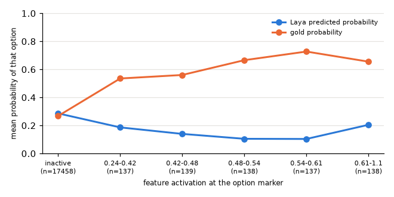

# Feature 12228

Critérios em que aparece: corr_error_stratified, corr_probe_right_laya_wrong_stratified

**Interpretação (preencher):** 

---

## Maiores ativações

**tr_security_incidents_000104 / true_positive** (noul, security_incidents) | ativação 3.777 em `estado` | opções ['false', 'true'] | Laya: **true** [0.037, 0.963] | gabarito: **true**

```
<bos> noul question: This alert reflects genuinely malicious or unauthorised activity.<eos>
▸ <mask> false: Benign activity, a misconfiguration, or a known false positive.
▸ <mask> true: The underlying behaviour is malicious or unauthorised.

<eos>

 {"alert": {"description": "a long-unused account became active", "evidence": "A CI runner identity \"ci-runner-007\" performed a token‑based API call from IP 203.0.113.5 at 2026-09-15T02:58:44Z. The source IP is not present in any known allowlist and the account has MFA disabled. The account's secret token was⟦ last⟧ refreshed on 2025-09-15, 365 days earlier.", "rule": "dormant_account_use"}, "context": {"asset_criticality": "medium", "change_window_active": false, "source_on_allowlist": false}, "history": {"credential_rotation_days_ago": 365, "distinct_countries_30d": 2, "logins_30d": 1079, "prior_alerts_90d": 25}, "principal": {"mfa_enrolled": false, "name": "adm-analytics-176", "privileges": ["repo:read"], "type": "ci_runner"}}<eos>
```

**tr_security_incidents_000104 / severity** (score, security_incidents) | ativação 3.736 em `estado` | opções ['0', '1', '2', '3', '4'] | Laya: **2** [0.112, 0.22, 0.458, 0.102, 0.109] | gabarito: **2**

```
<bos> score question: How severe is the potential impact if this alert is real?<eos>
▸ <mask> level 0: Negligible: no access to anything sensitive.
▸ <mask> level 1: Low: limited access, easily reversed.
▸ <mask> level 2: Moderate: access to internal systems or non-public data.
▸ <mask> level 3: High: access to production, secrets or customer data.
▸ <mask> level 4: Critical: active compromise of crown-jewel systems.

<eos>

 {"alert": {"description": "a long-unused account became active", "evidence": "A CI runner identity \"ci-runner-007\" performed a token‑based API call from IP 203.0.113.5 at 2026-09-15T02:58:44Z. The source IP is not present in any known allowlist and the account has MFA disabled. The account's secret token was⟦ last⟧ refreshed on 2025-09-15, 365 days earlier.", "rule": "dormant_account_use"}, "context": {"asset_criticality": "medium", "change_window_active": false, "source_on_allowlist": false}, "history": {"credential_rotation_days_ago": 365, "distinct_countries_30d": 2, "logins_30d": 1079, "prior_alerts_90d": 25}, "principal": {"mfa_enrolled": false, "name": "adm-analytics-176", "privileges": ["repo:read"], "type": "ci_runner"}}<eos>
```

**tr_customer_service_000239 / needs_human** (noul, customer_service) | ativação 3.670 em `estado` | opções ['false', 'true'] | Laya: **true** [0.389, 0.611] | gabarito: **true**

```
<bos> noul question: This conversation requires a human agent rather than automated handling.<eos>
▸ <mask> false: Automation can carry this to resolution.
▸ <mask> true: A human must take over: judgement, authority or empathy is required.

<eos>

 {"account": {"lifetime_value_usd": 672, "prior_tickets_90d": 5, "seats": 40, "tenure_months": 11, "tier": "enterprise"}, "orders": [{"amount_usd": 19, "date": "2026-03-14", "id": "A-50305", "status": "settled"}, {"amount_usd": 19, "date": "2026-02-11", "id": "A-78147", "status": "failed"}, {"amount_usd": 19, "date": "2026-02-26", "id": "A-68714", "status": "settled"}], "thread": [{"role": "customer", "text": "I’ve decided to downgrade my plan. I’ve reached out five times before about these billing issues, and at this point, I’m just tired of dealing with it."}, {"role": "agent", "text": "I am sorry to hear you've had such a difficult experience with us. Before I process that change, could you clarify which tier you would like to move to?"}, {"role": "customer", "text": "Just the basic tier. I’ve been here for eleven months, but I don’t think the enterprise⟦ features⟧ are worth the ongoing headache."}]}<eos>
```

**tr_customer_service_000253 / needs_human** (noul, customer_service) | ativação 3.594 em `estado` | opções ['false', 'true'] | Laya: **false** [0.52, 0.48] | gabarito: **true**

```
<bos> noul question: This conversation requires a human agent rather than automated handling.<eos>
▸ <mask> false: Automation can carry this to resolution.
▸ <mask> true: A human must take over: judgement, authority or empathy is required.

<eos>

 {"account": {"lifetime_value_usd": 4869, "prior_tickets_90d": 1, "seats": 40, "tenure_months": 60, "tier": "premium"}, "thread": [{"role": "customer", "text": "My premium package is⟦ late⟧ yet again. I’ve been a loyal customer for 60 months, and frankly, I’m tired of dealing with these same logistical failures."}, {"role": "agent", "text": "I understand your frustration regarding this delay. To help me investigate the status of your shipment, could you please provide your order reference number?"}, {"role": "customer", "text": "It’s 8829-X. You guys had this issue last year, and here we are repeating the exact same problem."}, {"role": "agent", "text": "Thank you for that information. I am checking the current tracking status for you now; could you verify if the address listed on your account is the one where the delivery was expected?"}, {"role": "customer", "text": "Yes, it is the same address as always. Just tell me where the package is instead of making me repeat myself."}]}<eos>
```

**tr_security_incidents_000104 / credential_compromise** (noul, security_incidents) | ativação 3.420 em `estado` | opções ['false', 'true'] | Laya: **true** [0.313, 0.687] | gabarito: **false**

```
<bos> noul question: The evidence indicates a credential or account has been compromised.<eos>
▸ <mask> false: no, the statement does not hold
▸ <mask> true: yes, the statement holds

<eos>

 {"alert": {"description": "a long-unused account became active", "evidence": "A CI runner identity \"ci-runner-007\" performed a token‑based API call from IP 203.0.113.5 at 2026-09-15T02:58:44Z. The source IP is not present in any known allowlist and the account has MFA disabled. The account's secret token was⟦ last⟧ refreshed on 2025-09-15, 365 days earlier.", "rule": "dormant_account_use"}, "context": {"asset_criticality": "medium", "change_window_active": false, "source_on_allowlist": false}, "history": {"credential_rotation_days_ago": 365, "distinct_countries_30d": 2, "logins_30d": 1079, "prior_alerts_90d": 25}, "principal": {"mfa_enrolled": false, "name": "adm-analytics-176", "privileges": ["repo:read"], "type": "ci_runner"}}<eos>
```

## Ativações medianas (faixa 40-60%, mediana 0.868)

**tr_security_incidents_000093 / disposition** (choice, security_incidents) | ativação 0.942 em `opção` | opções ['close_benign', 'contain', 'investigate', 'monitor'] | Laya: **monitor** [0.121, 0.071, 0.12, 0.688] | gabarito: **investigate**

```
<bos> choice question: How should this security alert be dispositioned?<eos>
▸ <mask> close_benign: Expected, explainable activity; close without analyst time.
▸ <mask> contain: Contain the host or account immediately; do not wait for triage.
▸ <mask> investigate: Warrants an analyst opening an investigation.
▸ <mask>⟦ monitor⟧: Not clearly malicious, but worth watching for recurrence.

<eos>

 {"alert": {"description": "audit logging was turned off on a host", "evidence": "At 14:22 UTC, the audit logging service on host PROD-SRV-04 was disabled by the shared_mailbox principal from allowlisted IP 192.168.1.55. This action occurred outside of any scheduled maintenance window using an account that last rotated its credentials 14 days ago. The session was established via a multi-factor authenticated login.", "rule": "disabled_logging"}, "context": {"asset_criticality": "high", "change_window_active": false, "source_on_allowlist": true}, "history": {"credential_rotation_days_ago": 14, "distinct_countries_30d": 4, "logins_30d": 583, "prior_alerts_90d": 0}, "principal": {"mfa_enrolled": true, "name": "adm-support-897", "privileges": ["repo:read"], "type": "shared_mailbox"}}<eos>
```

**tr_security_incidents_000140 / severity** (score, security_incidents) | ativação 0.813 em `estado` | opções ['0', '1', '2', '3', '4'] | Laya: **1** [0.137, 0.323, 0.24, 0.124, 0.176] | gabarito: **4**

```
<bos> score question: How severe is the potential impact if this alert is real?<eos>
▸ <mask> level 0: Negligible: no access to anything sensitive.
▸ <mask> level 1: Low: limited access, easily reversed.
▸ <mask> level 2: Moderate: access to internal systems or non-public data.
▸ <mask> level 3: High: access to production, secrets or customer data.
▸ <mask> level 4: Critical: active compromise of crown-jewel systems.

<eos>

 {"alert": {"description": "audit logging was turned off on a host", "evidence": "On 2026-09-16 at 01:07:58 UTC, the unprivileged service account svc⟦-⟧monitor on host 192.168.100.200 renamed the security log file C:\\Windows\\System32\\winevt\\Logs\\Security.evtx to Security.evtx.bak, effectively stopping audit logging. The action was initiated from an unrecognised source IP 172.20.30.40, and the account’s credentials have not been rotated for 412 days.", "rule": "disabled_logging"}, "context": {"asset_criticality": "crown_jewel", "change_window_active": false, "source_on_allowlist": false}, "history": {"credential_rotation_days_ago": 412, "distinct_countries_30d": 3, "logins_30d": 1000, "prior_alerts_90d": 0}, "principal": {"mfa_enrolled": false, "name": "usr-support-416", "privileges": ["repo:read"], "type": "service_account"}}<eos>
```

**tr_customer_service_000221 / urgency** (score, customer_service) | ativação 0.921 em `estado` | opções ['0', '1', '2', '3'] | Laya: **1** [0.117, 0.324, 0.239, 0.32] | gabarito: **1**

```
<bos> score question: How time-sensitive is this conversation?<eos>
▸ <mask> level 0: No time pressure; can wait indefinitely.
▸ <mask> level 1: Routine; handle within the normal queue.
▸ <mask> level 2: Elevated; should be handled within the same week.
▸ <mask> level 3: Critical; requires action within the same day.

<eos>

 {"account": {"lifetime_value_usd": 1327, "prior_tickets_90d": 0, "seats": 1, "tenure_months": 14, "tier": "standard"}, "orders": [{"amount_usd": 149, "date": "2026-02-16", "id": "A-75209", "status": "pending"}, {"amount_usd": 149, "date": "2026-02-14", "id": "A-62252", "status": "settled"}], "thread": [{"role": "customer", "text": "My order arrived this afternoon, but the contents are incorrect. I received a blue thermal carafe instead of the stainless steel model I ordered."}, {"role": "agent", "text": "I apologize for the mix-up with your shipment. I’d like to look into this for you; could you please share your order number and the SKU listed on the box you received?"}, {"role": "customer", "text": "The order number is #88492-AX. The box says SKU-992-B, but my invoice clearly lists SKU-992-S."}, {"role": "agent", "text": "Thank you for verifying those details. Are you able to upload a photo of the item you received so I can confirm the discrepancy for⟦ our⟧ records?"}, {"role": "customer", "text": "I've attached the photo to this message. Please let me know what the next steps are once you have verified it."}]}<eos>
```

**tr_security_incidents_000261 / disposition** (choice, security_incidents) | ativação 0.806 em `estado` | opções ['close_benign', 'contain', 'investigate', 'monitor'] | Laya: **monitor** [0.115, 0.168, 0.281, 0.436] | gabarito: **investigate**

```
<bos> choice question: How should this security alert be dispositioned?<eos>
▸ <mask> close_benign: Expected, explainable activity; close without analyst time.
▸ <mask> contain: Contain the host or account immediately; do not wait for triage.
▸ <mask> investigate: Warrants an analyst opening an investigation.
▸ <mask> monitor: Not clearly malicious, but worth watching for recurrence.

<eos>

 {"alert": {"description": "an unrecognised binary executed on a server", "evidence": "At 02:14 UTC on 2026-09-15, a process named \"c:\\temp\\svchost.exe\" was launched on server APP01 by contractor user jdoe (ID C12345). The binary’s SHA‑256 hash (a1b2c3d4e5…) does not appear in the approved software inventory. MFA authentication succeeded and no maintenance window was active.", "rule": "suspicious_process"}, "context": {"asset_criticality": "medium", "change_window_active": false, "source_on_allowlist": true}, "history": {"credential_rotation_days_ago": 700, "distinct_countries_30d": 1, "logins_30d": 1197, "⟦prior⟧_alerts_90d": 0}, "principal": {"mfa_enrolled": true, "name": "svc-billing-358", "privileges": ["repo:read"], "type": "contractor"}}<eos>
```

**tr_security_incidents_000027 / credential_compromise** (noul, security_incidents) | ativação 0.823 em `estado` | opções ['false', 'true'] | Laya: **true** [0.469, 0.531] | gabarito: **true**

```
<bos> noul question: The evidence indicates a credential or account has been compromised.<eos>
▸ <mask> false: no, the statement does not hold
▸ <mask> true: yes, the statement holds

<eos>

 {"alert": {"description": "a long-unused account became active", "evidence": "At 2026-09-15 03:42 UTC, the CI runner account \"ci-runner-112\" (privileged, MFA disabled) logged in successfully from IP 203.0.113.45 after having no activity since 2024-02-01. The source host is on the allowlist, the credentials were last rotated 700 days ago, and the event occurred outside any defined change window.", "rule": "dormant_account_use"}, "context": {"asset_criticality": "high", "change_window_active": false, "source_on_allowlist": true}, "history": {"credential_rotation_days_ago": 700, "distinct_countries_30d": 4, "⟦login⟧s_30d": 587, "prior_alerts_90d": 3}, "principal": {"mfa_enrolled": false, "name": "ci-billing-618", "privileges": ["deploy:production", "secrets:read"], "type": "ci_runner"}}<eos>
```

## Estatísticas (conjunto de descoberta, dev e teste)

**pred / error**

| split | decisões | ativas | ativas e Laya errou | taxa | lift | q (BH) | OR (CMH) | q (CMH) |
|---|---|---|---|---|---|---|---|---|
| discovery | 5100 | 76 | 39 | 0.513 | 0.80 | 0.0471 | 0.62 | 0.414 |
| dev | 900 | 19 | 10 | 0.526 | 0.78 | nan | nan | nan |
| test | 2000 | 32 | 19 | 0.594 | 0.91 | 0.722 | 1.32 | 0.911 |

**corr / error**

| split | decisões | ativas | ativas e Laya errou | taxa | lift | q (BH) | OR (CMH) | q (CMH) |
|---|---|---|---|---|---|---|---|---|
| discovery | 5100 | 428 | 391 | 0.914 | 1.42 | 1.38e-39 | 6.04 | 1.42e-57 |
| dev | 900 | 102 | 93 | 0.912 | 1.36 | 3.68e-08 | 5.49 | 8.03e-10 |
| test | 2000 | 164 | 151 | 0.921 | 1.42 | 1.14e-15 | 6.59 | 3.07e-22 |

**state / error**

| split | decisões | ativas | ativas e Laya errou | taxa | lift | q (BH) | OR (CMH) | q (CMH) |
|---|---|---|---|---|---|---|---|---|
| discovery | 5100 | 3396 | 2117 | 0.623 | 0.97 | 0.000176 | 1.01 | 0.98 |
| dev | 900 | 656 | 431 | 0.657 | 0.98 | 0.453 | 1.00 | 1 |
| test | 2000 | 1342 | 858 | 0.639 | 0.98 | 0.402 | 1.03 | 0.958 |

**pred / probe_right_laya_wrong**

| split | decisões | ativas | ativas e Laya errou | taxa | lift | q (BH) | OR (CMH) | q (CMH) |
|---|---|---|---|---|---|---|---|---|
| discovery | 2932 | 45 | 21 | 0.467 | 0.77 | 0.117 | 0.43 | 0.208 |
| dev | 523 | 9 | 5 | 0.556 | 0.86 | nan | nan | nan |
| test | 1149 | 21 | 14 | 0.667 | 1.09 | 0.876 | 1.30 | 0.912 |

**corr / probe_right_laya_wrong**

| split | decisões | ativas | ativas e Laya errou | taxa | lift | q (BH) | OR (CMH) | q (CMH) |
|---|---|---|---|---|---|---|---|---|
| discovery | 2932 | 361 | 337 | 0.934 | 1.54 | 1.45e-49 | 5.79 | 8.39e-30 |
| dev | 523 | 88 | 84 | 0.955 | 1.48 | 3.76e-12 | 20.83 | 1.8e-09 |
| test | 1149 | 139 | 132 | 0.950 | 1.55 | 7.57e-21 | 9.68 | 3e-15 |

**state / probe_right_laya_wrong**

| split | decisões | ativas | ativas e Laya errou | taxa | lift | q (BH) | OR (CMH) | q (CMH) |
|---|---|---|---|---|---|---|---|---|
| discovery | 2932 | 2007 | 1166 | 0.581 | 0.96 | 0.000387 | 1.10 | 0.715 |
| dev | 523 | 387 | 243 | 0.628 | 0.97 | 0.453 | 0.94 | 0.988 |
| test | 1149 | 816 | 486 | 0.596 | 0.97 | 0.299 | 1.21 | 0.719 |

Confusão mais sobre-representada (pred): `needs_human|0>1` (n=21, lift 26.10, p=7.9e-26). Formato `pergunta|índice previsto>índice correto`.

Confusão mais sobre-representada (corr): `duplicate|1>0` (n=216, lift 11.86, p=0). Formato `pergunta|índice previsto>índice correto`.

Confusão mais sobre-representada (state): `disposition|3>2` (n=150, lift 1.34, p=4.06e-12). Formato `pergunta|índice previsto>índice correto`.



