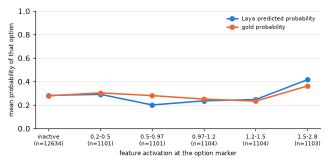

# Feature 12235

Critérios em que aparece: attribution_toward_correct

**Interpretação (preencher):** 

---

## Maiores ativações

**tr_security_incidents_000065 / severity** (score, security_incidents) | ativação 3.186 em `pergunta` | opções ['0', '1', '2', '3', '4'] | Laya: **2** [0.146, 0.261, 0.296, 0.146, 0.151] | gabarito: **2**

```
<bos> score question: How⟦ severe⟧ is the potential impact if this alert is real?<eos>
▸ <mask> level 0: Negligible: no access to anything sensitive.
▸ <mask> level 1: Low: limited access, easily reversed.
▸ <mask> level 2: Moderate: access to internal systems or non-public data.
▸ <mask> level 3: High: access to production, secrets or customer data.
▸ <mask> level 4: Critical: active compromise of crown-jewel systems.

<eos>

 {"alert": {"description": "an unrecognised binary executed on a server", "evidence": "At 2026-09-15 14:23:08 UTC, an employee workstation \"workstation-12\" launched the unknown binary \"/tmp/lsass_helper\" (PID 5874) on server \"app-prod-01\" during an open change window. The execution originated from an unrecognised source IP 192.0.2.55, and the employee’s MFA token was validated. The user’s credentials were last rotated 90 days ago.", "rule": "suspicious_process"}, "context": {"asset_criticality": "low", "change_window_active": true, "source_on_allowlist": false}, "history": {"credential_rotation_days_ago": 90, "distinct_countries_30d": 4, "logins_30d": 1617, "prior_alerts_90d": 0}, "principal": {"mfa_enrolled": true, "name": "usr-billing-187", "privileges": ["repo:read"], "type": "employee"}}<eos>
```

**tr_security_incidents_000072 / severity** (score, security_incidents) | ativação 3.176 em `pergunta` | opções ['0', '1', '2', '3', '4'] | Laya: **2** [0.258, 0.217, 0.266, 0.096, 0.164] | gabarito: **2**

```
<bos> score question:⟦ How⟧ severe is the potential impact if this alert is real?<eos>
▸ <mask> level 0: Negligible: no access to anything sensitive.
▸ <mask> level 1: Low: limited access, easily reversed.
▸ <mask> level 2: Moderate: access to internal systems or non-public data.
▸ <mask> level 3: High: access to production, secrets or customer data.
▸ <mask> level 4: Critical: active compromise of crown-jewel systems.

<eos>

 {"alert": {"description": "an unrecognised binary executed on a server", "evidence": "The unrecognised binary `svc_init.bin` was executed by an unprivileged admin principal on server `srv-prod-09` at 14:22 UTC. This execution originated from the unrecognised IP 198.51.100.12 outside of a change window using credentials last rotated 90 days ago.", "rule": "suspicious_process"}, "context": {"asset_criticality": "medium", "change_window_active": false, "source_on_allowlist": false}, "history": {"credential_rotation_days_ago": 90, "distinct_countries_30d": 1, "logins_30d": 1141, "prior_alerts_90d": 1}, "principal": {"mfa_enrolled": true, "name": "ci-infra-555", "privileges": ["repo:read"], "type": "admin"}}<eos>
```

**tr_security_incidents_000114 / true_positive** (noul, security_incidents) | ativação 3.168 em `opção` | opções ['false', 'true'] | Laya: **true** [0.389, 0.611] | gabarito: **false**

```
<bos> noul question: This alert reflects genuinely malicious or unauthorised activity.<eos>
▸ <mask> false: Benign activity, a misconfiguration,⟦ or⟧ a known false positive.
▸ <mask> true: The underlying behaviour is malicious or unauthorised.

<eos>

 {"alert": {"description": "a session token was presented from a second address", "evidence": "At 2026-09-15 08:42:10 UTC a session token (ID 5F4A9C) was presented from IP 10.12.5.23, which had previously been used from the allow‑listed address 172.31.4.9 at 2026-09-15 08:37:02 UTC. The employee account is unprivileged, has MFA enabled, and the associated credentials were last rotated 412 days ago.", "rule": "token_reuse"}, "context": {"asset_criticality": "high", "change_window_active": false, "source_on_allowlist": true}, "history": {"credential_rotation_days_ago": 412, "distinct_countries_30d": 4, "logins_30d": 912, "prior_alerts_90d": 0}, "principal": {"mfa_enrolled": true, "name": "svc-support-904", "privileges": ["repo:read"], "type": "employee"}}<eos>
```

**tr_security_incidents_000267 / severity** (score, security_incidents) | ativação 3.127 em `pergunta` | opções ['0', '1', '2', '3', '4'] | Laya: **2** [0.196, 0.222, 0.268, 0.148, 0.167] | gabarito: **3**

```
<bos> score question:⟦ How⟧ severe is the potential impact if this alert is real?<eos>
▸ <mask> level 0: Negligible: no access to anything sensitive.
▸ <mask> level 1: Low: limited access, easily reversed.
▸ <mask> level 2: Moderate: access to internal systems or non-public data.
▸ <mask> level 3: High: access to production, secrets or customer data.
▸ <mask> level 4: Critical: active compromise of crown-jewel systems.

<eos>

 {"alert": {"description": "an unrecognised binary executed on a server", "evidence": "At 2026-09-16 01:45:12 UTC, an executable located at /usr/local/bin/unknown_service (SHA256 = 3f7a9c2e…) was launched on server 172.16.45.22. The process was started by the admin account \"admin1\" under an MFA‑authenticated session, and the account’s credentials were last rotated on 2026-09-13.", "rule": "suspicious_process"}, "context": {"asset_criticality": "medium", "change_window_active": false, "source_on_allowlist": true}, "history": {"credential_rotation_days_ago": 3, "distinct_countries_30d": 4, "logins_30d": 1334, "prior_alerts_90d": 1}, "principal": {"mfa_enrolled": true, "name": "adm-deploy-493", "privileges": ["deploy:production", "secrets:read"], "type": "admin"}}<eos>
```

**tr_security_incidents_000061 / severity** (score, security_incidents) | ativação 3.109 em `pergunta` | opções ['0', '1', '2', '3', '4'] | Laya: **2** [0.071, 0.289, 0.462, 0.088, 0.091] | gabarito: **2**

```
<bos> score question:⟦ How⟧ severe is the potential impact if this alert is real?<eos>
▸ <mask> level 0: Negligible: no access to anything sensitive.
▸ <mask> level 1: Low: limited access, easily reversed.
▸ <mask> level 2: Moderate: access to internal systems or non-public data.
▸ <mask> level 3: High: access to production, secrets or customer data.
▸ <mask> level 4: Critical: active compromise of crown-jewel systems.

<eos>

 {"alert": {"description": "a large transfer to an external destination", "evidence": "On 2026-09-15 11:45:23 UTC a data transfer of 12.4 GB was observed from the internal server 10.2.5.8 to external IP 203.0.113.45 over HTTPS (port 443). The operation was performed by service account \"svc-data-export\" that is privileged, has MFA enabled, and its credentials were last rotated 180 days ago. The originating IP (10.2.5.8) is on the approved allowlist.", "rule": "data_egress"}, "context": {"asset_criticality": "low", "change_window_active": false, "source_on_allowlist": true}, "history": {"credential_rotation_days_ago": 180, "distinct_countries_30d": 3, "logins_30d": 1451, "prior_alerts_90d": 25}, "principal": {"mfa_enrolled": true, "name": "ci-infra-832", "privileges": ["deploy:production", "secrets:read"], "type": "service_account"}}<eos>
```

## Ativações medianas (faixa 40-60%, mediana 1.034)

**tr_agent_trace_observability_000179 / outcome** (choice, agent_trace_observability) | ativação 1.105 em `marcador` | opções ['failure', 'harmful', 'partial', 'success'] | Laya: **success** [0.257, 0.008, 0.192, 0.542] | gabarito: **success**

```
<bos> choice question: How did this agent run turn out?<eos>
▸ <mask> failure: The agent did not accomplish the task.
▸ ⟦<mask>⟧ harmful: The agent took an action that caused damage or violated a constraint.
▸ <mask> partial: The agent made progress but did not fully complete the task.
▸ <mask> success: The agent completed the task correctly.

<eos>

 {"agent": {"autonomy": "checkpointed", "model": "internal-agent-v2"}, "constraints": ["Never modify production without an approved change ticket"], "task": "Reduce the nightly report job's runtime below fifteen minutes.", "trace_summary": {"constraint_violations": 0, "duration_s": 308.7, "irreversible_actions": 0, "steps": 11, "tool_errors": 0}}<eos>
```

**tr_security_incidents_000295 / disposition** (choice, security_incidents) | ativação 0.901 em `opção` | opções ['close_benign', 'contain', 'investigate', 'monitor'] | Laya: **monitor** [0.082, 0.259, 0.103, 0.557] | gabarito: **investigate**

```
<bos> choice question: How should this security alert be dispositioned?<eos>
▸ <mask> close_benign⟦:⟧ Expected, explainable activity; close without analyst time.
▸ <mask> contain: Contain the host or account immediately; do not wait for triage.
▸ <mask> investigate: Warrants an analyst opening an investigation.
▸ <mask> monitor: Not clearly malicious, but worth watching for recurrence.

<eos>

 {"alert": {"description": "a large transfer to an external destination", "evidence": "A CI runner account initiated a 4.2GB data transfer to an external, unrecognized destination IP at 11:45 UTC. No authorized change window is currently scheduled, and the account credentials were last updated 14 days ago.", "rule": "data_egress"}, "context": {"asset_criticality": "medium", "change_window_active": false, "source_on_allowlist": false}, "history": {"credential_rotation_days_ago": 14, "distinct_countries_30d": 1, "logins_30d": 586, "prior_alerts_90d": 0}, "principal": {"mfa_enrolled": true, "name": "svc-billing-408", "privileges": ["repo:read"], "type": "ci_runner"}}<eos>
```

**tr_security_incidents_000202 / urgency** (score, security_incidents) | ativação 0.955 em `opção` | opções ['0', '1', '2', '3'] | Laya: **1** [0.168, 0.428, 0.202, 0.202] | gabarito: **1**

```
<bos> score question: How quickly must a responder act on this alert?<eos>
▸ <mask> level 0: No time pressure; can wait indefinitely.
▸ <mask> level 1: Routine; handle within the normal queue.
▸ <mask> level 2: Elevated; should be handled within the same week.
▸ <mask>⟦ level⟧ 3: Critical; requires action within the same day.

<eos>

 {"alert": {"description": "a long-unused account became active", "evidence": "A shared mailbox account that has been dormant for an extended period performed an authentication request. The account currently has MFA disabled, is not within a change window, and the credentials have not been updated for 700 days.", "rule": "dormant_account_use"}, "context": {"asset_criticality": "medium", "change_window_active": false, "source_on_allowlist": true}, "history": {"credential_rotation_days_ago": 700, "distinct_countries_30d": 3, "logins_30d": 251, "prior_alerts_90d": 25}, "principal": {"mfa_enrolled": false, "name": "adm-support-872", "privileges": ["repo:read"], "type": "shared_mailbox"}}<eos>
```

**tr_security_incidents_000073 / severity** (score, security_incidents) | ativação 0.949 em `marcador` | opções ['0', '1', '2', '3', '4'] | Laya: **1** [0.08, 0.406, 0.336, 0.077, 0.101] | gabarito: **1**

```
<bos> score question: How severe is the potential impact if this alert is real?<eos>
▸ <mask> level 0: Negligible: no access to anything sensitive.
▸ <mask> level 1: Low: limited access, easily reversed.
▸ <mask> level 2: Moderate: access to internal systems or non-public data.
▸ <mask> level 3: High: access to production, secrets or customer data.
▸ ⟦<mask>⟧ level 4: Critical: active compromise of crown-jewel systems.

<eos>

 {"alert": {"description": "an endpoint agent matched a known signature", "evidence": "An endpoint agent on `ci-executor-04` identified a file matching signature `WORM_RS_A` during a scheduled change window. The associated unprivileged `ci_runner` principal accessed the system from the allowlisted source 10.50.2.1 using credentials rotated 3 days ago.", "rule": "malware_signature"}, "context": {"asset_criticality": "low", "change_window_active": true, "source_on_allowlist": true}, "history": {"credential_rotation_days_ago": 3, "distinct_countries_30d": 4, "logins_30d": 731, "prior_alerts_90d": 0}, "principal": {"mfa_enrolled": true, "name": "adm-billing-719", "privileges": ["repo:read"], "type": "ci_runner"}}<eos>
```

**tr_security_incidents_000293 / urgency** (score, security_incidents) | ativação 0.926 em `opção` | opções ['0', '1', '2', '3'] | Laya: **3** [0.09, 0.367, 0.158, 0.385] | gabarito: **2**

```
<bos> score question: How quickly must a responder act on this alert?<eos>
▸ <mask> level 0: No time pressure; can wait indefinitely.
▸ <mask> level 1: Routine; handle within the normal queue.
▸ <mask> level⟦ ⟧2: Elevated; should be handled within the same week.
▸ <mask> level 3: Critical; requires action within the same day.

<eos>

 {"alert": {"description": "a session token was presented from a second address", "evidence": "A single session token was used to access resources from two distinct, unrecognized IP addresses within a 15-minute span. While the user is a contractor currently operating within an active change window, the second connection originated from an unknown network source.", "rule": "token_reuse"}, "context": {"asset_criticality": "medium", "change_window_active": true, "source_on_allowlist": false}, "history": {"credential_rotation_days_ago": 30, "distinct_countries_30d": 2, "logins_30d": 1286, "prior_alerts_90d": 0}, "principal": {"mfa_enrolled": true, "name": "adm-deploy-459", "privileges": ["repo:read"], "type": "contractor"}}<eos>
```

## Estatísticas (conjunto de descoberta, dev e teste)

**pred / error**

| split | decisões | ativas | ativas e Laya errou | taxa | lift | q (BH) | OR (CMH) | q (CMH) |
|---|---|---|---|---|---|---|---|---|
| discovery | 5100 | 1423 | 886 | 0.623 | 0.97 | 0.096 | 1.14 | 0.603 |
| dev | 900 | 244 | 156 | 0.639 | 0.95 | 0.418 | 1.46 | 0.625 |
| test | 2000 | 539 | 336 | 0.623 | 0.96 | 0.207 | 1.22 | 0.708 |

**corr / error**

| split | decisões | ativas | ativas e Laya errou | taxa | lift | q (BH) | OR (CMH) | q (CMH) |
|---|---|---|---|---|---|---|---|---|
| discovery | 5100 | 1554 | 1017 | 0.654 | 1.02 | 0.349 | 1.18 | 0.296 |
| dev | 900 | 272 | 184 | 0.676 | 1.01 | 0.969 | 1.26 | 0.628 |
| test | 2000 | 614 | 411 | 0.669 | 1.03 | 0.313 | 1.14 | 0.641 |

**state / error**

| split | decisões | ativas | ativas e Laya errou | taxa | lift | q (BH) | OR (CMH) | q (CMH) |
|---|---|---|---|---|---|---|---|---|
| discovery | 5100 | 463 | 236 | 0.510 | 0.79 | 2.52e-08 | 0.93 | 0.835 |
| dev | 900 | 80 | 42 | 0.525 | 0.78 | 0.153 | 0.87 | 0.873 |
| test | 2000 | 224 | 115 | 0.513 | 0.79 | 0.00171 | 0.83 | 0.698 |

**pred / probe_right_laya_wrong**

| split | decisões | ativas | ativas e Laya errou | taxa | lift | q (BH) | OR (CMH) | q (CMH) |
|---|---|---|---|---|---|---|---|---|
| discovery | 2932 | 882 | 524 | 0.594 | 0.98 | 0.502 | 1.28 | 0.345 |
| dev | 523 | 147 | 94 | 0.639 | 0.99 | 0.985 | 1.88 | 0.386 |
| test | 1149 | 319 | 189 | 0.592 | 0.97 | 0.595 | 0.95 | 0.952 |

**corr / probe_right_laya_wrong**

| split | decisões | ativas | ativas e Laya errou | taxa | lift | q (BH) | OR (CMH) | q (CMH) |
|---|---|---|---|---|---|---|---|---|
| discovery | 2932 | 916 | 558 | 0.609 | 1.01 | 0.846 | 1.23 | 0.371 |
| dev | 523 | 160 | 107 | 0.669 | 1.03 | 0.621 | 1.31 | 0.666 |
| test | 1149 | 353 | 223 | 0.632 | 1.03 | 0.44 | 1.01 | 0.902 |

**state / probe_right_laya_wrong**

| split | decisões | ativas | ativas e Laya errou | taxa | lift | q (BH) | OR (CMH) | q (CMH) |
|---|---|---|---|---|---|---|---|---|
| discovery | 2932 | 295 | 123 | 0.417 | 0.69 | 2.12e-10 | 0.77 | 0.32 |
| dev | 523 | 45 | 20 | 0.444 | 0.69 | 0.0688 | 0.93 | 0.947 |
| test | 1149 | 143 | 67 | 0.469 | 0.77 | 0.00602 | 0.84 | 0.744 |

Confusão mais sobre-representada (pred): `credential_compromise|1>0` (n=82, lift 3.58, p=0). Formato `pergunta|índice previsto>índice correto`.

Confusão mais sobre-representada (corr): `discrepancy_severity|2>0` (n=102, lift 3.10, p=0). Formato `pergunta|índice previsto>índice correto`.

Confusão mais sobre-representada (state): `credential_compromise|1>0` (n=45, lift 6.04, p=2.17e-26). Formato `pergunta|índice previsto>índice correto`.



