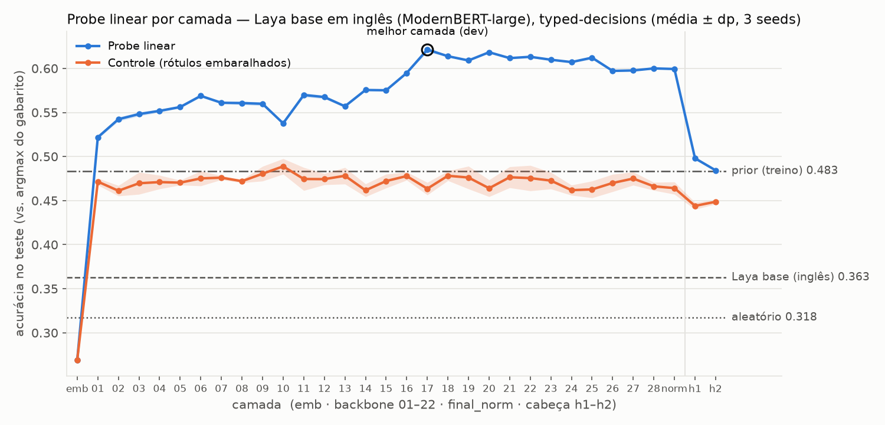

# Probe linear por camada — Laya base em inglês (ModernBERT-large) × typed-decisions

> Execução completa (1.200 casos de treino, 400 de teste).

## Resultado

- **Melhor camada (escolhida no dev, nunca no teste): `enc_17`.** Acurácia de teste do probe 0.621 ± 0.003 (3 seeds), contra 0.363 do próprio Laya, 0.483 do prior e 0.318 do aleatório.
- Probe vs. Laya: acima, por +25.8 p.p. (IC95% bootstrap por caso: +22.6 a +29.1).
- Probe vs. prior: acima, por +13.8 p.p. (IC95% bootstrap por caso: +11.1 a +16.5).
- **Controle** (mesmo probe e wd, gabarito embaralhado dentro de cada (workflow, pergunta)): 0.463 ± 0.007. Seletividade (probe − controle) = +15.8 p.p. O controle preserva a marginal de cada pergunta, então ele mede o que se acerta só com a identidade da opção (≈ prior); a seletividade é o que vem da informação específica de cada caso.

| modelo | acc | acc suave | KL(gold‖p) | choice | score | noul | agent_trace_observability | customer_service | invoice_processing | security_incidents |
|---|---|---|---|---|---|---|---|---|---|---|
| probe enc_17 | 0.621 ± 0.003 | 0.527 | 0.242 | 0.598 | 0.579 | 0.702 | 0.585 | 0.619 | 0.669 | 0.612 |
| controle enc_17 | 0.463 ± 0.007 | 0.423 | 0.362 | 0.413 | 0.408 | 0.589 | 0.349 | 0.422 | 0.527 | 0.555 |
| Laya base (inglês, convaiinnovations/laya) | 0.363 | 0.349 | 0.572 | 0.287 | 0.326 | 0.488 | 0.390 | 0.384 | 0.362 | 0.316 |
| prior (treino) | 0.483 | 0.434 | 0.374 | 0.418 | 0.414 | 0.642 | 0.362 | 0.452 | 0.518 | 0.602 |
| aleatório | 0.318 | 0.318 | 0.444 | 0.233 | 0.244 | 0.500 | 0.300 | 0.280 | 0.350 | 0.340 |

Acurácia = argmax da predição igual ao `label` do gabarito (o `label` está sempre entre os argmax da distribuição; 35 decisões de teste têm empate no gabarito e contam pelo `label`). Acurácia suave = média de `gold_dist[pred]`. KL = KL(gabarito ‖ predição), média por decisão. Aleatório: acurácia esperada (média de 1/k). Prior: frequência do `label` por (workflow, pergunta) no treino, suavizada com +0,5 (só afeta a KL).

## Método (resumo)

- Ativações no `[MASK]` de cada opção, capturadas por hooks **dentro** de `agent.predict` (entrada montada pelo próprio `laya.common.build_sequence`, `max_len`/`head_max_len` do checkpoint: 512/192; autocast `torch.bfloat16` em `cuda`). Camadas: emb, enc_01, enc_02, enc_03, enc_04, enc_05, enc_06, enc_07, enc_08, enc_09, enc_10, enc_11, enc_12, enc_13, enc_14, enc_15, enc_16, enc_17, enc_18, enc_19, enc_20, enc_21, enc_22, enc_23, enc_24, enc_25, enc_26, enc_27, enc_28, enc_final, head_1, head_2.
- Probe: `s = w·h + b` por marcador, softmax entre as opções da pergunta, CE contra o gabarito suave + wd·‖w‖². O `b` se cancela no softmax. Features padronizadas com estatísticas do conjunto de ajuste. L-BFGS em batch cheio; o problema é convexo, então a variação entre seeds do probe real é ~0 por construção (a seed só muda a inicialização); no controle a seed também muda a permutação.
- `emb` é um piso de sanidade, não uma camada informativa: na saída dos embeddings todo marcador é o mesmo vetor de `[MASK]` (o ModernBERT não tem embedding posicional; a posição entra via RoPE na atenção), então o probe só pode dar distribuição uniforme e o argmax cai na primeira opção.
- Seleção só no dev (900 decisões = 15% dos casos de treino por hash do `case_id`): wd ∈ [1e-05, 0.0001, 0.001, 0.01, 0.1, 1.0] por camada e melhor camada, ambos por acurácia média no dev (empate → menor KL). Depois, reajuste no treino inteiro (6000 decisões) e avaliação no teste.

## Paridade (checagem obrigatória da etapa A)

- train: 6000 decisões, passou=True; máx |Δlogit| recomputado vs forward = 0.00e+00; máx |Δp| recomputado vs predict sem hooks = 0.00e+00 (predict arredonda para 4 casas; tolerância 0.0001); máx |Δlogit| a partir dos vetores salvos em fp16 = 3.12e-02.
- test: 2000 decisões, passou=True; máx |Δlogit| recomputado vs forward = 0.00e+00; máx |Δp| recomputado vs predict sem hooks = 0.00e+00 (predict arredonda para 4 casas; tolerância 0.0001); máx |Δlogit| a partir dos vetores salvos em fp16 = 1.56e-02.

## Truncamento

- train: 0/1200 casos com o estado cortado (0 tokens descartados; maior estado 528 tokens, maior sequência 634); opções cortadas no limite de 48 tokens: 0; decisões com orçamento por opção reduzido: 0; opções colapsadas: 0.
- test: 0/400 casos com o estado cortado (0 tokens descartados; maior estado 491 tokens, maior sequência 597); opções cortadas no limite de 48 tokens: 0; decisões com orçamento por opção reduzido: 0; opções colapsadas: 0.

## Reprodutibilidade

- Versões: Python 3.14.10, torch 2.15.0+cu132 (CUDA 13.2), laya 0.4.30, transformers 5.22.2; GPU: NVIDIA B200 MIG 3g.90gb. Ambiente completo: `uv.lock` (raiz do repo) e `pip_freeze.txt` ao lado deste relatório.
- Laya `e333cb7c823cd1787276228260f56d02fbf5180b`; dataset `LocalLLaMA/typed-decisions@c76749ec58bd8c3d2ea706b31c333a9059c38f90`.
- Seeds: [0, 1, 2] (probe/controle); bootstrap seed 0, 2000 reamostras por caso.
- Jobs: (preencher com os IDs do sauron).
- Artefatos (relativos à raiz do repo): ativações `data/activations/partc/base_common/<split>/L??_*.npy` (+ `markers.parquet`, `decisions.parquet`, `parity*.`, `truncation.json`, `meta.json`); `results/sae_features/part_c/probe_base_common/per_decision.parquet`, `probe_by_layer.csv`, `wd_selection.csv`, `summary_table.csv`, `results.json`, `acc_by_layer.png`.
